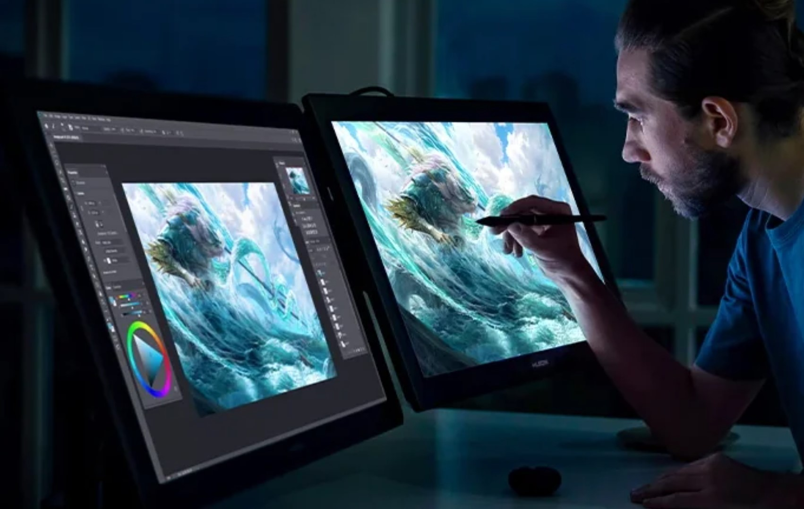

# Showing canvas on another display

## Introduction

Sometimes you may want to see the same canvas on two displays.

<figure><figcaption></figcaption></figure>

This is useful in a couple of cases:

* Work on the canvas on display A, but see a full-screen version of the canvas on display B.
* Work on the full-screen version on display A, but show the canvas on display B so that you can access the rest of the application's UI.

Some applications support this generic capability of putting the canvas on two displays simultaneously, but not all do.

### Krita

#### Method 1: New Window (Recommended)

1. In the main menu, select **Window > New Window**.
2. Drag the new window to your secondary display.
3. Both windows share the live active document. Zoom, pan, or rotate the view on your secondary display to fit your reference needs without affecting your working canvas on the pen display.
4. Optional - In the secondary window, press Tab to hide all dockers and toolbars, leaving an uncluttered, canvas-only view.

#### Method 2: Floating Subwindow / View

If you prefer not to duplicate the entire Krita shell, you can decouple views using Krita's subwindow mode:

1. Go to **Settings > Configure Krita > General → Window tab**.
2. Under **Multiple Document Mode**, switch the setting from **Tabs** to **Subwindows**, then click **OK**.
3. Go to **Window > New View >** select your active document name.
4. Restore/un-maximize the subwindows so they float inside Krita. You can drag the secondary view outside Krita’s main frame onto your other screen.

### Clip Studio Paint

Clip Studio Paint lets you spawn a duplicate view of your current canvas tab that syncs edits in real time.

1. In the main menu, select **Window > Canvas > New Window**.
2. A duplicate tab of your active document will appear in your canvas area.
3. Click and drag the new document's tab header away from the tab bar to detach it into a floating window.
4. Move the floating window onto your secondary monitor.
5. Edits made on your pen display reflect live on the secondary monitor.

#### Resources

* CSP:   [How to Create a Split Screen or Mirrored Window in Clip Studio Paint](https://www.youtube.com/watch?v=aXNbPsyFEhs)&#x20;

