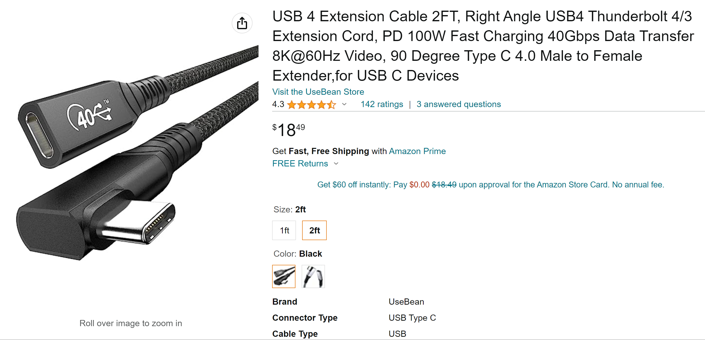

# Extension cables

### Overview

Sometimes your cables just aren't long enough. In those cases, you can use extension cables.


To better understand the requirements for connecting a pen display, see [Connecting a pen display](../../guides/connecting/connecting-pen-display/).


## USB-C extension cables

### Key requirements

* For pen tablets
  * It needs to support data and a small amount of power. Any USB 2.0 extension cable should work.
* For pen displays
  * For more information, see: [Connecting a pen display with USB-C](../../guides/connecting/connecting-pen-display/connecting-pen-display-usbc.md)
  * It must support data
  * It must support DP alt mode
  * It must support the resolution and refresh rate you need
  * It must support sending enough power to your pen display
  * <mark style="color:red;">**SAFETY CRITICAL**</mark> It must support **at least** as much power as the tablet's original cable. If it is not rated to handle that much power, it can become a safety or fire risk.

## Extending a 3-in-1 cable

For more info on 3-in-1 cables, see: [Connecting with a 3-in-1 cable](../../guides/connecting/connecting-pen-display/connecting-with-a-3-in-1-cable.md)

You have two choices:&#x20;

* Extend the USB-C end that connects to the pen display
* Extended the cables that connect to the computer

<figure><figcaption></figcaption></figure>

<figure><figcaption></figcaption></figure>

Notes

* Extending USB-C - Keep in mind you need to be careful of using USB-C extension cables due to power concerns. See the earlier part this doc that talks about it.
* Extending HDMI - Plenty of HDMI extension cables exit and at many sizes.
* Extending USB data - You should be able to find a USB exetnsion of the sible that works.
* Extending power - should not be needed. The power does no need to come from the computer. You can use a power adapter that is plugged in closer to the pen display.

### What I use for USB-C extension cables

I have used a 2-foot UseBean USB-C extension cable. It has worked well for me. I have run up to 4K@6Hz through this extension cable.

I used it in these scenarios:

* With a Huion Kamvas 22 Plus (GS2202): I connect it to the USB-C end of a Huion 3-in-1 cable.
* With a Wacom Cintiq Pro 16 (DTH-167): I connect it to the USB-C cable that came with the Cintiq.

[https://www.amazon.com/dp/B0BB13ZNPQ](https://www.amazon.com/dp/B0BB13ZNPQ)

### 

### Recessed ports for USB-C connections

Be aware of how deeply the port is housed in the pen display. The specific USB-C extender above has a plug that fits into some pen displays, but other pen displays have more deeply recessed USB-C ports. This cable will not fit those ports.

For example, The USBean extender I use does NOT go deep enough to fit into a Huion Kamvas 13.

##

### Links

* Teoh on Tech: Using Extension Cables with Pen Displays or Graphics Tablets [https://www.youtube.com/watch?v=y7kvIGbnjzo](https://www.youtube.com/watch?v=y7kvIGbnjzo)
* [**r/huion - Extending the 3 in 1 cable.**](https://www.reddit.com/r/huion/comments/11wvplt/extending_the_3_in_1_cable/) 2023-03-20
