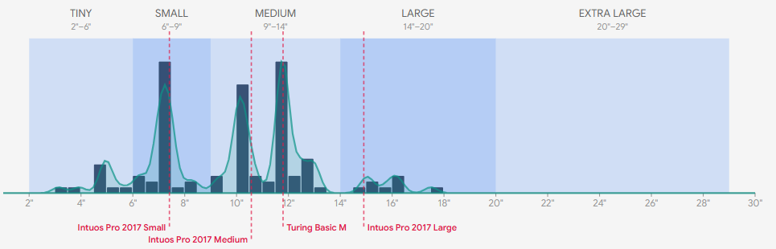
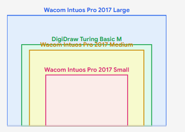
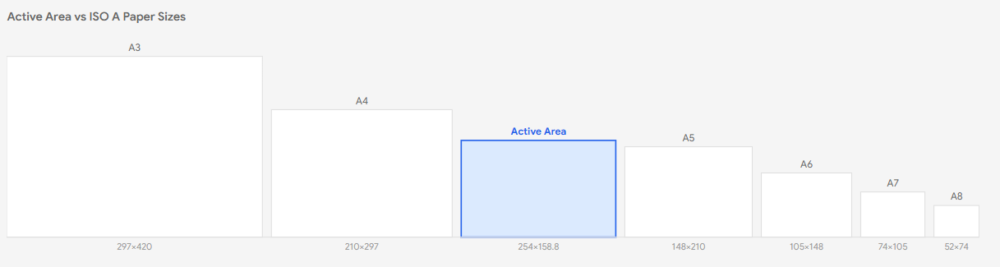
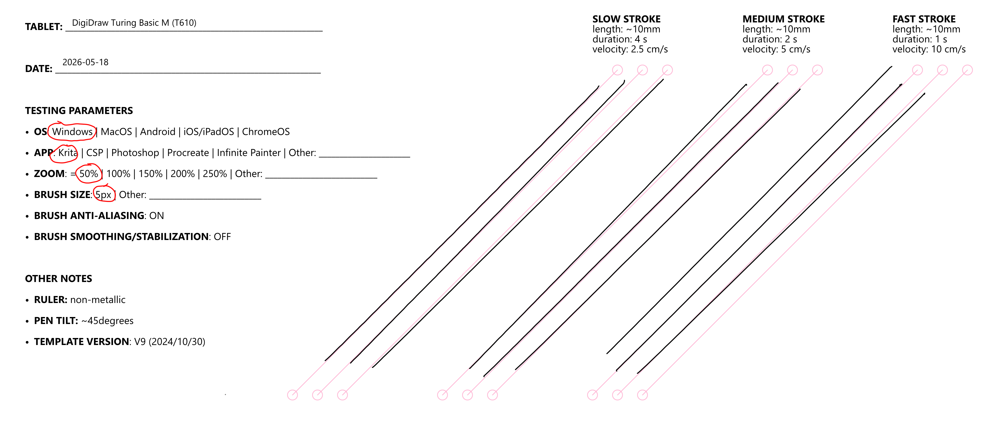

# DigiDraw Turing Basic M (T610)

## Summary

Overall, it makes for a very good basic tablet. That's not surprising. The tablet's technical lineage (digitizer) seems to be the Huion Frego M, which is one of my common recommendations for a pen tablet. See: [Huion Frego M L610 notes](../huion/huion-l610-notes.md).

This brand is very new so this is a very good start for them. As always with new brands, we have to see how the devices and customer support and community adoption works in the long term.

### Verdict

* Overall, it works quite fine. It would make a really good beginner tablet, and about $60 is a decent price for a beginner wired tablet. Honestly "beginner" isn't really the right word either - this is a fine tablet. If you needed to draw something and it needed to be drawn well, you could do it with this tablet. I would have zero problems drawing with it.
* If you use Android, there are issues. See [Usage with Android](#usage-with-android) below.
* If you're looking for a different experience from the Huion Frego, this is not going to be a different experience.
* The real con is that it's a new tablet: almost no one has one yet. If you need help, you won't be able to get one of your artist buddies or someone on Reddit to help you, because no one has the tablet. You'll have to contact customer support, and since the brand just started we don't know what that's like yet.
  * If you don't want to take any risk, get the [Huion Frego M](../huion/huion-l610-notes.md), because lots of people have that tablet.
  * If you're comfortable with tablets and OK taking that chance, this is a fine choice. The risk is not about the quality of the tablet.
* Going beyond this brand: this is yet another tablet that is better than what Wacom offers at the consumer level - in terms of pen, pressure and cost. The pen in the Wacom One pen tablets (CTC-4110WL, CTC-6110WL) is substandard and has weird pressure behavior (pressure banding). See: [Wacom One 2023 pen tablets (CTC-x110WL) notes](../wacom/wacom-one/wacom-ctcx110wl-notes.md). I didn't formally test pressure banding on the T610, but I didn't see any stroke problems in the testing I did.

### About the brand

* The brand is DigiDraw. The company behind it is Turing Creative, headquartered in Shenzhen, China, and the tablets are in the Turing product line. At the time of my stream the website was turingdraw.com (the product page is now on digidraw.com). This gets a little confusing - I kept mixing up which name is which during my stream.
* I like the names. Turing Creative pays tribute to Alan Turing, and it's easy to pronounce. DigiDraw is clear about what it is - digital and drawing - and it's easy to say.
* They describe themselves as one of the few manufacturers to master the entire industry supply chain, from their own chipsets to manufacturing. I'm not a supply chain expert, but what I'd hope that translates to is more predictability in the components that make up their products. I'd love for them to explain more about what that means.
* The lineup at the time of my stream:
  * Pen displays: Turing Pro 19 Touch and Turing 14 2.5K
  * Pen tablets: Turing Smart (Bluetooth 5.0 and soft keys) and Turing Basic (wired, buttonless), each in S and M sizes
* I bought my T610 retail on Amazon. I don't accept review units or gifts.

### My feedback for DigiDraw

* The Windows driver should be signed. See [Driver](#driver).
* Investigate the monitor mapping bug I saw. See [Driver](#driver).
* Make Screen Ratio the default workspace mapping.
* The model numbers and driver UI show their lineage. There's nothing wrong with that, but in the future consider differentiating them so the product more clearly marks itself out as a new and distinct brand. It's too late to change the model numbers on this tablet.
* Fix Android support. See [Usage with Android](#usage-with-android).

## Core links

* DrawTabData Explorer: [T610 specs](https://thesevenpens.github.io/DrawTabDataExplorer/entity/digidraw.tablet.t610)
* [Product page](https://www.digidraw.com/en/product/T610T410)
* [Store page](https://shop.digidraw.com/products/digidraw-turing-basic-m-t610)

## Other links

The reviews in this table come from the [DrawTabData Explorer](https://thesevenpens.github.io/DrawTabDataExplorer/entity/digidraw.tabletfamily.digidraw_turingbasic). To add or fix a link, change it in DrawTabData.

| Source     | Link                                                                                                                             | Date |
| ---------- | -------------------------------------------------------------------------------------------------------------------------------- | ---- |
| Seven Pens | [Tablets & Chill: 2026-04-22 - DigiDraw Turing Basic M unboxing and testing + Q\&A](https://www.youtube.com/watch?v=YSzg_U_3Rn0) |      |

## Notes on specs

### Pens

* Officially only the DigiDraw M3 pen is compatible.&#x20;
* In my testing I was able to fully use a Huion PW517 and PW550 pen with this tablet.
* Likewise I was able to use the DigiDraw M3 pen with Huion tablets that support the PW515/PW550 pens.
* DigiDraw calls the pen technology "Magic Pen 3.0". M3 is the pen model number.
* The M3 has two side buttons and no eraser. There's an eight-pointed star design on the end, but it is not an eraser.
* It's a slim pen, probably a little slimmer than I expected. Compared to the Wacom Pro Pen 3 it is lighter and about 2 mm shorter, and it has two buttons instead of three. The nibs stick out about the same amount.
* I love that the brand name and the M3 model number are printed on the pen. I have like 40 pens, and it's so easy to lose track of a pen that's just black plastic.
* The Wacom Pro Pen 3 moves the cursor on this tablet, but it won't draw or click.
* Tilt looked standard in my testing. I didn't see anything unusual in the tilt readouts.

## Design

* Looks attractive.
* The surface pattern is much much more subtle than the photos show. Not a problem. It just may be surprising for some people who might be expecting a much visible pattern.
* Buttonless design. I'm actually happy they emphasize this. I prefer tablets without buttons, because every physical thing that moves is a point of failure in the future.
* Slight wedge shape. The edge where your hand rests slopes down, and it's a little thicker toward the top.
* It feels a little lighter than I expected for a tablet of its size. Nothing bad.
* Four rubber feet on the back. The model number on the back is small - I wish it was bigger.
* The box clearly shows the brand, the model number and the size. No complaints.

### What's in the box

* T610 tablet
* M3 pen
* Pen stand, with 8 replacement nibs and a nib remover ring
* USB-A to USB-C cable. I'd estimate it at about 4 feet, not 6 feet, so you might need a longer one depending on your desk.
* Quick start guide

## Size

This is a medium-sized tablet, and it is slightly larger than the Wacom Intuos Pro 2017 Medium (PTH-660).

* Similar ISO paper: 17% larger than A5

<figure><figcaption></figcaption></figure>

<figure><figcaption></figcaption></figure>

<figure><figcaption></figcaption></figure>

## Drawing experience

### Nib feeling

* Slightly springier than Wacom Pro Pen 3.
* Retracts a little more than Wacom Pro Pen 3
* Feels a little "softer" than PP3. The PP3 nib feels firmer.
* Still feels nice to use.

## Pen pressure

IAF: The M3 pen seems to have a typical IAF. I would estimate it at around 3 gf.

MAX Pressure: I was also pleased with its maximum pressure - which \~350gf when I measured with a scale.

Notes

* Please remember, the max pressure and IAF comments involved measuring only a single pen. To form a more complete picture of a pen, it requires multiple pen units (>=3)to be measured.
* At very light pressure I didn't see the pressure dance up and down a lot, which means you'll get more controlled strokes by default.
* To me the pressure feels very similar to the Huion PW550 pen, which is a good pen.
* Overall I'm super happy with the pressure of the pen that came with it.

### Holding pressure steady

* It's pretty easy to hold the same pressure level. I could keep it steady at 50%, 75% and around 85-90%.
* Holding it at 25% or 10% is harder because you have to press pretty light. That's normal, and that's where a pressure curve and pressure smoothing help.

### Drawing at low pressure

VERY GOOD>

All EMR pens have their reported pressure change a bit abruptly when drawing at low pressure near the IAF. So does this pen, but not as strongly as some pens like the Wacom Pro Pen 2. As a result, you probably won't need as much of a pressure curve or pressure smoothing to deal with it. Overall, the pressure is well controlled in that domain and relatively stable.

### Surface texture

* GOOD - TYPICAL
* Feels fine to draw with. The texture has enough grip to keep the pen from feeling slippery.
* Comparisons to Wacom Pro Pen 2 on PTH-660
  * The PTH-660 has a little more texture, but about the same amount of nib noise. The pitch is slightly lower.
* The design on the surface is not "paint" and it does not affect the surface texture at all. The surface texture feels completely the same across the full area.
* It doesn't feel overtextured. It produces a little bit of sound, but not a super scratchy sound. If you want it quiet, you will hear it.
* Comparisons to Wacom Pro Pen 3 on the Wacom Intuos Pro 2025 (PTK-870)
  * The T610 has a little more textured feeling and slightly more noise. Not bad - you just hear it more.

### Button stroke interruption

Like many non-Wacom pens, the buttons interrupt strokes slightly. Even if the buttons are disabled in the driver, I noticed that strokes were interrupted when the button was released. Again, this is common, and most likely you will never encounter it or have it affect you while drawing.

* It happens with both buttons. With the second button, pressing it down while drawing also caused a sudden increase in pressure.
* Most people never notice this because very few people press a button while they're drawing. Pressing a button pushes into the pen and deflects it, so you'd disrupt the stroke anyway.

### Pointer lag

* GOOD - LOW. Subjectively, it is very slightly more than a Wacom tablet, but I doubt anyone would notice.

## Diagonal wobble

* GOOD to OK
* Very slight wobble at slow speeds, and even less at medium and fast strokes.
* To compensate for the wobble, I only needed to add a little smoothing. In Krita, I used weighted smoothing with distance set to 100. For many tablets, I have to increase the smoothing to 200.

<figure><figcaption></figcaption></figure>

## Connection and cabling

### Ports

* Single USB-C port on the upper left of the tablet

### Connecting through a USB hub

After I had connected the tablet to an Android device and then back to my computer through my USB hub, the driver said no devices were connected. Once I connected it directly to the computer, it was found right away. Tablets sometimes get into weird states. If you ever have that problem, try connecting directly to the computer. In general I recommend plugging a new tablet directly into your computer.

### Wireless

NO. The tablet is not wireless and requires a USB cable to connect to a computer.

## Other features

* Replaceable surface? No.
* Touch? No.
* Physical buttons? No. It's a buttonless design.

## Driver

Driver version:

* I downloaded the Windows driver: DIGIDRAW Win\_V1.0 which was released on 2026-04-14
* At the time, the drivers were on the support page of turingdraw.com, for macOS, Windows, Windows ARM64 and Linux.

Works without a driver

* DigiDraw says you don't need to install drivers for the pen tablets. When I plugged it in before installing anything, it just worked with the built-in Windows driver. That's a nice advantage - if your tablet driver is having problems, the Windows driver is a last option to keep your tablet working.

Before installing

* Uninstall any other tablet drivers and reboot. On Windows, don't mix and match tablet drivers - install only one brand.

Driver experience

* The driver has an attractive skin than matches the DigiDraw branding. In terms of capabilities this version is very similar to the Huion V15 drivers.
* There's nothing wrong with that lineage, but I would prefer if, in addition to the very beautiful styling, the UI had its own flavor. If you're going to start a new brand, the look and feel of the product should be that brand. A great example is Xencelabs: its parent company is Hanvon Ugee, but the Xencelabs driver looks nothing like the Ugee or XP-Pen drivers.
* Like with every tablet, turn on Screen Ratio (DigiDraw's name for [force proportions](../../../guides/customizing/force-proportions.md)).

Driver issues I discovered:

* DRIVER NOT SIGNED
  * The Windows driver installer triggers a Windows Defender SmartScreen warning ("Windows protected your PC" - an unrecognized app). Most likely the driver is not signed. I typically tell people not to install software when this message comes up, and it creates panic for any normal Windows user. To get past it, click More info - it shows the publisher as Turing Creative Technology (Shenzhen) - and then Run anyway.

* MINOR ANNOYANCE
  * The driver UI got confused on the identities of the monitors. I have two monitors - let's call them A and B. If I wanted to map the tablet to monitor A, I had to pick monitor B. You can see this occur in my livestream video.
  * I tested on my standard testing machine and have never experienced this before. It is unclear what is causing it, but since I have never seen this with any other driver I lean towards this being a driver issue.

## Usage with Android

SUMMARY: Does NOT work well with Android

I tested this tablet with multiple apps (Concepts, HiPaint, and Infinite Painter) on two different Android tablets (Samsung S11 Ultra & Wacom MovinkPad Pro 14).

In all cases:

* Only a vertical column on the tablet, about a third of the tablet, is usable.
* Strokes were severely distorted on Android.

Details

* Wacom MovinkPad Pro 14 was running Android 14. The Samsung Galaxy Tab S11 Ultra was running Android 16.
* Only a narrow sliver of the tablet maps to the Android display. When I drew a circle, I got a very distorted oval.
* Pen pressure did work.
* The tablet doesn't support wireless, so connecting over Bluetooth instead isn't an option.
* In my earlier testing the [Huion Frego M](../huion/huion-l610-notes.md) worked well with Android. TBD: I need to find my Frego and retest it on these devices, since Android has had updates since then.
