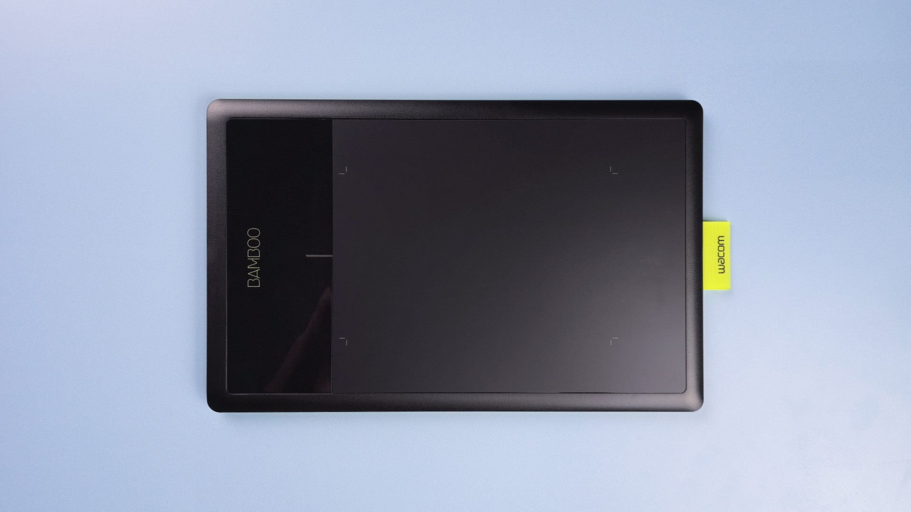
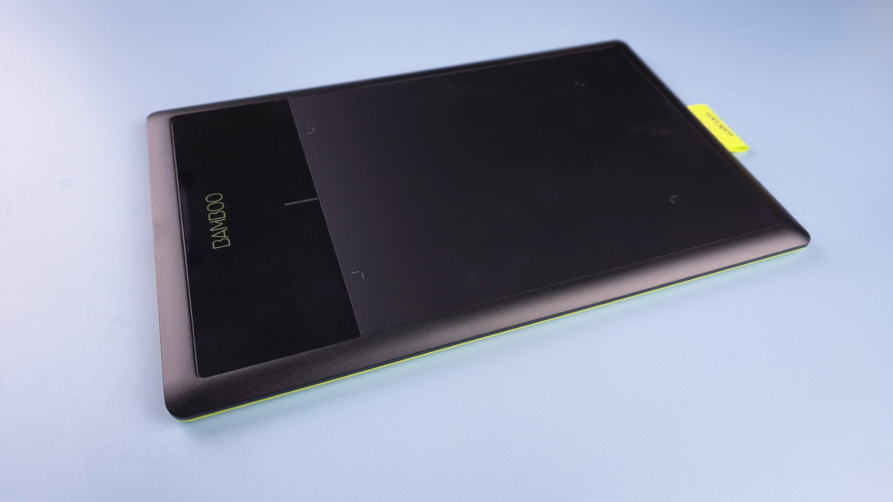
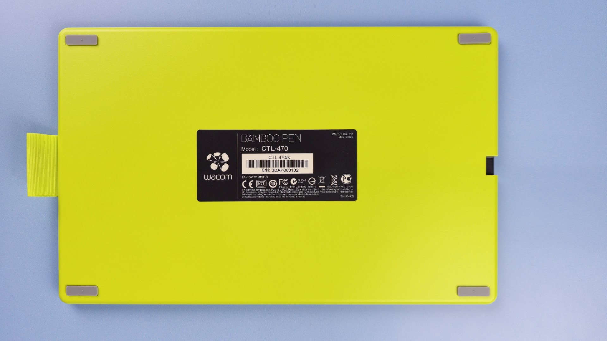
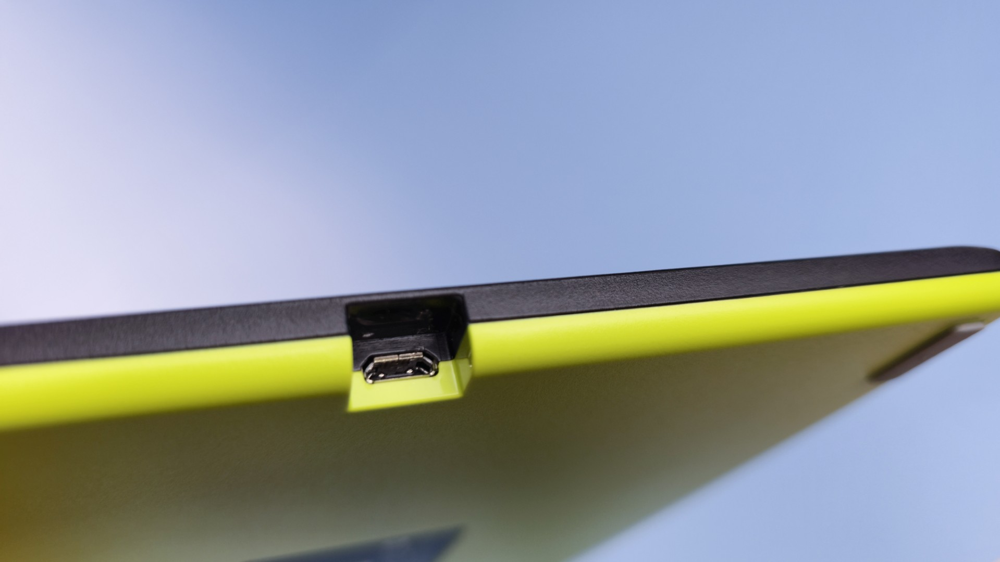

# Wacom Bamboo (CTL-470) notes

## Names

This tablet was sold under different names and with different packaging and artwork:

* Bamboo
* Bamboo Splash
* Bamboo Connect

## Links

These links come from the [DrawTabData Explorer](https://thesevenpens.github.io/DrawTabDataExplorer/entity/wacom.tabletfamily.wacom_bamboo_2011). To add or fix a link, change it in DrawTabData.

| Source | Link | Date |
| --- | --- | --- |
| DrawTabData Explorer | [CTL-470 specs](https://thesevenpens.github.io/DrawTabDataExplorer/entity/wacom.tablet.ctl470) |  |

## Photos

<figure><figcaption></figcaption></figure>

<figure><figcaption></figcaption></figure>

<figure><figcaption></figcaption></figure>

<figure><figcaption></figcaption></figure>
