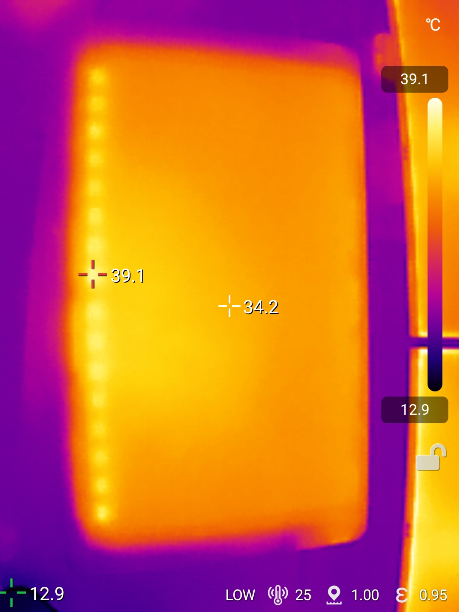
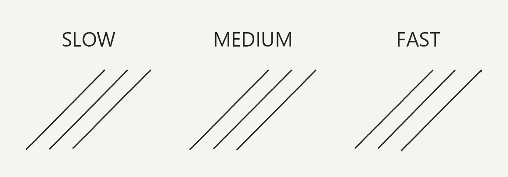

# Wacom Cintiq Pro 32 Touch (DTH-3220) notes

## Overview

The Cintiq Pro 32 Touch was released around 2018. It is still an amazing drawing device, given its age and size. It is as good as anything else on the market in 2026. It has an excellent drawing experience driven by the included Pro Pen 2, model number KP504E, and an absolutely gigantic screen.

## Core links

* DrawTabData Explorer: [DTH-3220 specs](https://thesevenpens.github.io/DrawTabDataExplorer/entity/wacom.tablet.dth3220)
* [User manual](http://101.wacom.com/UserHelp/en/TOC/DTH-3220.html)

## Other links

The reviews in this table come from the [DrawTabData Explorer](https://thesevenpens.github.io/DrawTabDataExplorer/entity/wacom.tabletfamily.wacom_cintiqpro). To add or fix a link, change it in DrawTabData.

| Source                  | Link                                                                                                                                             | Date       |
| ----------------------- | ------------------------------------------------------------------------------------------------------------------------------------------------ | ---------- |
| Seven Pens              | [Cintiq Pro 32 (DTH-3220) Live testing and Q\&A](https://www.youtube.com/watch?v=hUFB9kBYy4E)                                                    | 2026-08-01 |
| The Art of Aaron Blaise | [Wacom Cintiq Pro 32 Unboxing](https://www.youtube.com/watch?v=HLHda7w_ttY)                                                                      | 2019-01-24 |
| Aaron Rutten            | [Wacom CINTIQ PRO 24 & 32 Review (In-Depth)](https://www.youtube.com/watch?v=lvSeRhrUcCY)                                                        | 2018-12-13 |
| Wieger Poutsma          | [REVIEW/IN-USE VIDEO Wacom Cintiq Pro 32 - by digital artist/creative entrepreneur Wieger Poutsma.](https://www.youtube.com/watch?v=GgYu9zXD8Gk) | 2018-11-19 |

* [Aaron Rutten - How to Setup Wacom CINTIQ PRO 24 & 32](https://www.youtube.com/watch?v=hjOAm8AQxck) 2018-11-14

## Notes on specs

### Pens

* As of 2026, the included pen is still likely the best drawing pen that has ever existed, with a very low initial activation force, a very high maximum pressure, and good ergonomics.
* See: [Wacom Pro Pen 2 KP-504E notes](../../../pens/wacom-pens/wacom-kp504e-notes.md)

## Should you get the Cintiq Pro 32 in 2026?

This is a nuanced issue. It will work well as a tablet, but you should be aware of what you are getting into.

### Pros

* The tablet's drawing and display performance are excellent. I have no hesitation in saying it will work as well as any other available tablet.
* You may find used units for a good price. I have seen it listed from $3,000 to $1,200. The unit I bought was about $1200.
* It is large, which can feel luxurious.
* Multiple video connectivity options make it more likely to work with your computer.

### Cons

* It was released in 2018, and Wacom may drop driver support in the next few years. When driver support ends, you will need to address that. You could use an older driver or OpenTabletDriver. Eventually, an older driver may not work with a modern version of Windows or macOS. We do not know when that might occur.
* It is large, and it may be too large for you. Create a cardboard mockup that includes its bezel. Draw a rectangle where the screen is. This lets you simulate how it would feel to use.

## Ergonomics

### Dealing with the size

This tablet is the largest Pen display ever made.

* Desk space — You will essentially need to reserve a desk for it. It occupies so much space that you may be unable to do anything else. It can be challenging to reach a keyboard if you use many shortcuts. Consider auxiliary input devices such as the TourBox.
* Weight — It is very heavy and incredibly difficult to move. You will not be able to push it out of the way easily.
* Miscellaneous — My drawing pens tended to roll under the tablet. I had to lift one side to check whether anything was underneath.
* Reachability — Some people may have trouble reaching the top edge or corners of the screen.

### How my preference for size changed

Until 2026, I had told people that I preferred a 22-inch pen display. I felt that 24 inches was too large. A 32-inch display is definitely too large for me, but I enjoyed the experience. It was not bad in any way. There are simply trade-offs when using such a large device. After using this tablet for a couple of months, I became much more comfortable with a 24-inch display. It now feels like an appropriate size, especially with small bezels.

### Legs

This tablet does come with two folding legs. I found that the legs put the tablet at enough of an angle that it's very comfortable to use, though some people may want to get a stand to achieve a higher angle.

### Noise

Like many of Wacom's Cintiq Pro models, this tablet has fans to dissipate heat. I did not find the noise excessively loud from the fans, but I set the brightness to 50% to keep it at a comfortable level.

### VESA

You can mount this on a basic stand, but it requires a special adapter. I did not have the adapter, so I did not try it.

### Heat

<figure><figcaption></figcaption></figure>

## Connections and Cabling

### Ports

* Power - This tablet has a port for power and then it also has three separate ways to get a video signal.
* Video - There are three separate ways of getting a video signal to the tablet: DisplayPort, HDMI, and USB-C.

## Drawing experience

### Overview

The drawing experience is excellent. Across the board, Wacom still provides the best drawing experience in this space.

### Diagonal wobble

RATING: VERY GOOD (VERY LOW)

Diagonal wobble was very good. I observed only tiny amounts of wobble at different stroke speeds. The amount of wobble was lower than on most pen displays. In fact, I think it was slightly better than on the Cintiq Pro 27.

<figure><figcaption></figcaption></figure>

### Lag

The lag is typical for a pen display of this size. As you draw, you can see the pointer trailing the physical tip of the pen slightly. There was nothing unusual about the lag. It was typical for pen displays.

## Display experience

### Parallax

Parallax seemed good, but some modern pen displays have better parallax. You will notice the parallax more when the pen is far from you. Because the display is so large, the pen can be very far away.

### Pixel density

This is a 4K display, but the screen is very large. At the distance you will keep it while drawing, you will notice the pixels. It is still a high-quality device, but some people are very sensitive to visible pixels. Keep that in mind if you are considering this device.

## Ergonomics

### Noise

Like many of Wacom's Cintiq Pro models, this tablet has fans to dissipate heat. I did not find the noise excessively loud from the fans, but I set the brightness to 50% to keep it at a comfortable level.

### VESA

You can mount this on a basic stand, but it requires a special adapter. I did not have the adapter, so I did not try it.
