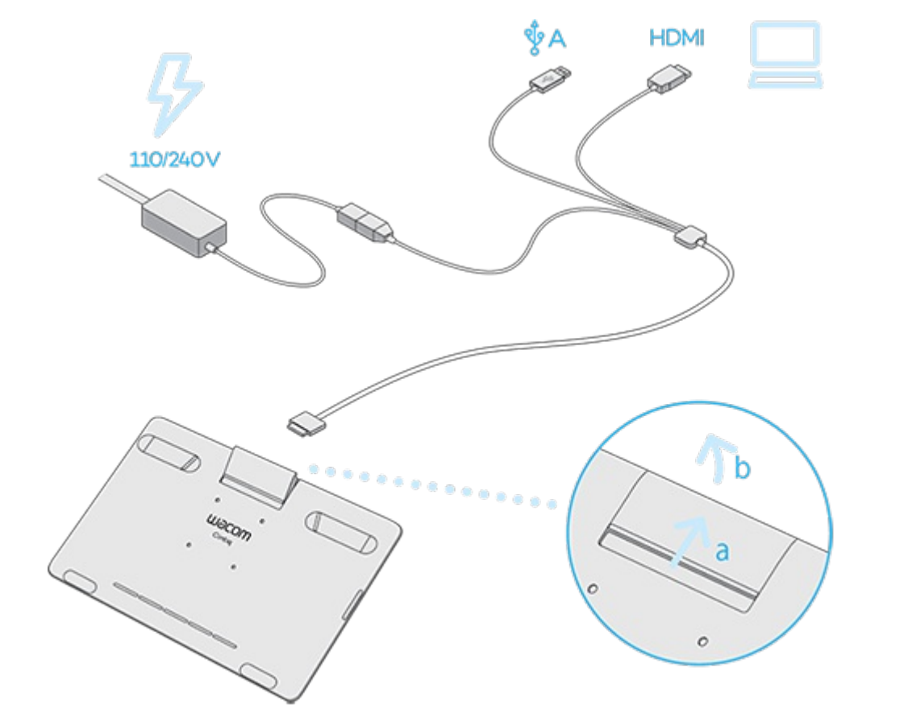

# Wacom Cintiq 16 2019 (DTK-1660) notes

## Summary

This is a little bit of a dated tablet. I do suggest you consider getting the Cintiq 16 2025 (DTK-168) instead. [Wacom Cintiq 16 2025 (DTK-168) notes](wacom-dtk168-notes.md) have a comparison between the two tablets.

## Links

These links come from the [DrawTabData Explorer](https://thesevenpens.github.io/DrawTabDataExplorer/entity/wacom.tabletfamily.wacom_cintiq). To add or fix a link, change it in DrawTabData.

| Source | Link | Date |
| --- | --- | --- |
| DrawTabData Explorer | [DTK-1660 specs](https://thesevenpens.github.io/DrawTabDataExplorer/entity/wacom.tablet.dtk1660) |  |
| Wacom | [User manual](http://101.wacom.com/UserHelp/en/TOC/DTK-1660.html) |  |
| Wacom | [Product information](https://cdn.wacom.com/u/support/wiki_migration/c/cd/dtk-1660_en.pdf) |  |
| Wacom | [User manual](http://101.wacom.com/UserHelp/en/TOC/DTK-1660E.html) |  |
| Ross Draws | [Wacom Cintiq 16 Review + SKETCH!](https://youtu.be/6_tMU5z6s9s) | 2019-02-22 |
| Brad Colbow | [Wacom Cintiq 16 Review (A $650 Wacom Drawing Tablet!)](https://www.youtube.com/watch?v=ye8R0LAbkiE) | 2019-01-08 |
| MobileTechReview | [Wacom Cintiq 16 Review - the Much More Affordable Cintiq](https://youtu.be/v4qDRupCLHY) | 2019-01-08 |
| Aaron Rutten | [Wacom CINTIQ 16 - Drawing Tablet Review](https://youtu.be/nXrFULq096A) | 2019-01-07 |

## Cables and connections

This tablet connects to your computer via a proprietary 3-in-1 cable.

This tablet does NOT support getting a video signal over a USB-C cable, unlike many modern pen displays.

<figure><figcaption></figcaption></figure>
