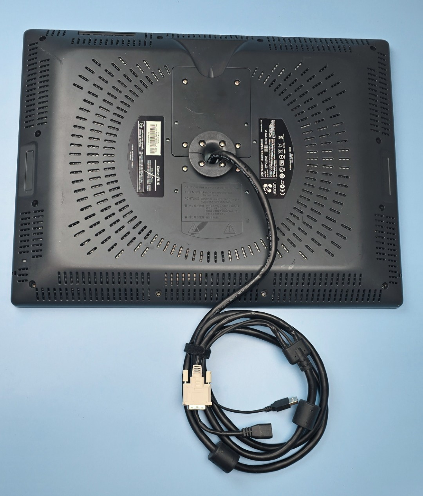
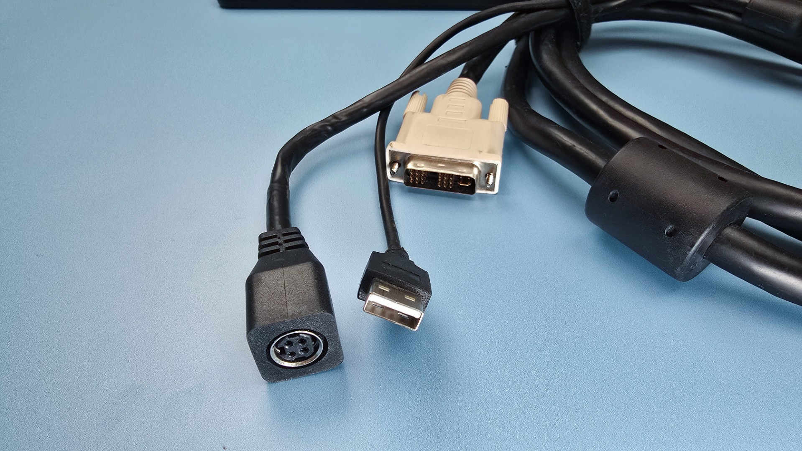
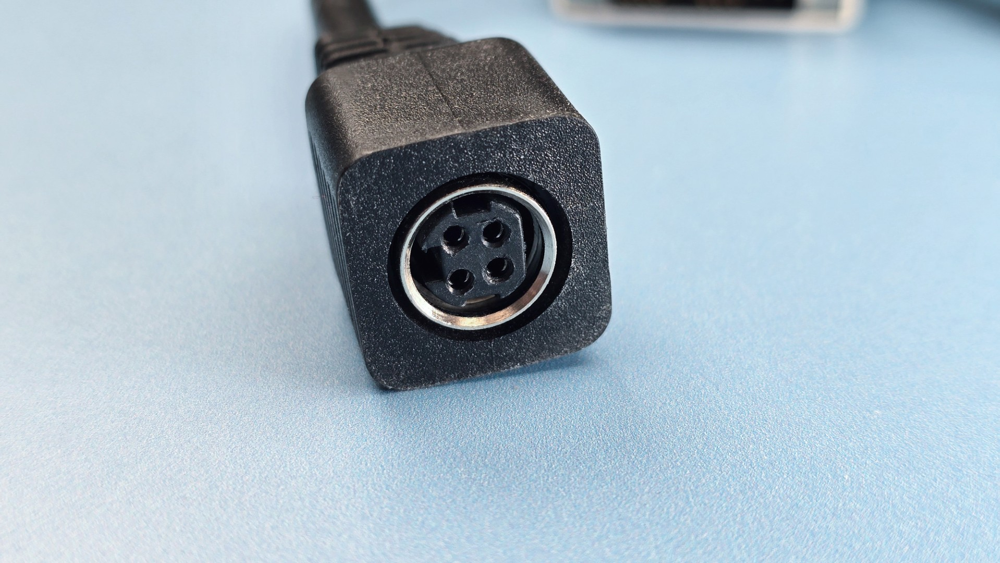
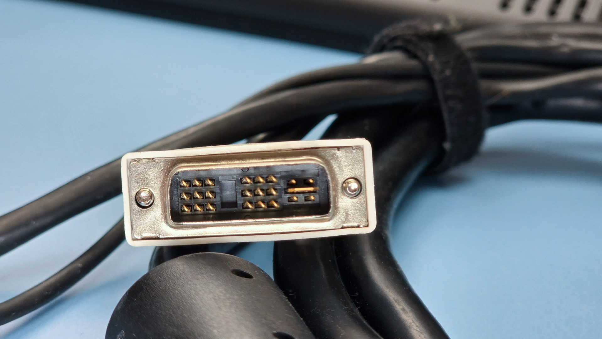

# Wacom Cintiq 21 UX 2010 (DTK-2100) notes

## Overview

NOTE: This is a second generation of the Cintiq 21 UX (DTZ-2100) that was released in 2005. [Wacom Cintiq 21UX 2005 (DTZ-2100) notes](wacom-dtz2100-notes.md).

## Links

These links come from the [DrawTabData Explorer](https://thesevenpens.github.io/DrawTabDataExplorer/entity/wacom.tabletfamily.wacom_cintiq). To add or fix a link, change it in DrawTabData.

| Source | Link | Date |
| --- | --- | --- |
| DrawTabData Explorer | [DTK-2100 specs](https://thesevenpens.github.io/DrawTabDataExplorer/entity/wacom.tablet.dtk2100) |  |

## Connections and cabling

### 3-in-1 cable

A fixed 3-in-1 cable coming out the back splits into three ends

* USB-A for data
* DVI-I (Dual Link) for video signal
* Power

<figure><figcaption></figcaption></figure>

### Power connector

<figure><figcaption></figcaption></figure>

<figure><figcaption></figcaption></figure>

## DVI-I (Dual Link) connector

<figure><figcaption></figcaption></figure>

To connect this to a modern computer you via HDMI or DisplayPort will need an adapter. Make sure you get one that supports 1600x1200 resolution at 60hz. Not all adapters are capable of that.
