# Wacom Intuos Pro 2025 vs Intuos Pro 2017

## Overview

This document summarizes the differences between the Intuos Pro 2025 (PTK-x70) and the Intuos Pro 2017 (PTH-x60) series.

For more details:

* [Wacom Intuos Pro 2025 (PTK-x70) notes](wacom-intuos-pro-2025/wacom-ptkx70-notes.md)
* [Wacom Intuos Pro 2017 (PTH-x60) notes](wacom-intuos-pro-2017/wacom-pthx60-notes.md)

## Summary

Both are the best pen tablets ever made, and the drawing experience is the same. The main changes from the Intuos Pro 2017 (PTH-x60):

* No improvement to drawing performance
* ExpressKeys and dials moved to the top
* Multitouch support dropped
* Bezels are significantly smaller
* Smaller and about 40% lighter, with a larger 16:9 active area
* Comes with Pro Pen 3 instead of Pro Pen 2
* Improved report rate (wired report rate is 300Hz versus the older models' 200Hz)

Depending on your background you might prefer one over the other.

## Which one should you buy: 2025 or 2017?

* **Buying your first pro tablet?** → Intuos Pro 2025.
* **Already own an Intuos Pro 2017?** → PROBABLY NO need to upgrade. Unless there is a specific benefit you will get from the Intuos Pro 2025, there is no point in upgrading.
* **Need multitouch?** → Intuos Pro 2017. The 2025 edition does not support it.
* **Rest your hand on the bezels, or keep your non-drawing hand on the ExpressKeys?** → Try the 2025 edition before you buy if you can. See [Bezels](wacom-intuos-pro-2025-vs-2017.md#bezels) and [ExpressKeys layout](wacom-intuos-pro-2025-vs-2017.md#expresskeys-layout).

Overall I recommend the Intuos Pro 2025 because in a few years (by 2030 at the latest I expect) the support lifetime for the Intuos Pro 2017 will end. After that point:

* Wacom will no longer issue driver updates for the tablet.
* Wacom support will likely not help you if you ask them for help.

You can certainly still use the Intuos Pro 2017 but you should be aware of those consequences. See [Buying an Intuos Pro 2017 in 2026](wacom-intuos-pro-2017/buying-pthx60-in-2026.md).

## Models

Each 2025 model replaces the 2017 model of the same size category.

| Size category | Intuos Pro 2017                                                                          | Intuos Pro 2025                                                                          |
| ------------- | ---------------------------------------------------------------------------------------- | ---------------------------------------------------------------------------------------- |
| LARGE         | [PTH-860](https://thesevenpens.github.io/DrawTabDataExplorer/entity/wacom.tablet.pth860) | [PTK-870](https://thesevenpens.github.io/DrawTabDataExplorer/entity/wacom.tablet.ptk870) |
| MEDIUM        | [PTH-660](https://thesevenpens.github.io/DrawTabDataExplorer/entity/wacom.tablet.pth660) | [PTK-670](https://thesevenpens.github.io/DrawTabDataExplorer/entity/wacom.tablet.ptk670) |
| SMALL         | [PTH-460](https://thesevenpens.github.io/DrawTabDataExplorer/entity/wacom.tablet.pth460) | [PTK-470](https://thesevenpens.github.io/DrawTabDataExplorer/entity/wacom.tablet.ptk470) |

The full specs for each model are in the DrawTabData Explorer. Click a model ID above to see them.

## Key differences at a glance

|                          | Intuos Pro 2017           | Intuos Pro 2025         |
| ------------------------ | ------------------------- | ----------------------- |
| Drawing performance      | EXCELLENT                 | EXCELLENT (same)        |
| Included pen             | Pro Pen 2 (KP-504E)       | Pro Pen 3 (ACP-500)     |
| Wired report rate        | 200 Hz                    | 300 Hz (with Pro Pen 3) |
| Active area aspect ratio | Varies by model, not 16:9 | 16:9                    |
| ExpressKeys              | Left side                 | Top, with dials         |
| Multitouch               | Yes                       | No                      |
| Bezels                   | Wide                      | Very narrow on 3 sides  |
| Weight                   | Heavier                   | About 40% lighter       |
| Driver support           | Expected to end by 2030   | Current                 |

## Key differences

### Drawing performance

WINNER: TIED

There is no improvement to drawing performance. Pressure handling, diagonal wobble and pointer lag are all about the same. Most of the drawing experience comes from the pen; see [Wacom Pro Pen 3 (ACP-500) vs Wacom Pro Pen 2 (KP-504E)](../../pens/wacom-pens/wacom-acp500-vs-kp504e.md).

### Included pen

WINNER: UNCLEAR

The 2017 edition comes with the Pro Pen 2 (KP-504E). The 2025 edition comes with the Pro Pen 3 (ACP-500), which is very customizable. Opinions about the two pens are very polarized. See [Wacom Pro Pen 3 (ACP-500) vs Wacom Pro Pen 2 (KP-504E)](../../pens/wacom-pens/wacom-acp500-vs-kp504e.md).

### Pen compatibility

WINNER: INTUOS PRO 2025

The Intuos Pro 2025 works with the Pro Pen 3 and with specific pens that use "Wacom UD EMR", and it still works with the Pro Pen 2 and most of the older Wacom pro pens.

<table data-search="false"><thead><tr><th width="262.20001220703125">Pen</th><th width="150.60003662109375">Tested?</th><th>Intuos Pro 2017 PTH-x60</th><th>Intuos Pro 2025 PTK-x70</th></tr></thead><tbody><tr><td>Wacom Pro Pen 3 (ACP-500)</td><td>TESTED</td><td>NO</td><td>YES</td></tr><tr><td>SPECIFIC pens using “Wacom UD EMR”</td><td>TESTED</td><td>NO</td><td>YES</td></tr><tr><td>Wacom Pro Pen 2 (KP-504E)</td><td>TESTED</td><td>YES</td><td>YES</td></tr><tr><td>Wacom Pro Pen Slim (KP-301E)</td><td>UNTESTED</td><td>YES</td><td>YES</td></tr><tr><td>Wacom Pro Pen 3D (KP-505)</td><td>UNTESTED</td><td>YES</td><td>YES</td></tr><tr><td>Wacom Grip Pen (KP-501E)</td><td>TESTED</td><td>YES</td><td>YES</td></tr><tr><td>Wacom Pro Pen (KP-503E)</td><td>TESTED</td><td>YES</td><td>YES</td></tr><tr><td>Wacom Art Pen (KP-701E)</td><td>TESTED</td><td>YES</td><td>YES</td></tr><tr><td>Wacom Airbrush Pen (KP-400E)</td><td>UNTESTED</td><td>?</td><td>?</td></tr><tr><td>Wacom 4K pen (LP-1100K)</td><td>TESTED</td><td>NO</td><td>NO</td></tr><tr><td>Wacom 2K pen (LP-190)</td><td>TESTED</td><td>NO</td><td>NO</td></tr></tbody></table>

For which UD EMR pens work, see [Compatibility with specific Wacom UD EMR pens](wacom-intuos-pro-2025/wacom-ptkx70-notes.md#compatibility-with-specific-wacom-ud-emr-pens).

### Report rate

WINNER: INTUOS PRO 2025

The wired report rate of the 2025 edition is 300Hz with the Pro Pen 3, versus 200Hz for the 2017 edition. With a Pro Pen 2 the 2025 edition reports at 200Hz wired. See [Pen Report Rate](wacom-intuos-pro-2025/wacom-ptkx70-notes.md#pen-report-rate) for the measurements.

### ExpressKeys layout

WINNER: DEPENDS

From 2009 to 2025, there were 4 editions of professional pen tablets from Wacom, and all kept a consistent layout with ExpressKeys on the left. The 2025 edition moved the ExpressKeys and dials to the top, which surprised many of us.

<figure>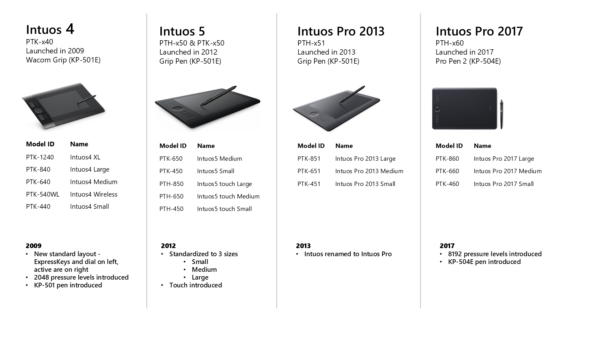<figcaption></figcaption></figure>

With the Intuos Pro 2017, the non-drawing hand can stay near or on the ExpressKeys without covering the active area.

<figure>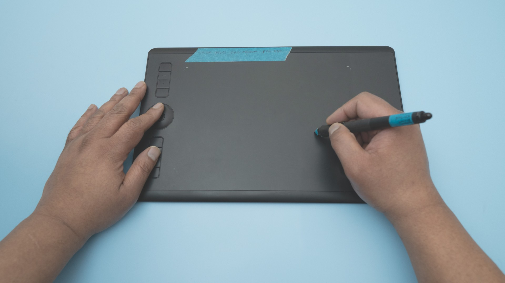<figcaption></figcaption></figure>

With the Intuos Pro 2025, the non-drawing hand will cover some part of the active area. Some people find that this interferes with their experience since they have to move the non-drawing hand out of the way much more often.

If you don't use the ExpressKeys (I use a TourBox and disabled them), the new layout doesn't matter. See [ExpressKeys and dials](wacom-intuos-pro-2025/wacom-ptkx70-notes.md#expresskeys-and-dials) for how they work on the 2025 edition.

### Multitouch

WINNER: INTUOS PRO 2017

The Intuos Pro 2025 does **NOT** support multitouch. Many people did not use the multi-touch feature of the Intuos Pro 2017, but a few did and were big fans of it. For them, losing it is a major negative.

In my opinion the touch support on the 2017 edition is not great. See [Touch](wacom-intuos-pro-2017/wacom-pthx60-notes.md#touch).

### Device size and active area

WINNER: INTUOS PRO 2025

Physically, the new devices are smaller than their 2017 counterparts, but their active areas have grown in size. So, you have more room than ever for drawing despite the devices shrinking.

<figure><figcaption></figcaption></figure>

#### Device size

<table><thead><tr><th width="140.20001220703125">Size category</th><th width="183.39996337890625">Intuos Pro 2017</th><th width="186.800048828125">Intuos Pro 2025</th></tr></thead><tbody><tr><td>LARGE</td><td>
PTH-860

430 x 287 mm

1234.1 cm2
</td><td>
PTK-870

377 x 253 mm 953.81 cm2
</td></tr><tr><td>MEDIUM</td><td>
PTH-660

338 x 219 mm 740.22 cm2
</td><td>
PTK-670

291 x 206 mm 599.46 cm2
</td></tr><tr><td>SMALL</td><td>
PTH-460

269 x 170 mm 457.3 cm2
</td><td>
PTK-470

215 x 163 mm 350.45 cm2
</td></tr></tbody></table>

#### Active area

<table><thead><tr><th width="140.20001220703125">Size category</th><th width="183.39996337890625">Intuos Pro 2017</th><th width="186.800048828125">Intuos Pro 2025</th></tr></thead><tbody><tr><td>LARGE</td><td>
PTH-860

311 x 216 mm 671.76 cm2
</td><td>
PTK-870

349 x 195 mm 680.55 cm2
</td></tr><tr><td>MEDIUM</td><td>
PTH-660

224 x 148 mm 331.52 cm2
</td><td>
PTK-670

263 x 148 mm 389.24 cm2
</td></tr><tr><td>SMALL</td><td>
PTH-460

160 x 100 mm 160.0 cm2
</td><td>
PTK-470

187 x 105 mm 196.35 cm2
</td></tr></tbody></table>

<figure>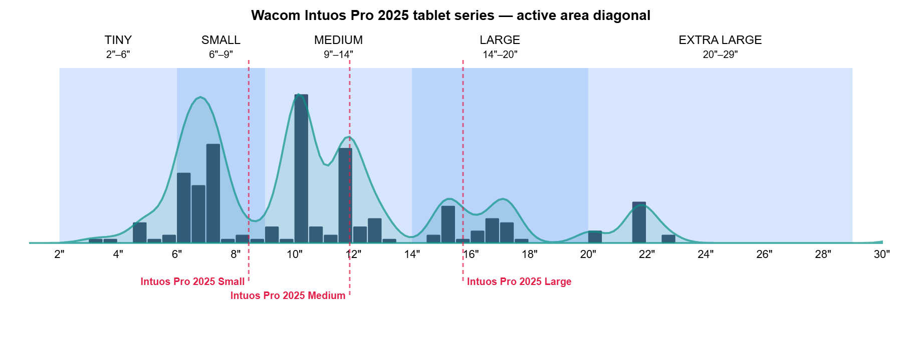<figcaption></figcaption></figure>

As you can see, the 2025 models are clearly a little larger than their 2017 counterparts.

<figure>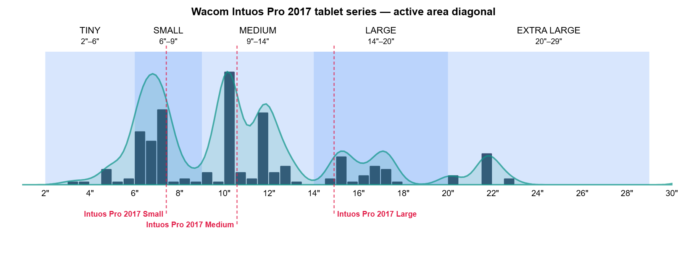<figcaption></figcaption></figure>

#### Intuos Pro 2025 Large vs Intuos Pro 2017 Medium

The new Intuos Pro 2025 Large is physically very close in size to the Intuos Pro 2017 Medium. This may make the 2025 Large a bit easier to place on the desktop for those of you interested in a large pen tablet.

<figure>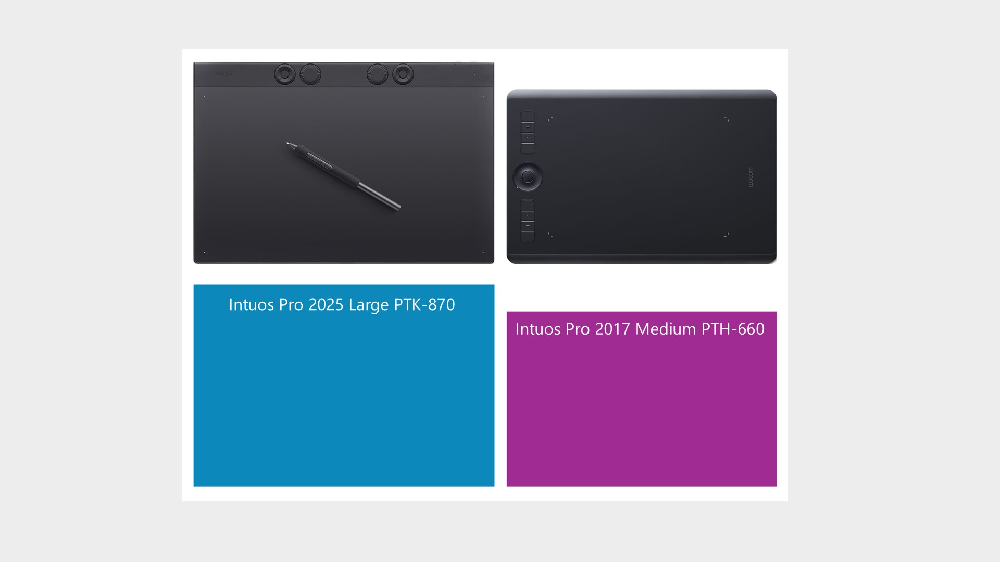<figcaption></figcaption></figure>

<figure>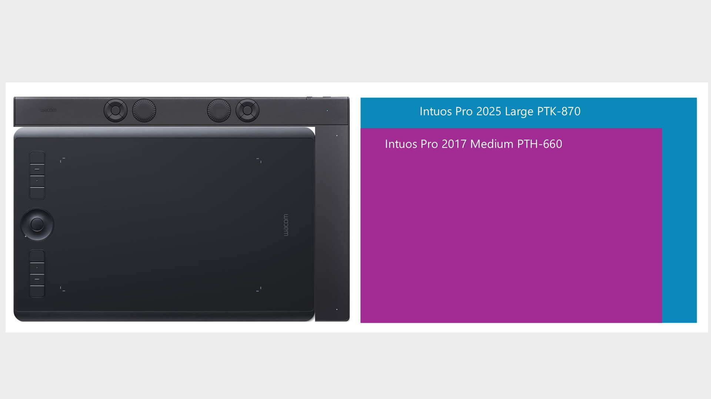<figcaption></figcaption></figure>

### Aspect ratio and Force Proportions

WINNER: INTUOS PRO 2025

The 2017 models had unusual aspect ratios, while the new devices all have 16:9 aspect ratios, or something incredibly close to that. This has a nice consequence. If you use a 16:9 monitor, you have to turn on Force Proportions to draw normally with the 2017 models. But Force Proportions is not needed and has no effect on the new models with a 16:9 monitor. Because a mismatch in aspect ratios between the pen tablet's active area and the monitor causes Force Proportions to stop using some amount of active area, the new tablets give you much more active area in practice than the 2017 models.

<figure>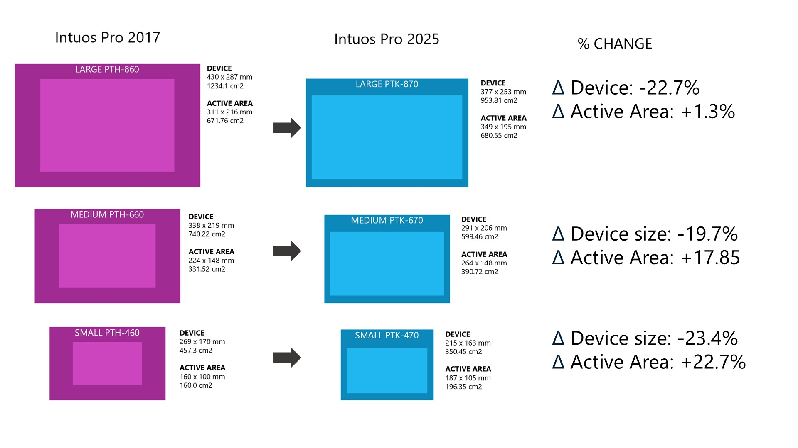<figcaption></figcaption></figure>

#### Aspect ratio

<table><thead><tr><th width="140.20001220703125">Size category</th><th width="183.39996337890625">Intuos Pro 2017</th><th width="186.800048828125">Intuos Pro 2025</th></tr></thead><tbody><tr><td>LARGE</td><td>
PTH-860

1.440:1
</td><td>
PTK-870

16:9 (1.79)
</td></tr><tr><td>MEDIUM</td><td>
PTH-660

≈3:2 (1.514:1)
</td><td>
PTK-670

16:9 (1.784)
</td></tr><tr><td>SMALL</td><td>PTH-460 16:10</td><td>
PTK-470

16:9 (1.781)
</td></tr></tbody></table>

#### Active area with Force Proportions enabled on a 16:9 monitor

<table><thead><tr><th width="140.20001220703125">Size category</th><th width="183.39996337890625">Intuos Pro 2017</th><th width="186.800048828125">Intuos Pro 2025</th></tr></thead><tbody><tr><td>LARGE</td><td>
PTH-860

311 x 174.94 mm <strong>544.06 cm2</strong>
</td><td>
PTK-870

349 x 195 mm 680.55 cm2
</td></tr><tr><td>MEDIUM</td><td>
PTH-660

224 x 126.0 mm 282.24 cm2
</td><td>
PTK-670

263 x 148 mm 389.24 cm2
</td></tr><tr><td>SMALL</td><td>
PTH-460

160 x 90.0 mm 144.0 cm2
</td><td>
PTK-470

187 x 105 mm 196.35 cm2
</td></tr></tbody></table>

### Weight

WINNER: INTUOS PRO 2025

* 40% weight reduction across all models
* The 2025 LARGE model weighs less than the 2017 MEDIUM model
* The 2025 MEDIUM model weighs less than the 2017 SMALL model

<table><thead><tr><th width="157">Tablet</th><th>Intuos Pro 2017</th><th>Intuos Pro 2025</th><th>% decrease</th></tr></thead><tbody><tr><td>Large</td><td>1300g</td><td>660g</td><td>-49.23%</td></tr><tr><td>Medium</td><td>700g</td><td>411g</td><td>-41.286%</td></tr><tr><td>Small</td><td>450g</td><td>240g</td><td>-40.67%</td></tr></tbody></table>

Despite the weight loss, the 2025 edition does not slide around on the desk while drawing. It does require less force to move deliberately than the PTH-660.

### Thickness and wrist angle

WINNER: INTUOS PRO 2025 (SLIGHTLY)

The 2025 edition is slightly thinner than the 2017 edition and has a slight wedge shape that is thinner at the bottom and thicker at the top.

<figure><figcaption></figcaption></figure>

Because the Intuos Pro 2025 series is thinner, a wrist should need to flex a little less when drawing. Wacom says this should make it a little more comfortable to work on the tablet and let you work longer. I don't doubt them but I didn't find the effect especially noticeable.

<figure>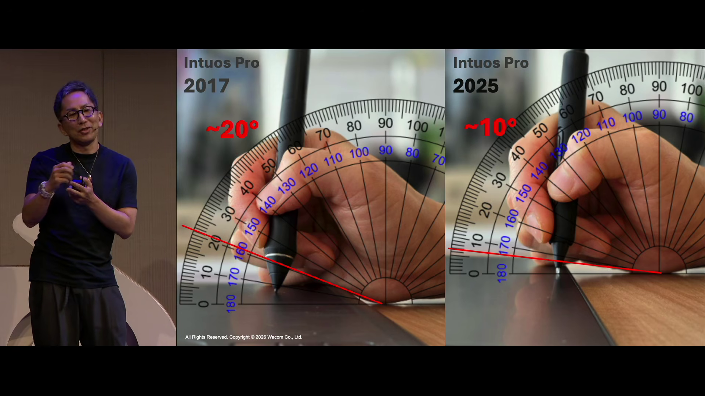<figcaption>
Wacom CEO Nobu Ide speaking about the Intuos Pro 2025 tablets.
</figcaption></figure>

### Bezels

WINNER: DEPENDS

With the device sizes shrinking but the active area increasing, the bezels have really changed size.

* 3 bezels have significantly shrunk
* The TOP bezel has grown a bit to hold the ExpressKeys and dials
* All numbers here are approximate

<table><thead><tr><th width="149">Bezel size</th><th>Bezel PTH-660</th><th>Bezel PTK-670</th><th>Delta</th><th>%change</th></tr></thead><tbody><tr><td>TOP</td><td>30</td><td>40</td><td>+10mm</td><td>+33.3%</td></tr><tr><td>RIGHT</td><td>60</td><td>10</td><td>-50mm</td><td>-83.3%</td></tr><tr><td>BOTTOM</td><td>35</td><td>10</td><td>-25mm</td><td>-71.2%</td></tr><tr><td>LEFT</td><td>60</td><td>10</td><td>-50mm</td><td>-83.3%</td></tr></tbody></table>

Numbers don't capture the difference. Here's a photo with purple tape over the right bezel of the Intuos Pro 2017 Medium and the Intuos Pro 2025 Medium.

<figure>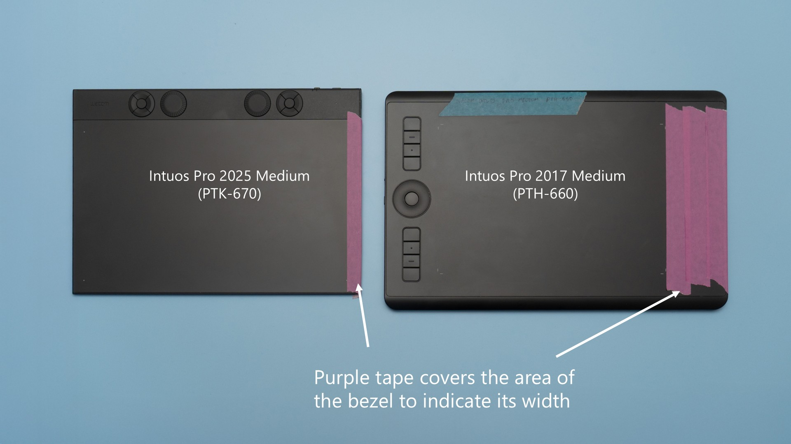<figcaption></figcaption></figure>

#### Bezels and resting your hand on the tablet

Bezels provide a place for your hand to rest as you draw. This is a fact I don't think I appreciated until I drew more with the Intuos Pro 2025 Medium.

**When drawing with the Intuos Pro 2017 Medium**, as the pen reaches the edge of the active area the hand can stay on the bezel almost the entire time. Only sometimes does the hand need to touch the desk, and even then the hand is still mostly resting on the tablet.

**When drawing with the Intuos Pro 2025 Medium**, even when the pen is some distance from the edge of the active area the hand will make contact and partially rest on the desk. By the time the pen reaches the edge of the active area, the entire hand will be resting on the desk.

#### Bezel edge

There is a slight bump at the edge of the tablet. In photos, it is hard to tell the difference between the Intuos Pro 2025 Medium and the Intuos Pro 2017 Medium.

<figure>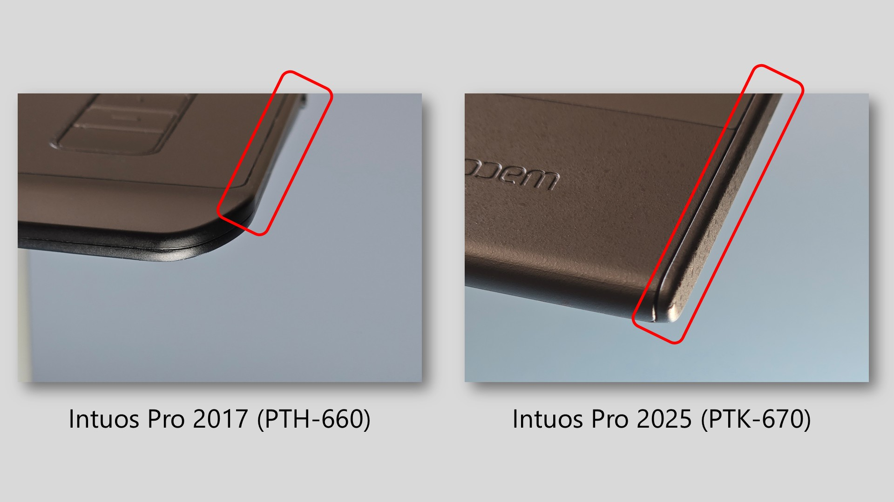<figcaption></figcaption></figure>

But you can feel the difference. The diagram below exaggerates the feeling, but with the 2025 Medium you can definitely feel the edge of the tablet more. While it is not painful and does not "dig into" the hand, I do notice it, and other users might be disturbed by it.

<figure>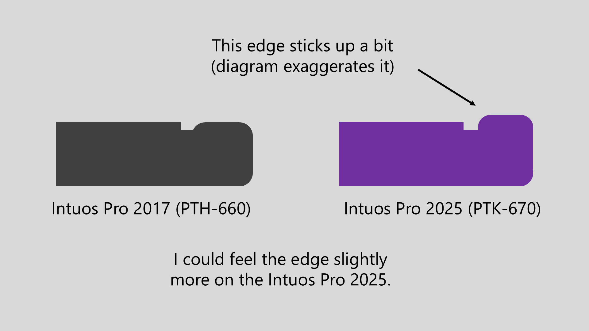<figcaption></figcaption></figure>

#### Are the bezels a problem?

Answer: IT DEPENDS

It was **OK** for ME.

* Tablet is very thin - hand did not “fall off a cliff”
* Hand will transition from tablet to the desk
* Edge did not “dig into” hand – but definitely more noticeable
* I can now understand why people like wider bezels

However, ...

* As of May 2025, I’m still adapting to it
* For some people this could be an issue

#### How the bezels have been received by users

The bezel is highly polarizing for a lot of people. There are two aspects of the bezel to take into consideration. First is the reduction in bezel size. Second is that the lip at the edge of the tablet is very slightly more raised than on the previous generation of Intuos Pro.

The smaller bezel seems to irritate some people, and for other people it just seems to take some time to adjust. Personally, after using the Intuos Pro for so long with large bezels, I have to admit it feels weird to use the new tablet with much smaller bezels. Even after a month or so, it still feels a little bit weird. It's not bad, just different.

The raised edge causes some people more discomfort than the old model. Because your hand will statistically feel that raised edge much more often with the new design, and because it is more noticeable, some people find it irritating, and in fact some people find it painful.

### Surface texture

WINNER: DEPENDS

Compared to the Intuos Pro 2017 (PTH-660), the Intuos Pro 2025:

* Has slightly less texture
* Feels “softer” through the pen
* Exhibits less texture erosion, based on my initial two-week testing
* Is significantly quieter: much harder to hear, not “scratchy”

Over time, I would EXPECT nibs to wear down less on the 2025 edition. Only time will tell.

For texture sheets, the 2017 edition had Standard, Smooth and Rough sheets for the MEDIUM and LARGE models (often sold out). The 2025 edition has sheets for all three sizes, but only in Standard texture.

### Driver support lifetime

WINNER: INTUOS PRO 2025

Wacom professional pen tablets have a support lifetime of something like 10 to 12 years. I expect support for the Intuos Pro 2017 to end between 2027 and 2029, and by 2030 at the latest. The Intuos Pro 2025 is the current model. See [Buying an Intuos Pro 2017 in 2026](wacom-intuos-pro-2017/buying-pthx60-in-2026.md).
