# Wacom Intuos Pro 2025 (PTK-x70) notes

## Summary

This is an EXCELLENT tablet, but may not be the right one for you if:

* You do not like the new ExpressKeys placement
* You need multi-touch support
* You are already happy with an Intuos Pro 2017 model

## Companion video

If you would rather watch, use this video: [https://www.youtube.com/watch?v=Q2rH32pBpq0](https://www.youtube.com/watch?v=Q2rH32pBpq0)

But do check this document for any updates since the original video was published.



## Compared to the Intuos Pro 2017

The main changes from the Intuos Pro 2017 (PTH-x60):

* No improvement to drawing performance
* ExpressKeys and dials moved to the top
* Multitouch support dropped
* Bezels are significantly smaller
* Smaller and about 40% lighter, with a larger 16:9 active area
* Comes with Pro Pen 3 instead of Pro Pen 2
* Improved report rate (wired report rate is 300Hz versus the older models' 200Hz)

For the full comparison, and help choosing between them, see [Wacom Intuos Pro 2025 vs Intuos Pro 2017](../wacom-intuos-pro-2025-vs-2017.md).

## Should you buy the Intuos Pro 2025

* Your first pro tablet? → YES
* Want the best? → YES
* Upgrade from 2017 edition? → PROBABLY NOT. Unless there is a specific benefit you will get from the Intuos Pro 2025, there is no point in upgrading. See [Wacom Intuos Pro 2025 vs Intuos Pro 2017](../wacom-intuos-pro-2025-vs-2017.md).
* Need multitouch support? → NO

## Model numbers

It's always helpful to be clear on the model numbers so that you don't buy the wrong version of the tablet.

<figure>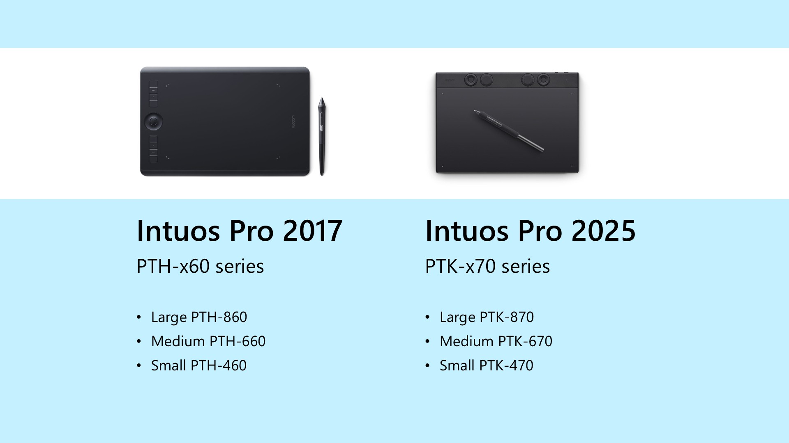<figcaption></figcaption></figure>

## Links

These links come from the [DrawTabData Explorer](https://thesevenpens.github.io/DrawTabDataExplorer/entity/wacom.tabletfamily.wacom_intuospro_2025). To add or fix a link, change it in DrawTabData.

| Source       | Link                                                                                                                      | Date       |
| ------------ | ------------------------------------------------------------------------------------------------------------------------- | ---------- |
| Wacom        | [Product page](https://www.wacom.com/en-us/products/pen-tablets/wacom-intuos-pro)                                         |            |
| Wacom        | [Store page](https://estore.wacom.com/en-us/wacom-intuos-pro-small-s-ptk470k0a.html) (PTK-470)                            |            |
| Wacom        | [Store page](https://estore.wacom.com/en-us/wacom-intuos-pro-medium-m-ptk670k0a.html) (PTK-670)                           |            |
| Wacom        | [Store page](https://estore.wacom.com/en-us/wacom-intuos-pro-large-l-ptk870k0a.html) (PTK-870)                            |            |
| Wacom        | [User manual](https://101.wacom.com/UserHelp/en/TOC/PTK470.html) (PTK-470)                                                |            |
| Wacom        | [User manual](http://101.wacom.com/UserHelp/en/TOC/PTK670.html) (PTK-670)                                                 |            |
| Wacom        | [User manual](https://101.wacom.com/UserHelp/en/TOC/PTK870.html) (PTK-870)                                                |            |
| JEEJON 技冏    | [Wacom Intuos pro 2025 review & comparison](https://www.youtube.com/watch?v=ZfB2MXQgAZc)                                  | 2025-11-03 |
| Aaron Rutten | [Unboxing the Wacom Intuos Pro 2025 - First Impressions](https://www.youtube.com/watch?v=Abegz9US7Lg)                     | 2025-07-13 |
| Seven Pens   | [Wacom Intuos Pro Large and Small: Unboxing and Q\&A](https://www.youtube.com/watch?v=A9Rk_BdMR50) (PTK-470, PTK-870)     | 2025-05-24 |
| JEEJON 技冏    | [I Don't Recommend The New Intuos Pro 2025 Series](https://www.youtube.com/watch?v=KawJkmmDuPE)                           | 2025-05-07 |
| Aaron Rutten | [2025 Intuos Pro - Everything You Need to Know (Review)](https://www.youtube.com/watch?v=Rf66Lqx9NFc)                     | 2025-04-26 |
| Seven Pens   | [Notes on Wacom Intuos Pro 2025](https://www.youtube.com/watch?v=Q2rH32pBpq0)                                             | 2025-04-23 |
| Brad Colbow  | [2025 Wacom Intuos Pro Review](https://www.youtube.com/watch?v=Ko0sovi0rX4)                                               | 2025-04-14 |
| Seven Pens   | [Wacom Intuos Pro 2025 Medium (PTK-670) Live Unboxing and Testing](https://www.youtube.com/watch?v=Vs9IZ0cejKY) (PTK-670) | 2025-03-31 |
| Seven Pens   | [Live Wacom Intuos Pro 2025 PTK-670 medium testing and Q\&A](https://www.youtube.com/watch?v=fMjU-0ciml0) (PTK-670)       | 2025-03-31 |

## Specs

These specs come from the [DrawTabData Explorer](https://thesevenpens.github.io/DrawTabDataExplorer/entity/wacom.tabletfamily.wacom_intuospro_2025). Click a model ID to see its full record there.



|          | [PTK-470](https://thesevenpens.github.io/DrawTabDataExplorer/entity/wacom.tablet.ptk470) | [PTK-670](https://thesevenpens.github.io/DrawTabDataExplorer/entity/wacom.tablet.ptk670) | [PTK-870](https://thesevenpens.github.io/DrawTabDataExplorer/entity/wacom.tablet.ptk870) |
| -------- | ---------------------------------------------------------------------------------------- | ---------------------------------------------------------------------------------------- | ---------------------------------------------------------------------------------------- |
| Name     | Intuos Pro 2025 Small                                                                    | Intuos Pro 2025 Medium                                                                   | Intuos Pro 2025 Large                                                                    |
| Released | 2025-02-12                                                                               | 2025-02-12                                                                               | 2025-02-12                                                                               |
| Status   | Available                                                                                | Available                                                                                | Available                                                                                |



|                   | [PTK-470](https://thesevenpens.github.io/DrawTabDataExplorer/entity/wacom.tablet.ptk470) | [PTK-670](https://thesevenpens.github.io/DrawTabDataExplorer/entity/wacom.tablet.ptk670) | [PTK-870](https://thesevenpens.github.io/DrawTabDataExplorer/entity/wacom.tablet.ptk870) |
| ----------------- | ---------------------------------------------------------------------------------------- | ---------------------------------------------------------------------------------------- | ---------------------------------------------------------------------------------------- |
| Active area       | 187 × 105 mm (7.4 × 4.1 in)                                                              | 263 × 148 mm (10.4 × 5.8 in)                                                             | 349 × 195 mm (13.7 × 7.7 in)                                                             |
| Diagonal          | 214.5 mm (8.4 in)                                                                        | 301.8 mm (11.9 in)                                                                       | 399.8 mm (15.7 in)                                                                       |
| Aspect ratio      | 16:9                                                                                     | 16:9                                                                                     | ≈16:9 (1.790:1)                                                                          |
| Pen technology    | Passive EMR                                                                              | Passive EMR                                                                              | Passive EMR                                                                              |
| Pressure levels   | 8192                                                                                     | 8192                                                                                     | 8192                                                                                     |
| Tilt              | ±60°                                                                                     | ±60°                                                                                     | ±60°                                                                                     |
| Accuracy (center) | —                                                                                        | —                                                                                        | —                                                                                        |
| Accuracy (corner) | —                                                                                        | —                                                                                        | —                                                                                        |
| Report rate       | —                                                                                        | —                                                                                        | —                                                                                        |
| Density           | 200 LPmm (5080 LPI)                                                                      | 200 LPmm (5080 LPI)                                                                      | 200 LPmm (5080 LPI)                                                                      |
| Max hover         | —                                                                                        | —                                                                                        | —                                                                                        |



|                 | [PTK-470](https://thesevenpens.github.io/DrawTabDataExplorer/entity/wacom.tablet.ptk470)                                                                                                                                                                                                                                                                                                                                                                                                                                                                                                         | [PTK-670](https://thesevenpens.github.io/DrawTabDataExplorer/entity/wacom.tablet.ptk670)                                                                                                                                                                                                                                                                                                                                                                                                                                                                                                         | [PTK-870](https://thesevenpens.github.io/DrawTabDataExplorer/entity/wacom.tablet.ptk870)                                                                                                                                                                                                                                                                                                                                                                                                                                                                                                         |
| --------------- | ------------------------------------------------------------------------------------------------------------------------------------------------------------------------------------------------------------------------------------------------------------------------------------------------------------------------------------------------------------------------------------------------------------------------------------------------------------------------------------------------------------------------------------------------------------------------------------------------ | ------------------------------------------------------------------------------------------------------------------------------------------------------------------------------------------------------------------------------------------------------------------------------------------------------------------------------------------------------------------------------------------------------------------------------------------------------------------------------------------------------------------------------------------------------------------------------------------------ | ------------------------------------------------------------------------------------------------------------------------------------------------------------------------------------------------------------------------------------------------------------------------------------------------------------------------------------------------------------------------------------------------------------------------------------------------------------------------------------------------------------------------------------------------------------------------------------------------ |
| Included pen    | [Pro Pen 3 (ACP-500)](https://thesevenpens.github.io/DrawTabDataExplorer/entity/wacom.pen.acp500)                                                                                                                                                                                                                                                                                                                                                                                                                                                                                                | [Pro Pen 3 (ACP-500)](https://thesevenpens.github.io/DrawTabDataExplorer/entity/wacom.pen.acp500)                                                                                                                                                                                                                                                                                                                                                                                                                                                                                                | [Pro Pen 3 (ACP-500)](https://thesevenpens.github.io/DrawTabDataExplorer/entity/wacom.pen.acp500)                                                                                                                                                                                                                                                                                                                                                                                                                                                                                                |
| Compatible pens | 
<a href="https://thesevenpens.github.io/DrawTabDataExplorer/entity/wacom.pen.acp500">Pro Pen 3 (ACP-500)</a> <a href="https://thesevenpens.github.io/DrawTabDataExplorer/entity/wacom.pen.acp700">Art Pen 2 (ACP-700)</a> <a href="https://thesevenpens.github.io/DrawTabDataExplorer/entity/wacom.pen.kp501e">Intuos4 Grip Pen (KP-501E)</a> <a href="https://thesevenpens.github.io/DrawTabDataExplorer/entity/wacom.pen.kp504e">Pro Pen 2 (KP-504E)</a> <a href="https://thesevenpens.github.io/DrawTabDataExplorer/entity/wacom.pen.kp701e">Intuos4 Art Pen (KP-701E)</a>
 | 
<a href="https://thesevenpens.github.io/DrawTabDataExplorer/entity/wacom.pen.acp500">Pro Pen 3 (ACP-500)</a> <a href="https://thesevenpens.github.io/DrawTabDataExplorer/entity/wacom.pen.acp700">Art Pen 2 (ACP-700)</a> <a href="https://thesevenpens.github.io/DrawTabDataExplorer/entity/wacom.pen.kp501e">Intuos4 Grip Pen (KP-501E)</a> <a href="https://thesevenpens.github.io/DrawTabDataExplorer/entity/wacom.pen.kp504e">Pro Pen 2 (KP-504E)</a> <a href="https://thesevenpens.github.io/DrawTabDataExplorer/entity/wacom.pen.kp701e">Intuos4 Art Pen (KP-701E)</a>
 | 
<a href="https://thesevenpens.github.io/DrawTabDataExplorer/entity/wacom.pen.acp500">Pro Pen 3 (ACP-500)</a> <a href="https://thesevenpens.github.io/DrawTabDataExplorer/entity/wacom.pen.acp700">Art Pen 2 (ACP-700)</a> <a href="https://thesevenpens.github.io/DrawTabDataExplorer/entity/wacom.pen.kp501e">Intuos4 Grip Pen (KP-501E)</a> <a href="https://thesevenpens.github.io/DrawTabDataExplorer/entity/wacom.pen.kp504e">Pro Pen 2 (KP-504E)</a> <a href="https://thesevenpens.github.io/DrawTabDataExplorer/entity/wacom.pen.kp701e">Intuos4 Art Pen (KP-701E)</a>
 |



|              | [PTK-470](https://thesevenpens.github.io/DrawTabDataExplorer/entity/wacom.tablet.ptk470) | [PTK-670](https://thesevenpens.github.io/DrawTabDataExplorer/entity/wacom.tablet.ptk670) | [PTK-870](https://thesevenpens.github.io/DrawTabDataExplorer/entity/wacom.tablet.ptk870) |
| ------------ | ---------------------------------------------------------------------------------------- | ---------------------------------------------------------------------------------------- | ---------------------------------------------------------------------------------------- |
| Buttons      | 5                                                                                        | 10                                                                                       | 10                                                                                       |
| Dials        | 1                                                                                        | 2                                                                                        | 2                                                                                        |
| Touch rings  | —                                                                                        | —                                                                                        | —                                                                                        |
| Touch strips | —                                                                                        | —                                                                                        | —                                                                                        |
| Touch        | No                                                                                       | No                                                                                       | No                                                                                       |



|        | [PTK-470](https://thesevenpens.github.io/DrawTabDataExplorer/entity/wacom.tablet.ptk470) | [PTK-670](https://thesevenpens.github.io/DrawTabDataExplorer/entity/wacom.tablet.ptk670) | [PTK-870](https://thesevenpens.github.io/DrawTabDataExplorer/entity/wacom.tablet.ptk870) |
| ------ | ---------------------------------------------------------------------------------------- | ---------------------------------------------------------------------------------------- | ---------------------------------------------------------------------------------------- |
| Size   | 215 × 163 × 7 mm (8.5 × 6.4 × 0.3 in)                                                    | 291 × 206 × 7 mm (11.5 × 8.1 × 0.3 in)                                                   | 377 × 253 × 7 mm (14.8 × 10 × 0.3 in)                                                    |
| Weight | 240 g                                                                                    | 411 g                                                                                    | 660 g                                                                                    |



|                | [PTK-470](https://thesevenpens.github.io/DrawTabDataExplorer/entity/wacom.tablet.ptk470) | [PTK-670](https://thesevenpens.github.io/DrawTabDataExplorer/entity/wacom.tablet.ptk670) | [PTK-870](https://thesevenpens.github.io/DrawTabDataExplorer/entity/wacom.tablet.ptk870) |
| -------------- | ---------------------------------------------------------------------------------------- | ---------------------------------------------------------------------------------------- | ---------------------------------------------------------------------------------------- |
| Ports          | USB-C                                                                                    | USB-C                                                                                    | USB-C                                                                                    |
| Attached cable | None                                                                                     | None                                                                                     | None                                                                                     |
| Bluetooth      | Yes                                                                                      | Yes                                                                                      | Yes                                                                                      |



|          | [PTK-470](https://thesevenpens.github.io/DrawTabDataExplorer/entity/wacom.tablet.ptk470) | [PTK-670](https://thesevenpens.github.io/DrawTabDataExplorer/entity/wacom.tablet.ptk670) | [PTK-870](https://thesevenpens.github.io/DrawTabDataExplorer/entity/wacom.tablet.ptk870) |
| -------- | ---------------------------------------------------------------------------------------- | ---------------------------------------------------------------------------------------- | ---------------------------------------------------------------------------------------- |
| Contents | —                                                                                        | —                                                                                        | —                                                                                        |



## Notes on specs

### Digitizer

* Barrel rotation - YES. Although the included Pro Pen 3 does not support barrel rotation. You can use the Wacom Art Pen (KP-701E) that does support rotation with the tablet.

### Pens

* Included pen: see [Wacom Pro Pen 3 (ACP-500) notes](../../../pens/wacom-pens/wacom-acp500-notes.md)

#### The tablet only comes with 1 pen

This is a little bit of a disappointment. Some other brands are starting to include 2 pens with some of their professional models.

For example, as of April 2025, here is a **partial** list of tablets that come with two pens:

* Xencelabs Pen Tablet Medium
* Huion Kamvas Pro 19
* Huion Kamvas Pro 27
* XP-Pen Artist Pro 19 GEN2

## Design

Although not everyone shares this opinion, I find it a very beautiful and professional-looking tablet.

<figure>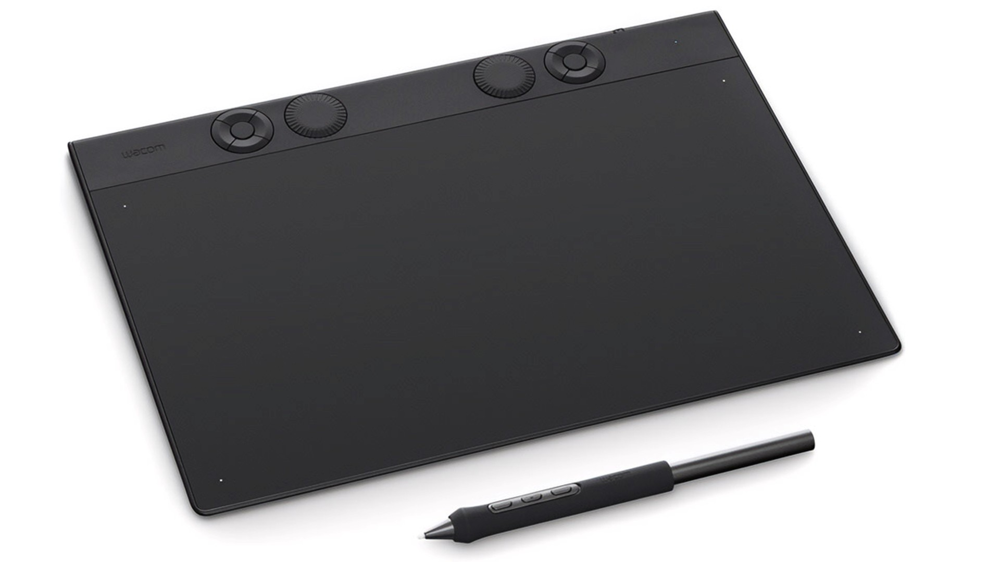<figcaption></figcaption></figure>

<figure>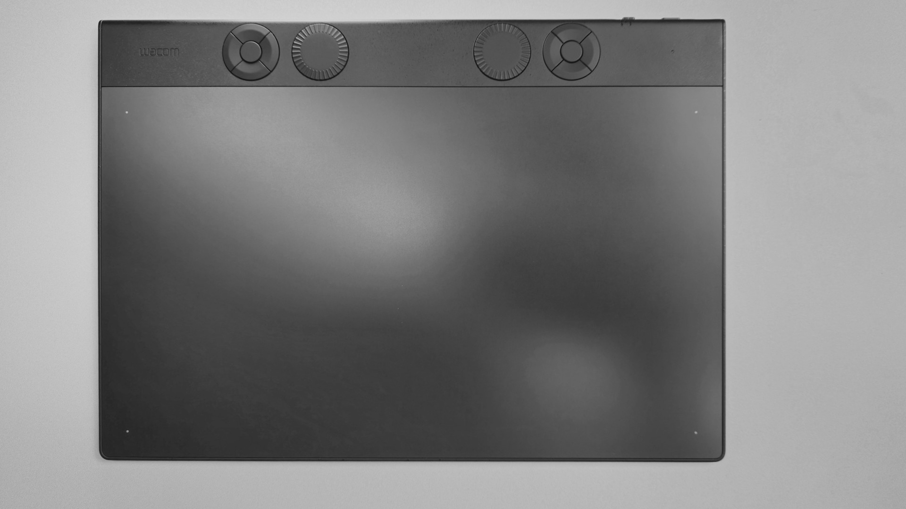<figcaption></figcaption></figure>

<figure>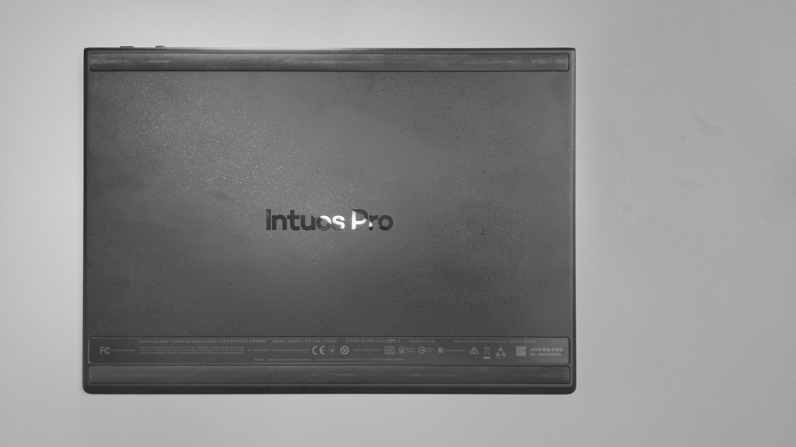<figcaption></figcaption></figure>

One of the interesting design touches is a slight texture on the non-drawing surface of the tablet.

<figure>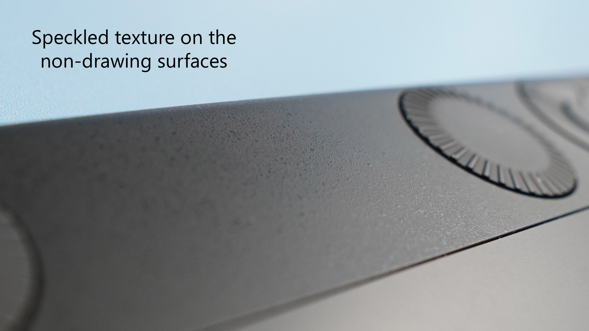<figcaption></figcaption></figure>

## What's in the box

Nothing too surprising, you get the tablet, pen, pen stands, and nibs.

<figure>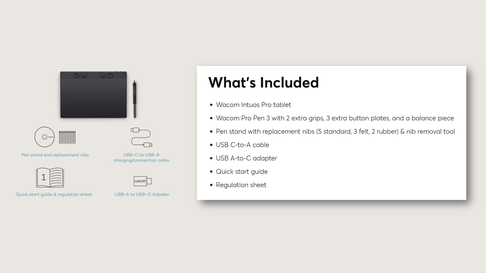<figcaption></figcaption></figure>

## Drawing experience

### Summary

The drawing performance is excellent and keeps the same quality as the previous Intuos Pro 2017 edition.

### Moving between high and low pressure worked well

<figure>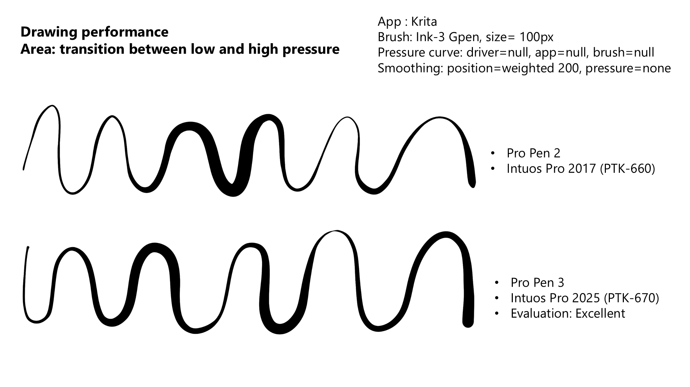<figcaption></figcaption></figure>

### Diagonal wobble

EVALUATION: Very good. Low amount of diagonal wobble. Similar to Intuos Pro 2017 edition.

<figure>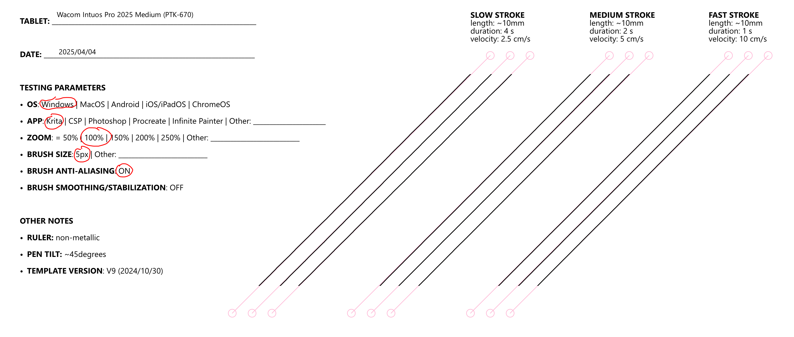<figcaption></figcaption></figure>

### Tilt compensation

EVALUATION: VERY GOOD

Even as I tilted the pen at different angles, the pointer did not deflect much from the tip of the pen.

### Pointer lag

EVALUATION: VERY GOOD (VERY LOW)

As expected, the pointer trailed the physical tip of the pen by a little bit. It was about the same as the pointer lag of the Intuos Pro 2017 model. In general, Wacom has excellent, low pointer lag in their pen tablets.

### Artifacts at low pressure

EVALUATION: TYPICAL. When using large brushes and drawing at very light pressure you may notice a lot of instability in the pressure. This is normal for Wacom Intuos Pro (and many other tablets and pens). You can use pressure curves and pressure smoothing to minimize these issues if you encounter them.

Keep in mind this is a very extreme test. Normally you should not notice these issues.

<figure>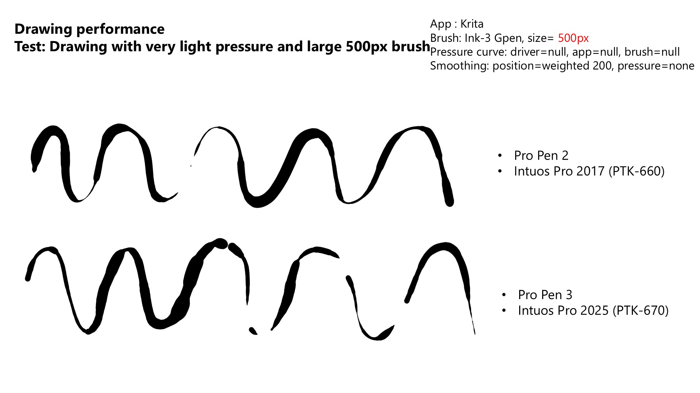<figcaption></figcaption></figure>

<figure>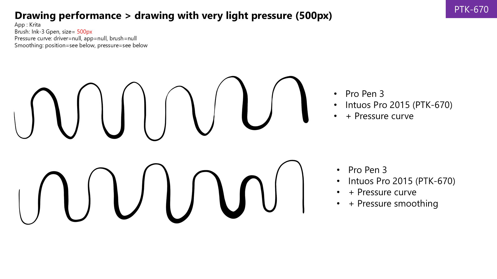<figcaption></figcaption></figure>

These were the pressure curves and pressure smoothing amounts (in Krita) that controlled that behavior.

<figure>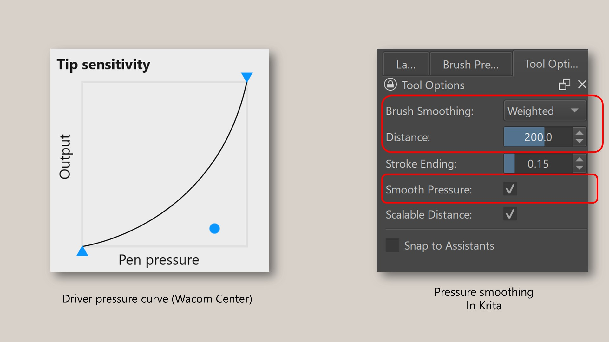<figcaption></figcaption></figure>

## Non-pen inputs

### Multitouch

Unlike the previous Intuos Pro 2017 (PTH-x60) series, the Intuos Pro 2025 (PTK-x70) series does **NOT** support multitouch.

### ExpressKeys and dials

The PTK-x70 series tablets come with pairs of ExpressKey rings and dials.

<figure>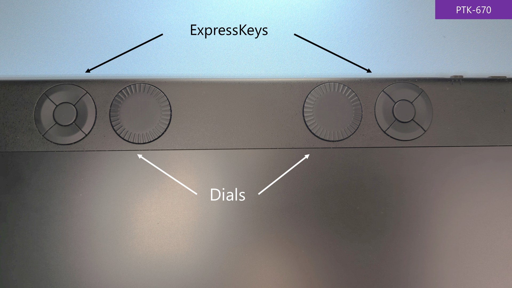<figcaption></figcaption></figure>

Do be aware that the number of ExpressKeys and dials depends on which tablet size in the PTK-x70 series you get.

<figure>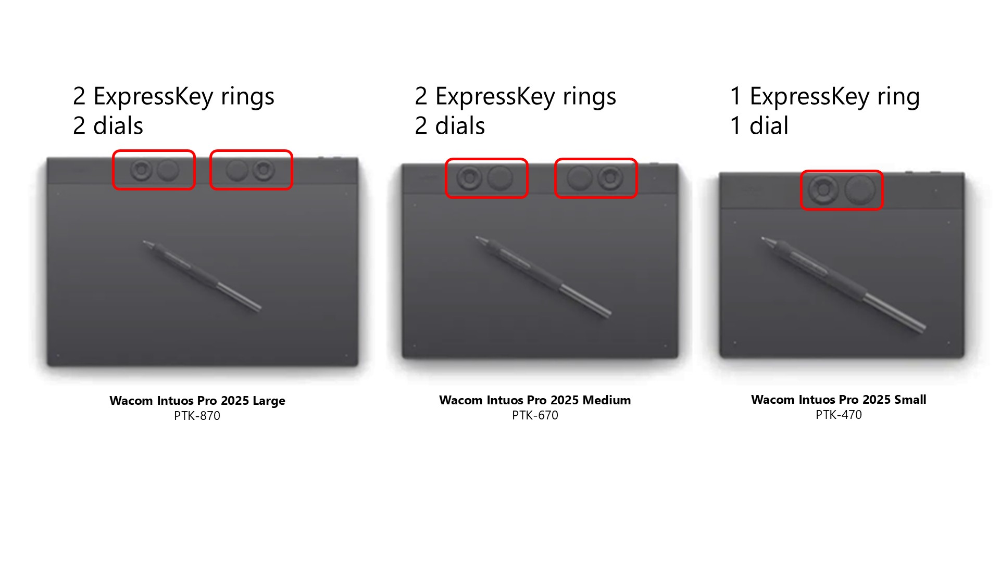<figcaption></figcaption></figure>

### Accidentally pressing the ExpressKeys and dials

It is possible to accidentally hit the ExpressKeys and dials depending on how the tablet is positioned near your keyboard.

**Tablet next to keyboard** - no accidental presses

<figure>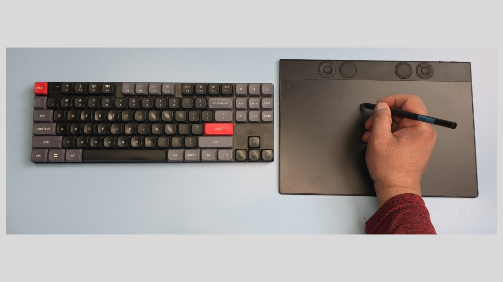<figcaption></figcaption></figure>

**Tablet underneath the keyboard** - no accidental presses while drawing, but accidental presses did happen when reaching for keys toward the top of the keyboard.

<figure>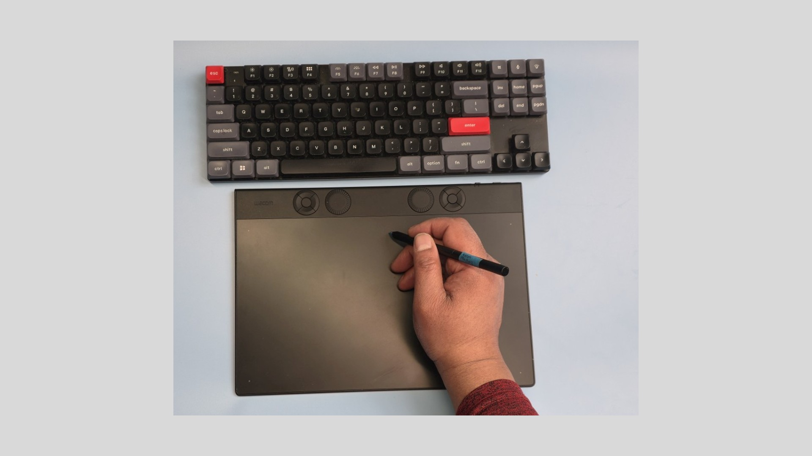<figcaption></figcaption></figure>

<figure>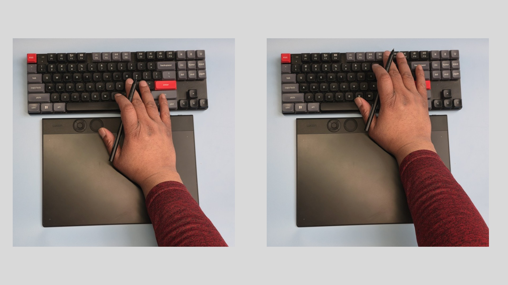<figcaption></figcaption></figure>

**Accidental presses were not possible in the way I draw** - I use a TourBox device. So my keyboard is not near the tablet at all. So accidental presses did not happen for me.

<figure>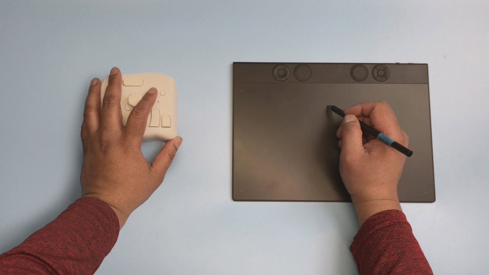<figcaption></figcaption></figure>

**Ultimately, I disabled all the ExpressKeys and dials** - I simply did not need them.

<figure>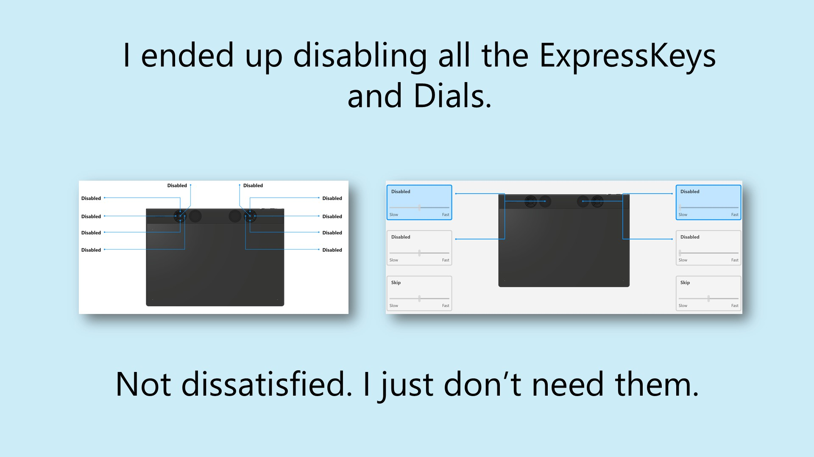<figcaption></figcaption></figure>

**I did accidentally hit the ExpressKeys when I meant to hit the dial and vice versa**. They are very similar in size and shape, and they are close together. Often I reached and touched the wrong one. Over time I may have been able to train my brain a bit better.

<figure>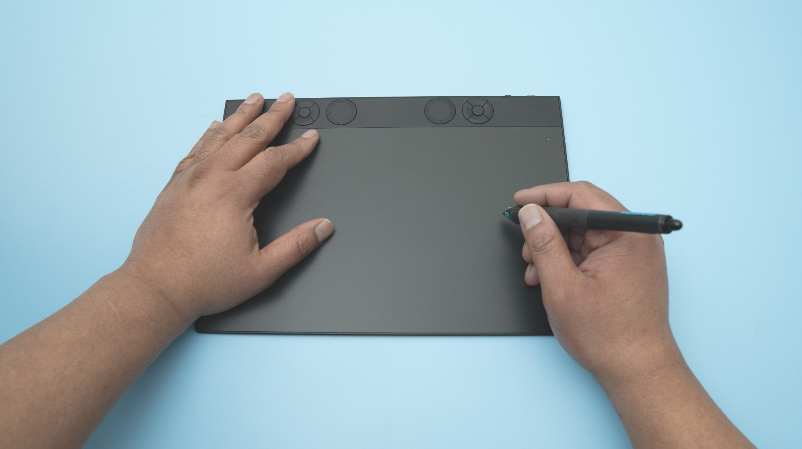<figcaption></figcaption></figure>

## Usage notes on dials

* Be aware that the dials only support rotation. They do not support pressing the dial as a third action. This is not a problem, but I am used to doing that with the TourBox dials, so I wanted to mention it.
* The dials feel nice to rotate. Rotating produces a soft click feel and a small sound.
* The dials do not rotate too easily nor do they require too much force to rotate.

## Usage notes on ExpressKeys

* It is not obvious in pictures, but the ExpressKey rings have 5 buttons. The fifth button in the middle is used to switch what the other 4 buttons do.

<figure>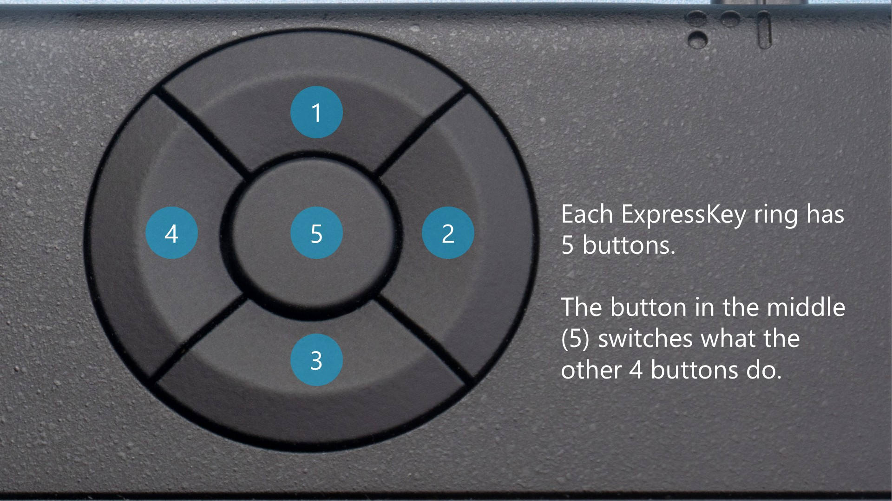<figcaption></figcaption></figure>

## Ergonomics

Compared to the Intuos Pro 2017, the top ExpressKeys change where the non-drawing hand rests, and the much smaller bezels change where the drawing hand rests. See [ExpressKeys layout](../wacom-intuos-pro-2025-vs-2017.md#expresskeys-layout) and [Bezels](../wacom-intuos-pro-2025-vs-2017.md#bezels) in the comparison.

## Size and bezels

Physically, the 2025 models are smaller than their 2017 counterparts, but their active areas are larger and all 16:9, and three of the four bezels are much narrower. The size, active area, aspect ratio and bezel measurements are in [Wacom Intuos Pro 2025 vs Intuos Pro 2017](../wacom-intuos-pro-2025-vs-2017.md#device-size-and-active-area).

### Bezel size visualized: Movink 13 vs Intuos Pro 2025 medium

<figure>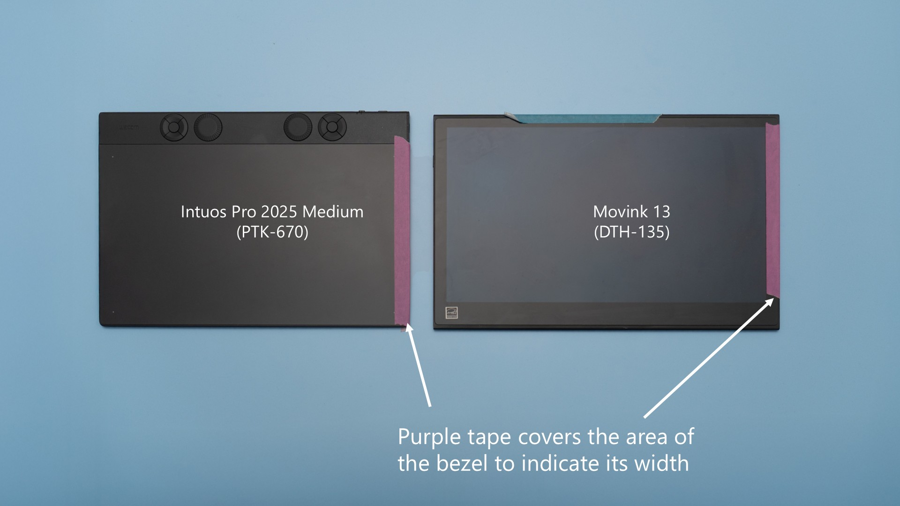<figcaption></figcaption></figure>

## Thickness

The tablet is slightly thinner than the previous 2017 edition and has a slight wedge shape that is thinner at the bottom and thicker at the top.

<figure>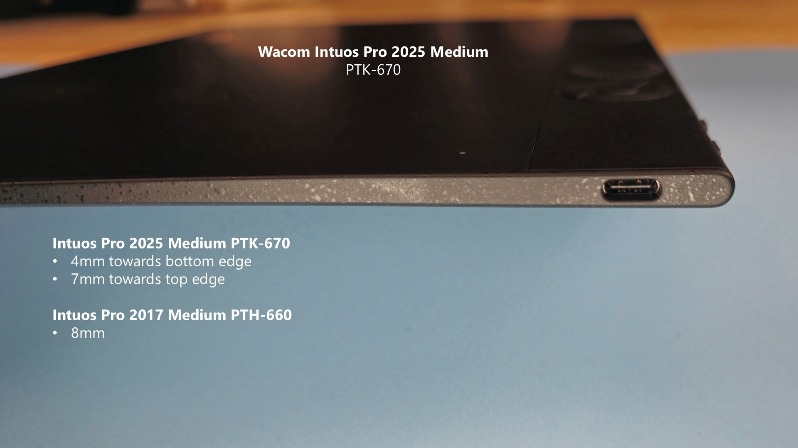<figcaption></figcaption></figure>

The thickness and wedge shape are very similar to the Wacom Movink 13.

<figure>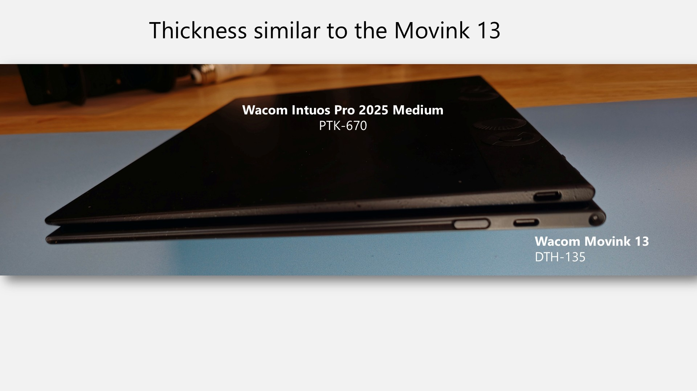<figcaption></figcaption></figure>

## Weight

About 40% lighter than the Intuos Pro 2017 across all models. See [Weight](../wacom-intuos-pro-2025-vs-2017.md#weight) in the comparison.

**Does it slide around on the desk as you draw?** NO. While drawing, it will NOT slide. It moves only if you deliberately force it to move. It requires less force to move than the PTH-660.

## Flatness

The Intuos Pro 2025 pen tablets are slightly bowed up in the middle. The diagram below demonstrates it, but **greatly exaggerates** the amount of the bowing. In reality, it seems like the bowing is about 0.15mm in the middle.

<figure>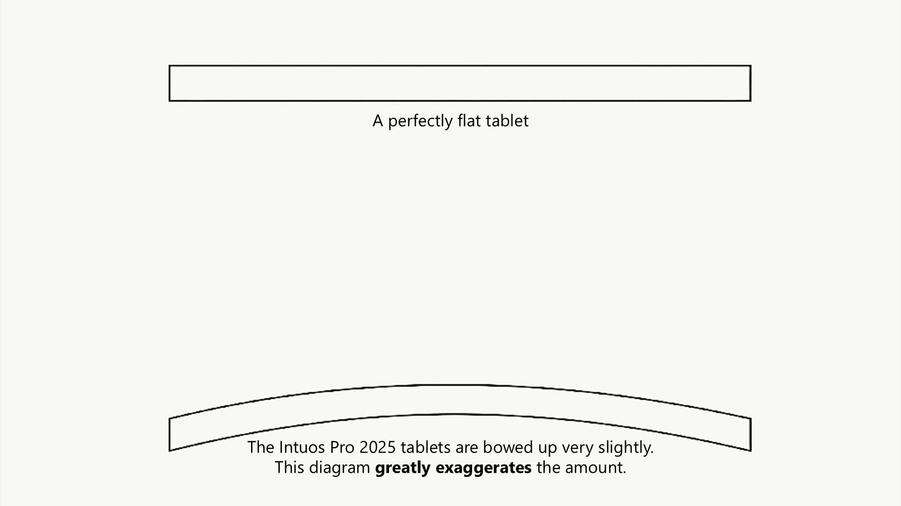<figcaption></figcaption></figure>

This bowing seems widespread (I have seen it in a PTK-870 and PTK-670) and many other users have found it.

A photo may reveal it, or, more simply, take the corner of a piece of paper and try to slide it under the tablet. You will not be able to do so near the sides, but in the middle the paper will go under the tablet. Be aware, when using the paper method, that the surface the tablet is on may not be perfectly flat.

The bowing does NOT seem to be noticeable while drawing. No user has complained that this affects how drawing works with the tablet.

We are unclear about the exact cause, but suspect it is due to the extreme thinness of the Intuos Pro 2025 series. Bowing is not uncommon in tablets. I even have an Intuos Pro 2017 Medium (PTH-660) that bows in the same exact way. The key thing to understand is that it is NOT a cause for concern, even if you notice it.

## Surface Texture

Summary: Great texture feeling across all nib types. Compared to the Intuos Pro 2017 it has slightly less texture, feels softer through the pen and is much quieter. See [Surface texture](../wacom-intuos-pro-2025-vs-2017.md#surface-texture) in the comparison.

## Connections and cabling

### Single USB-C port

The port is located on the right side, close to the top.

<figure>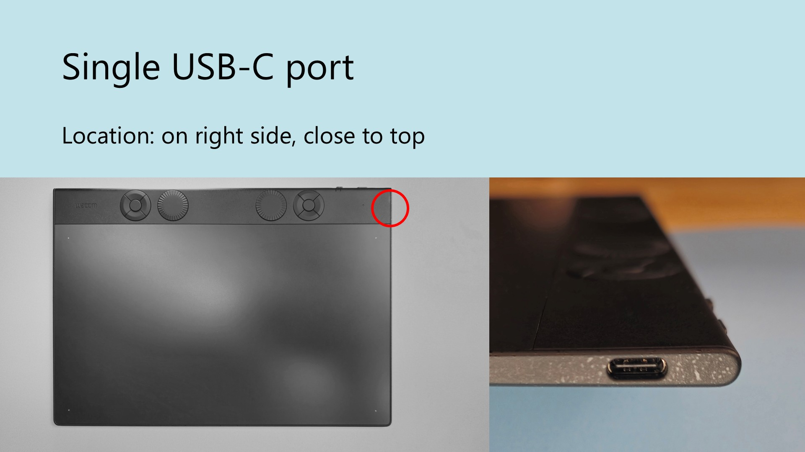<figcaption></figcaption></figure>

* USB-C port location: top right
* Multiple wireless connections: TBD

### USB Cables

* The tablet comes with a USB-A → USB-C cable
* You should be able to use any USB-C cable that supports data
* I tested with these three cables, and all worked:
  * Included USB-A → USB-C cable
  * Intuos Pro 2017 cable
  * Monoprice USB 2.0 USB-A → USB-C cable

### USB-C cable connector

The included USB cable no longer has an L-shaped connector like the cable that came with the 2017 Intuos Pro.

<figure>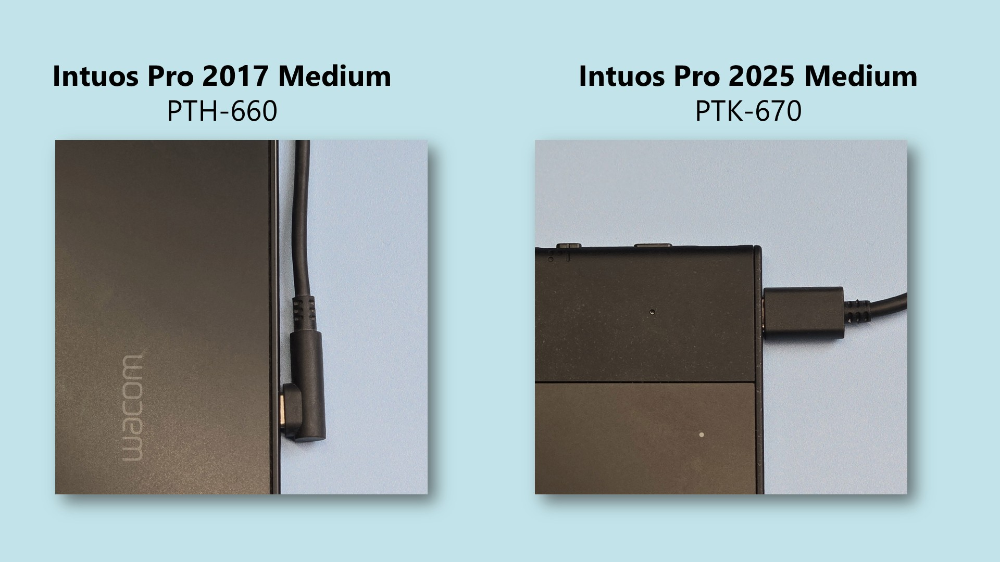<figcaption></figcaption></figure>

## Wireless

Summary

* Physical switch on top controls whether to use wired mode or one of two wireless connections
* Can pair with two devices wirelessly. Switching between devices is accomplished through the physical switch. This makes it convenient when moving between computers since all you have to do is change the switch position and you do not have to re-pair the device each time.
* Wireless testing
  * Wireless worked
  * I was easily able to switch between two paired devices using the switch
  * In my subjective evaluation, the wireless connection has a little bit more pointer lag than the wired connection. It may not bother many people, but if you want or need the lowest pointer lag, you should use wired connections.

<figure>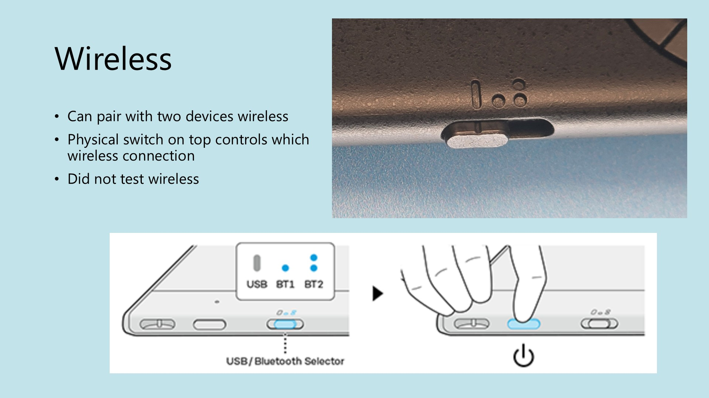<figcaption></figcaption></figure>

## Texture sheets

Wacom sells texture sheets in case you scratch up the drawing surface and want to restore it to its original pristine state. The texture sheets are available in 3 sizes (Large, Medium, Small) and only one texture (Standard).

<figure>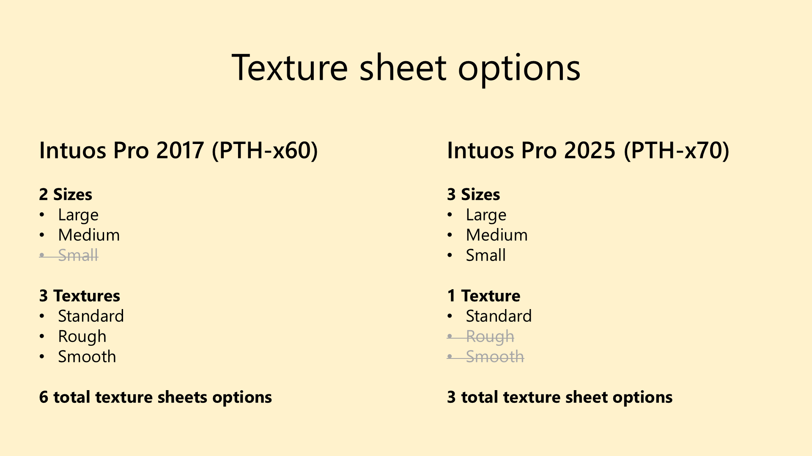<figcaption></figcaption></figure>

## Underneath the texture sheet

There is a grid pattern underneath the texture sheet.

<figure>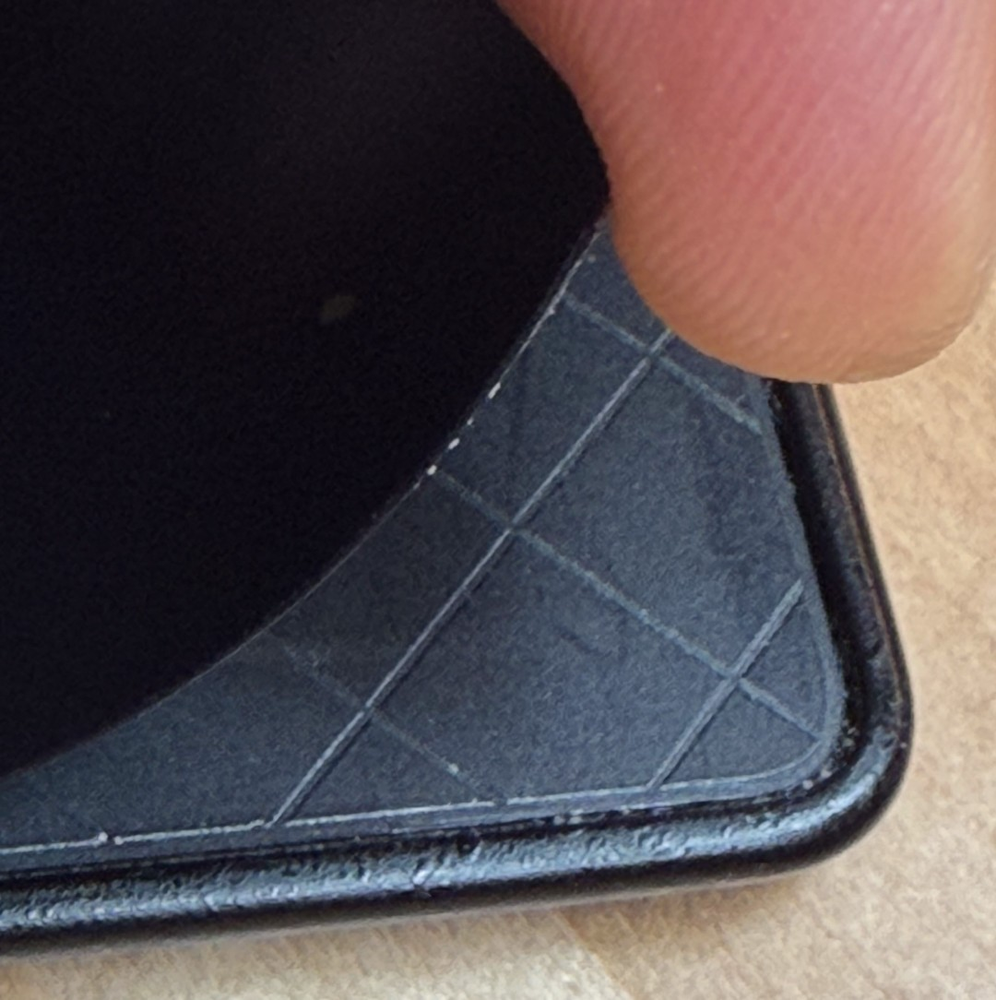<figcaption></figcaption></figure>

We think this pattern has these benefits:

* makes removing the texture sheet easier
* helps avoid air bubbles when placing a texture sheet on the tablet

Can this pattern be felt?

* By touch - NO
* By "normal" drawing - NO
* By "pressing very hard" - YES

Does Intuos Pro 2017 have this texture? NO

## Driver UI > Wacom Center vs Wacom Tablet Properties

There are two driver configuration UIs available for Wacom tablets: Wacom Center and Wacom Tablet Properties. For the Intuos Pro 2025, most features are available in both apps, but some are available only in Wacom Center.

Available in BOTH

* Tablet orientation
* Pen vs Mouse mode
* Screen area (full, portion, & specific monitors)
* Tablet area (full, portion, force proportions)
* Windows Ink
* Tip feel (a.k.a. "the pressure curve")
* Pen Button actions

Available only in Wacom Center for Intuos Pro 2025

* ExpressKey actions
* Dial actions

## Pen Report Rate

Overall for PTK-670 with Pro Pen 3

* Wired: 300Hz
* Wireless: 260Hz

Overall for PTK-670 with Pro Pen 2

* Wired: 260Hz
* Wireless: 230Hz

Overall with Samsung S Pen

* Wired: 245Hz
* Wireless: Did not test

<table><thead><tr><th width="127">Scenario</th><th width="179.9166259765625">Driver</th><th width="113.75">Report Rate</th><th>Tested with</th></tr></thead><tbody><tr><td>PTK-670 Pro Pen 3 Wired</td><td>OpenTabletDriver</td><td>300Hz</td><td>OTD tablet debugger, skill-test.net</td></tr><tr><td>PTK-670 Pro Pen 3 Wired</td><td>Wacom driver</td><td>300Hz</td><td>skill-test.net</td></tr><tr><td>PTK-670 Pro Pen 2 Wired</td><td>OpenTabletDriver</td><td>200Hz</td><td>OTD tablet debugger, skill-test.net</td></tr><tr><td>PTK-670 Pro Pen 2 Wired</td><td>Wacom driver</td><td>200Hz</td><td>skill-test.net</td></tr><tr><td>PTK-670 Pro Pen 3 Wireless</td><td>Wacom driver</td><td>260Hz</td><td>skill-test.net</td></tr><tr><td>PTK-670 Pro Pen 2 Wireless</td><td>Wacom driver</td><td>230Hz</td><td>skill-test.net</td></tr><tr><td>PTK-670 Samsung S Pen Wired</td><td>OpenTabletDriver</td><td>245Hz</td><td>OTD tablet debugger</td></tr></tbody></table>

Reference:

* Skill-test.net page: [https://skill-test.net/polling-rate-test](https://skill-test.net/polling-rate-test)

## Pen hover height testing

<table><thead><tr><th width="125.5">Tablet</th><th width="122">Pen</th><th width="105.5">Driver</th><th width="115">Initial detect height</th><th width="125">Max height</th></tr></thead><tbody><tr><td>PTK-670</td><td>ACP-500</td><td>Wacom</td><td>15 mm</td><td>15 mm</td></tr><tr><td>PTK-670</td><td>KP-504E</td><td>Wacom</td><td>11 mm</td><td>15 mm</td></tr><tr><td>PTK-870</td><td>ACP-500</td><td>Wacom</td><td>16 mm</td><td>16 mm</td></tr><tr><td>PTK-870</td><td>KP-504E</td><td>Wacom</td><td>13 mm</td><td>16 mm</td></tr><tr><td>PTK-470</td><td>ACP-500</td><td>Wacom</td><td>15 mm</td><td>15 mm</td></tr><tr><td>PTK-470</td><td>KP-504E</td><td>Wacom</td><td>12 mm</td><td>15 mm</td></tr><tr><td>PTK-670</td><td>ACP-500</td><td>OTD</td><td>15 mm</td><td>16 mm</td></tr><tr><td>PTK-670</td><td>KP-504E</td><td>OTD</td><td>12 mm</td><td>16 mm</td></tr><tr><td>PTK-870</td><td>ACP-500</td><td>OTD</td><td>16mm</td><td>16mm</td></tr><tr><td>PTK-870</td><td>KP-504E</td><td>OTD</td><td>15 mm</td><td>15 mm</td></tr><tr><td>PTK-470</td><td>ACP-500</td><td>OTD</td><td>15 mm</td><td>15 mm</td></tr><tr><td>PTK-470</td><td>KP-504E</td><td>OTD</td><td>12 mm</td><td>16 mm</td></tr></tbody></table>

## Pen compatibility testing

My pen compatibility testing, side by side with the Intuos Pro 2017, is in [Pen compatibility](../wacom-intuos-pro-2025-vs-2017.md#pen-compatibility) in the comparison.

## Compatibility with specific Wacom UD EMR pens

Wacom lists these pens as compatible with Intuos Pro 2025

* Hi-uni DIGITAL for Wacom (CP20206BZ)
* STAEDTLER, Noris digital
* STAEDTLER Noris digital jumbo
* LAMY safari twin pen all black EMR Digital Writing
* LAMY AL-star black EMR Digital Writing
* Dr. Grip Digital for Wacom (CP202A01A/CP202A02A)
* THIRDWAVE Mitsubishi 9800 digitizer pen
* Galaxy S22 Ultra S pen
* Kaweco AL SPORT Connect EMR Black

I also tested these UD EMR pens and can confirm they work

* Wacom CP-913 (comes with Wacom One 2019)
* Wacom CP-923 (comes with Wacom One 2023)
* Samsung S Pen (that comes with Samsung Galaxy Tab)
* Samsung S Pen creator edition
* Samsung Galaxy S24 Ultra S pen

## Notes on UD EMR pens with the Wacom Intuos Pro 2025

Compatibility

Not all UD EMR pens are compatible. But many are. Before you buy any UD EMR pen, confirm compatibility first.

Drawing performance

* UD EMR pens have noticeably higher IAF
* UD EMR pens have much lower max pressure
* Some UD EMR pens have only 1 button
* Stroke quality is just OK

Cost benefits

* UD EMR pens cost \~$30 USD
* $130 USD for Pro Pen 3
* $80 USD for Pro Pen 2

Recommendation

* Consider UD EMR pens as backup pens

## Reception

The introduction of the Intuos Pro 2025 has been met with polarized opinions.

The tablet's technical quality is widely recognized. It maintains clear leadership in this device category. Many users love this tablet.

However, users pointed out these negatives:

* The decreased bezel width was less comfortable.
* The edges of the tablet are slightly more pronounced than on the older model. For some people, that made it uncomfortable to rest their hand on the edge. With the decreased bezel size, there is also a much higher chance that your hand will rest on the edge.
* Although many people did not use the multi-touch feature of the Intuos Pro 2017, a few did and were big fans of it. For them, multi-touch not being available on the Intuos Pro 2025 was a major negative.
