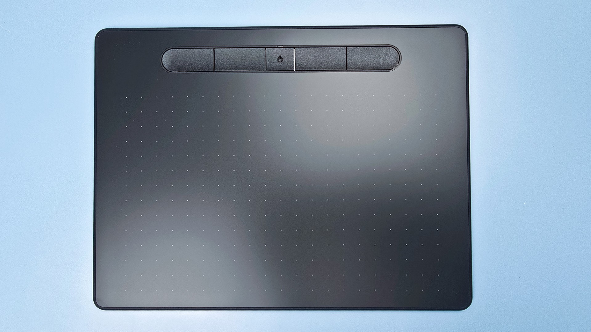
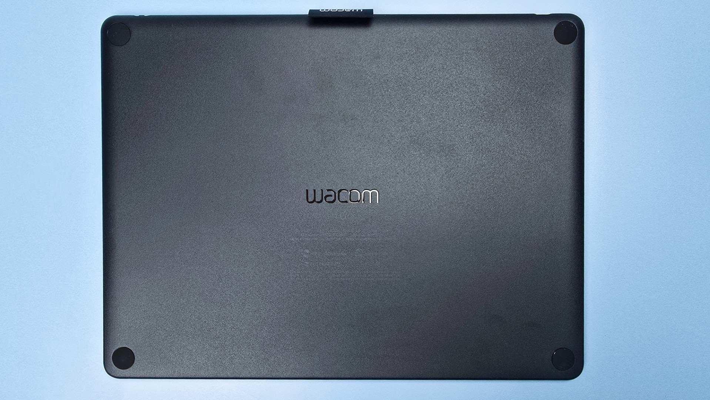
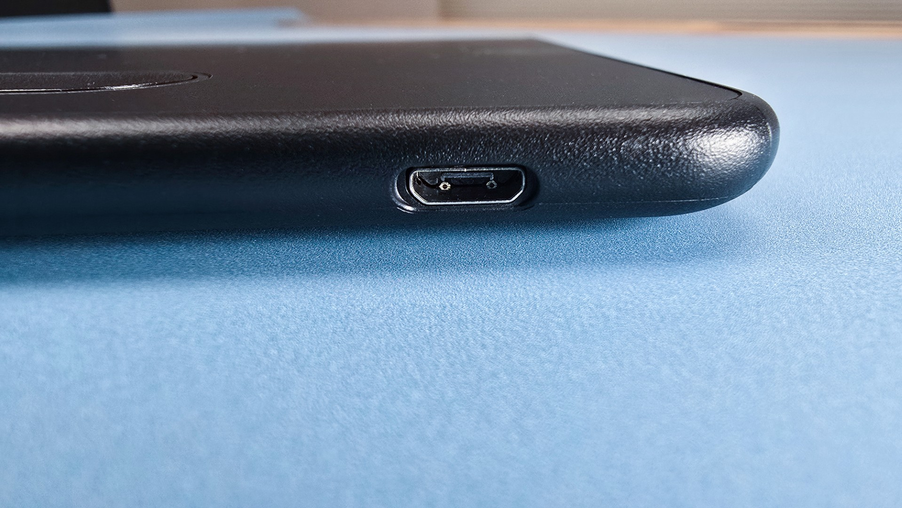
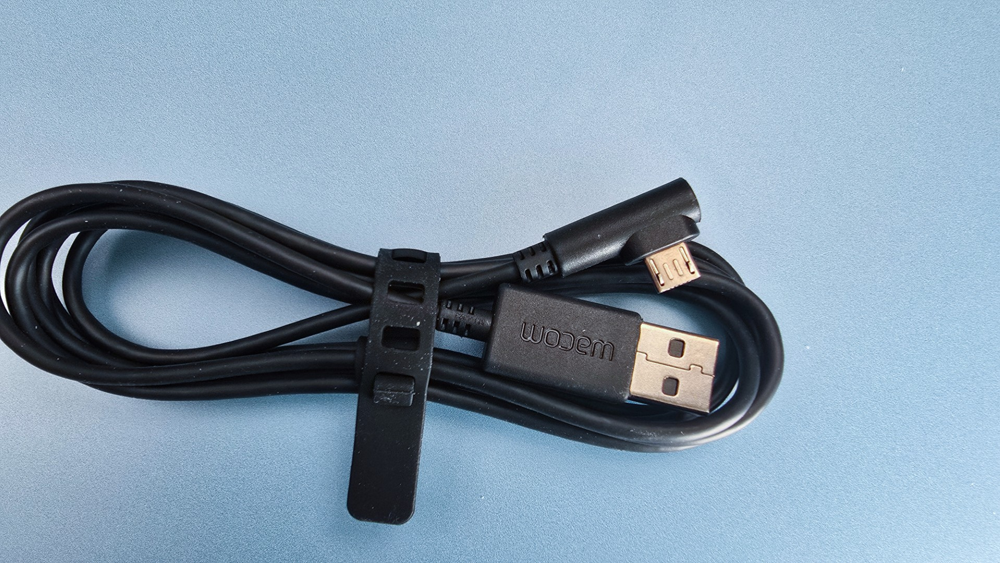
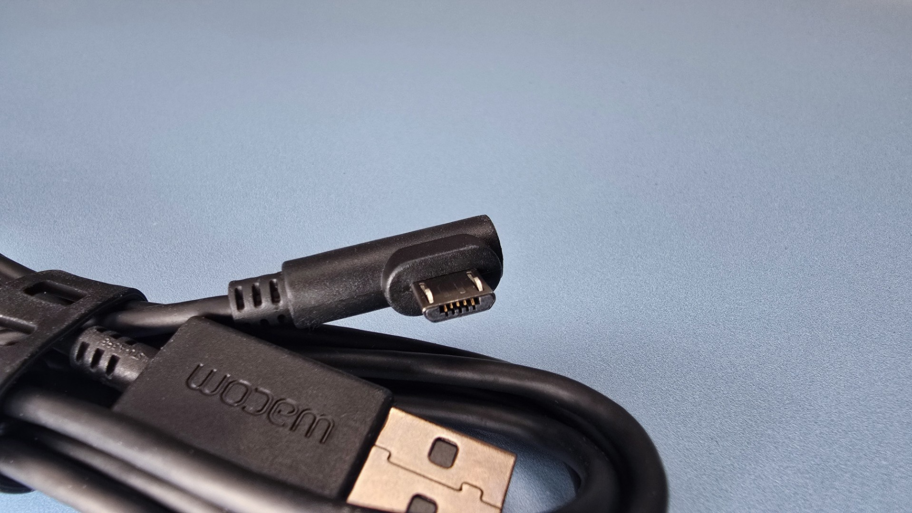
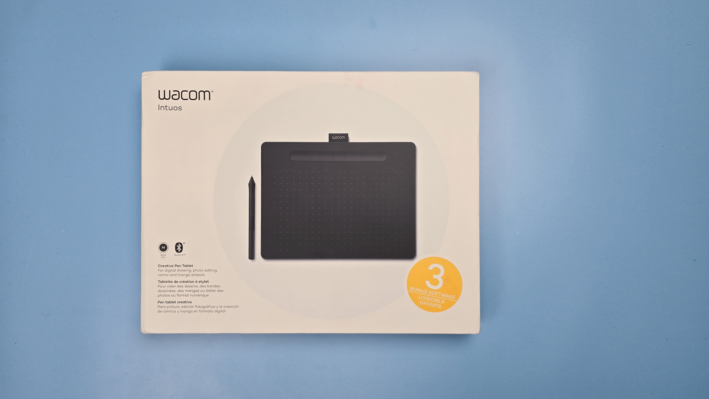
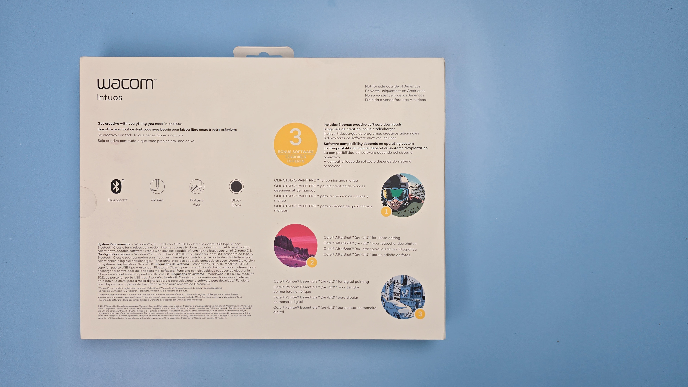

# Wacom Intuos (CTL-x100) notes

## Overview

These are **VERY GOOD** pen tablets from Wacom and still highly competitive with pro tablets from non-Wacom brands. The only real limitation is that they don't support TILT.

<figure><figcaption>
CTL-6100WL
</figcaption></figure>

<figure><figcaption>
CTL-6100WL
</figcaption></figure>

## Core links

* DrawTabData Explorer: [CTL-4100 specs](https://thesevenpens.github.io/DrawTabDataExplorer/entity/wacom.tablet.ctl4100), [CTL-4100WL specs](https://thesevenpens.github.io/DrawTabDataExplorer/entity/wacom.tablet.ctl4100wl), [CTL-6100 specs](https://thesevenpens.github.io/DrawTabDataExplorer/entity/wacom.tablet.ctl6100), [CTL-6100WL specs](https://thesevenpens.github.io/DrawTabDataExplorer/entity/wacom.tablet.ctl6100wl)
* [Product page](https://www.wacom.com/en-us/products/pen-tablets/wacom-intuos#Specifications)
* [Store page](https://estore.wacom.com/en-us/wacom-intuos-s-black-us-ctl4100.html) (CTL-4100)
* [Store page](https://estore.wacom.com/en-US/tablets/wacom-intuos-s-bluetooth-black-us-ctl4100wlk0.html) (CTL-4100WL)
* [Store page](https://estore.wacom.com/en-us/wacom-intuos-m-bluetooth-black-us-ctl6100wlk0.html) (CTL-6100WL)
* [User manual](http://101.wacom.com/UserHelp/en/TOC/CTL-4100.html) (CTL-4100)
* [User manual](http://101.wacom.com/UserHelp/en/TOC/CTL-4100wl.html) (CTL-4100WL)
* [User manual](http://101.wacom.com/UserHelp/en/TOC/CTL-6100.html) (CTL-6100)
* [User manual](http://101.wacom.com/UserHelp/en/TOC/CTL-6100wl.html) (CTL-6100WL)

## Other links

The reviews in this table come from the [DrawTabData Explorer](https://thesevenpens.github.io/DrawTabDataExplorer/entity/wacom.tabletfamily.wacom_intuos_2018). To add or fix a link, change it in DrawTabData.

| Source | Link | Date |
| --- | --- | --- |
| Brad Colbow | [Wacom Intuos Small / Medium (2018) Review](https://www.youtube.com/watch?v=H-ZYte_UOVM) | 2018-03-26 |
| Aaron Rutten | [INTUOS Small & Medium - Wacom Drawing Tablet for Beginners (Review) ✏️](https://www.youtube.com/watch?v=WLclWCHmrjg) | 2018-03-21 |

## Notes on specs

### Pens

* See [Wacom 4K Pen for Intuos (LP-1100K) notes](../../../pens/wacom-pens/wacom-lp1100k-notes.md).

## Non-pen inputs

### Auxiliary inputs

The tablet has its buttons at the top

NOTE: technically there is a fifth button - but that is for turning the bluetooth on and off

## Cables and connectivity

### Ports

There is a single micro USB port on the upper left corner of the tablet.

<figure><figcaption></figcaption></figure>

### Cabling

The tablet comes with a USB-A to Micro USB cable.

<figure><figcaption></figcaption></figure>

<figure><figcaption></figcaption></figure>

### Alternate cabling

You can use a USB-C to Micro-USB adapter. Since I prefer to connect all my pen tablets with the same USB-C connector, I use a female USB-C to male Micro-USB adapter.

## Photos

<figure><figcaption></figcaption></figure>

<figure><figcaption></figcaption></figure>

## Resources

* [Wacom - Playlist: Getting started with your Wacom Intuos pen tablet](https://www.youtube.com/playlist?list=PL5JDtjDGWsw3KRruZfqAwRmbNpAQbW89y)
