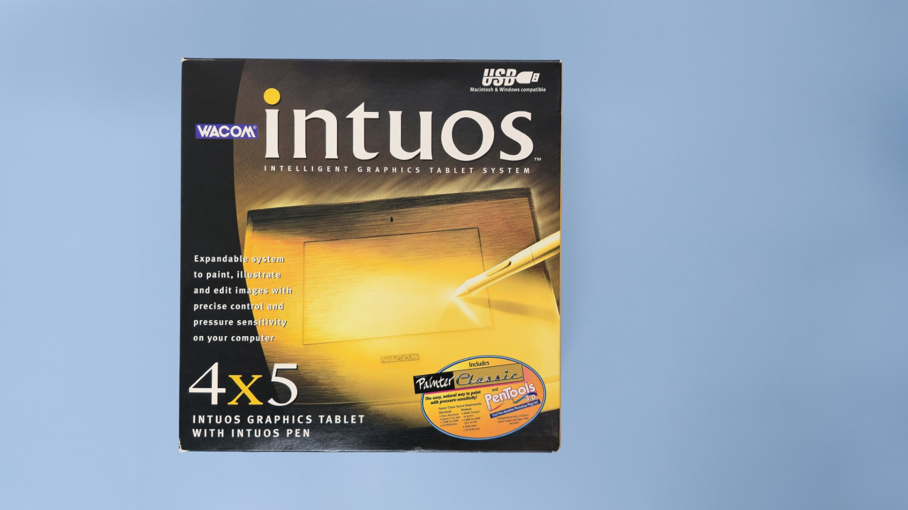
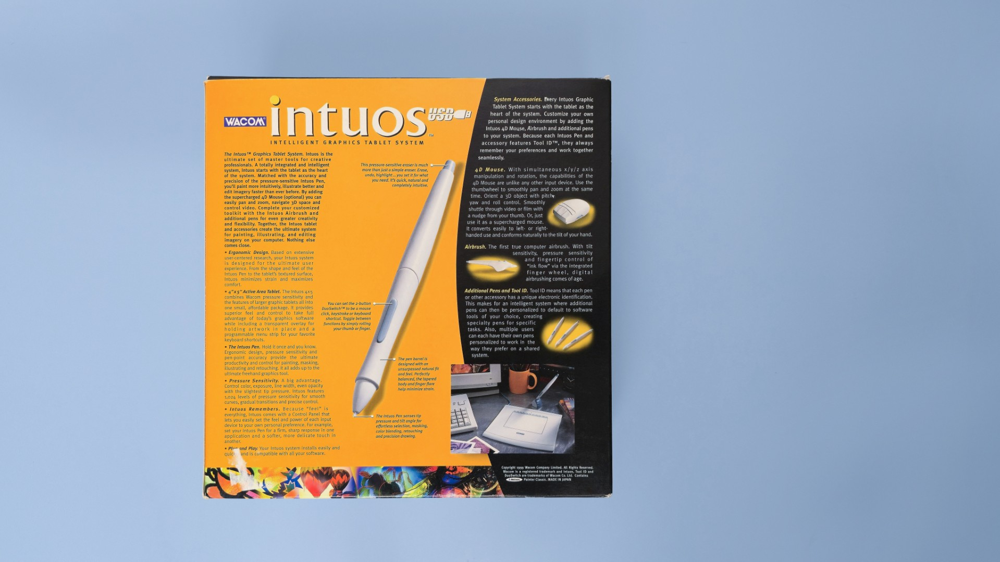

# Wacom Intuos1 (GD-xxxx) notes

## Core links

* DrawTabData Explorer: [GD-0405-U specs](https://thesevenpens.github.io/DrawTabDataExplorer/entity/wacom.tablet.gd0405u), [GD-0608-U specs](https://thesevenpens.github.io/DrawTabDataExplorer/entity/wacom.tablet.gd0608u), [GD-0912-U specs](https://thesevenpens.github.io/DrawTabDataExplorer/entity/wacom.tablet.gd0912u), [GD-1212-U specs](https://thesevenpens.github.io/DrawTabDataExplorer/entity/wacom.tablet.gd1212u), [GD-1218-U specs](https://thesevenpens.github.io/DrawTabDataExplorer/entity/wacom.tablet.gd1218u)
* [User manual](https://101.wacom.com/productsupport/manual/IntuosUserManual.pdf)

## Name

This was the first introduction of the “Intuos” name into their products.

At this time, the name “Intuos” indicated that a tablet was part of Wacom's professional pen tablet series. It was only some years later that Wacom decided to use "Intuos" for its consumer tablets and Intuos Pro for the professional tablets.

## Other links

The reviews in this table come from the [DrawTabData Explorer](https://thesevenpens.github.io/DrawTabDataExplorer/entity/wacom.tabletfamily.wacom_intuos1_1998). To add or fix a link, change it in DrawTabData.

| Source | Link | Date |
| --- | --- | --- |
| EyekooDrawsStuff | [This 23 year old tablet is still going!](https://www.youtube.com/watch?v=eXgcuOzg1-M) (GD-1212-U) | 2021-10-27 |

* [S-Config - Original Wacom GD-0912-R on Windows 7 x64 ](https://www.s-config.com/original-wacom-gd-0912-r-on-windows-7-x64/)([archive](https://archive.is/oeUFc))

## Photos

<figure><figcaption></figcaption></figure>

<figure><figcaption></figcaption></figure>

## Connections and cabling

The Intuos2 series that followed connected via USB and serial and no longer supported Apple Desktop Bus (ADB) connections.
