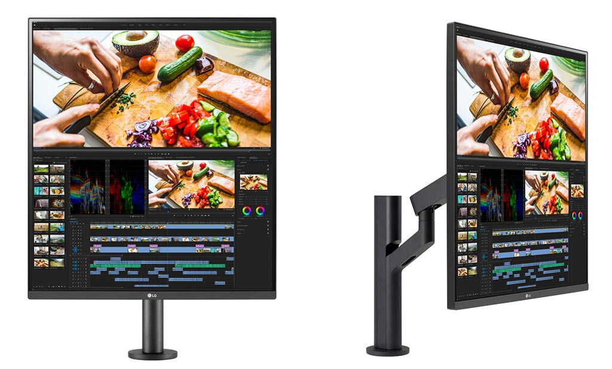
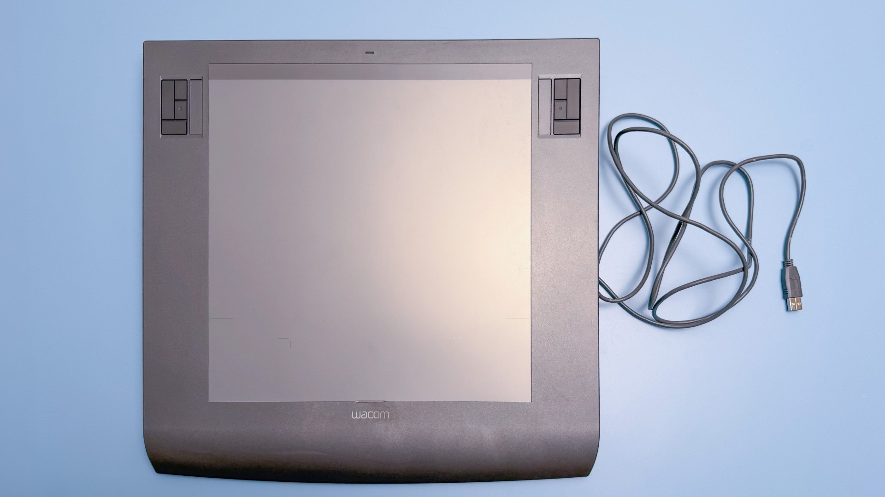
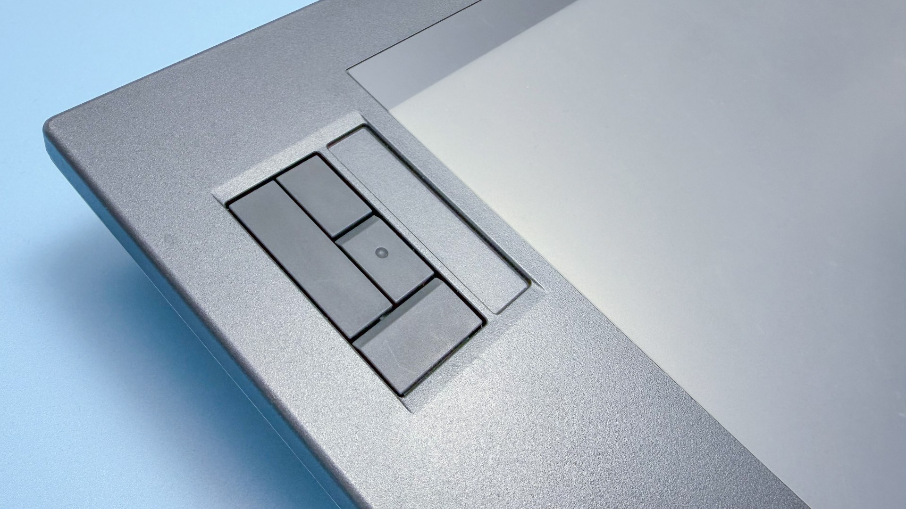
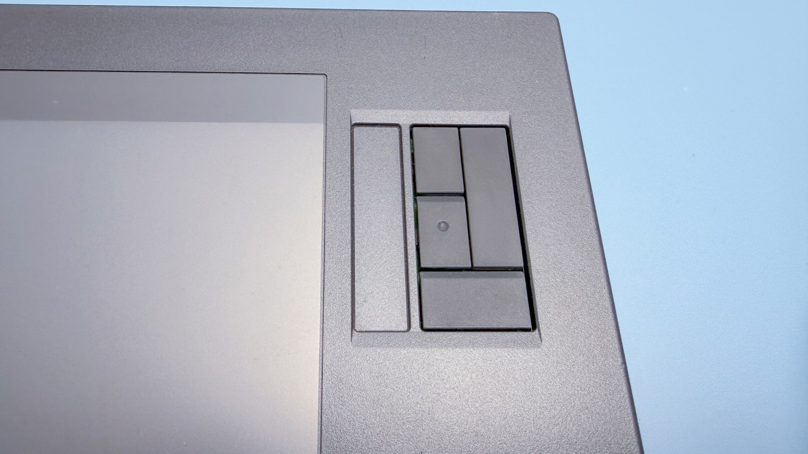
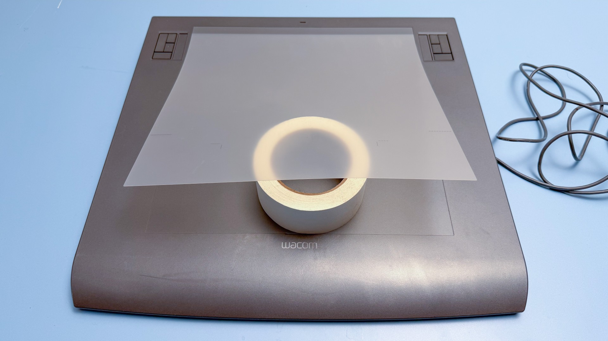
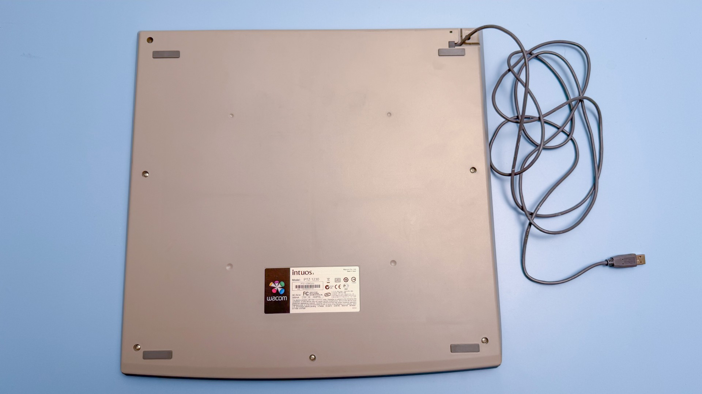
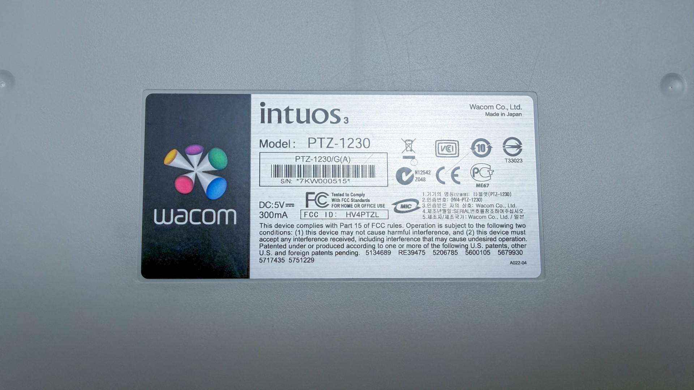
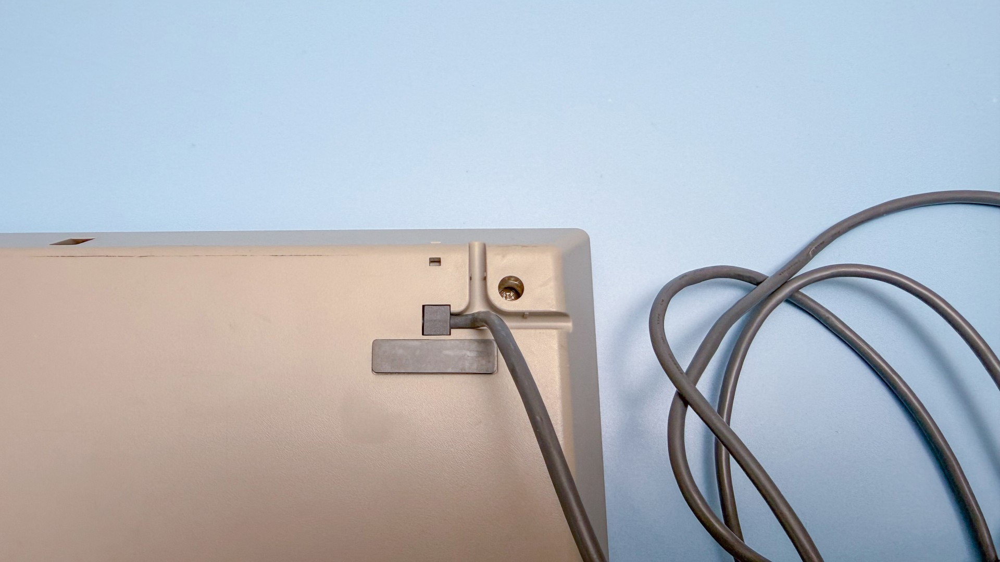
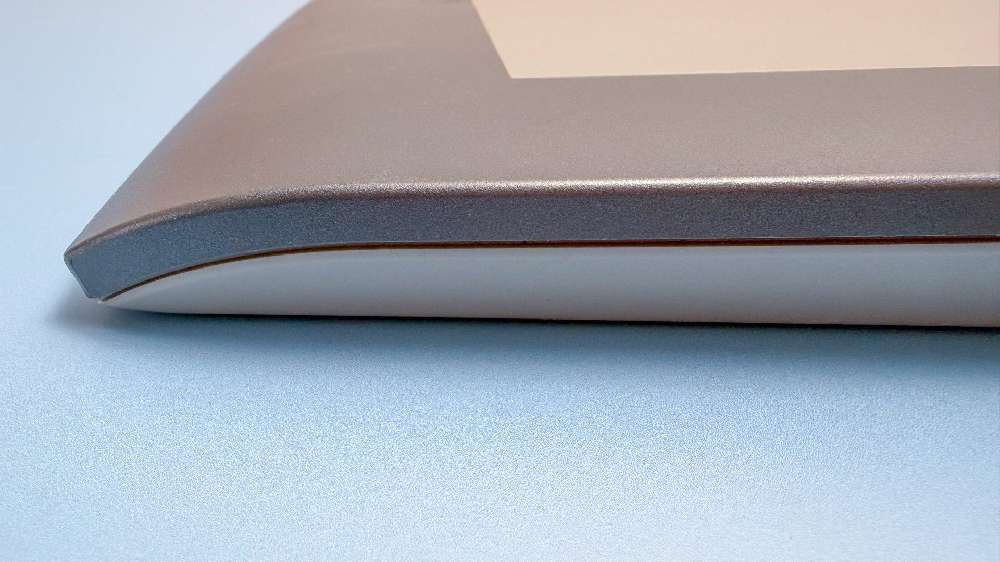
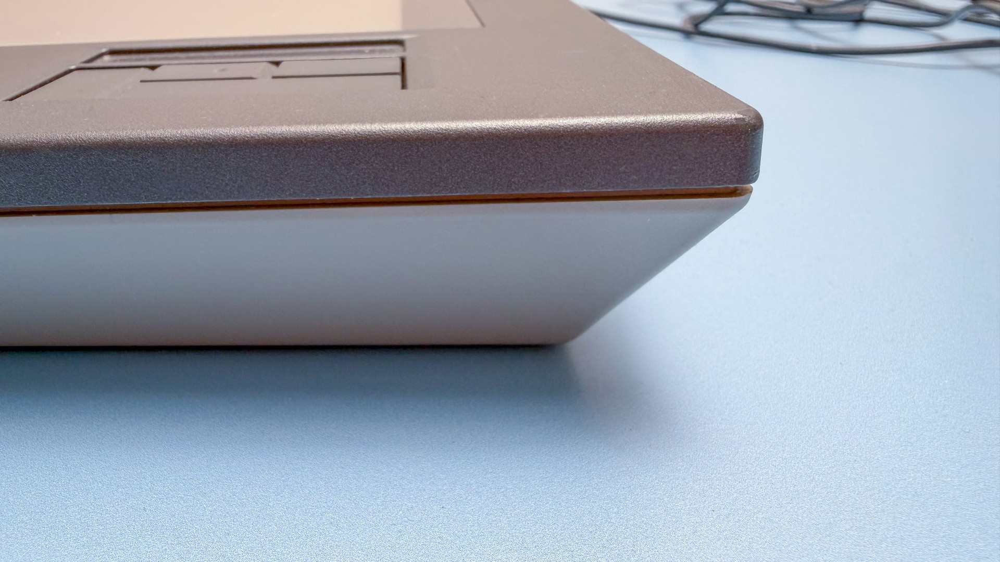

# Wacom Intuos3 12x12 (PTZ-1230) notes

## Overview

Released in 2004, the PTZ-1230 is the last of Wacom's pen tablets with a square aspect ratio.

## Official resources

* [User manual](https://cdn.wacom.com/u/productsupport/manuals/Intuos3/User%27s%20Manual.pdf)

## Links

These links come from the [DrawTabData Explorer](https://thesevenpens.github.io/DrawTabDataExplorer/entity/wacom.tabletfamily.wacom_intuos3_2004). To add or fix a link, change it in DrawTabData.

| Source | Link | Date |
| --- | --- | --- |
| DrawTabData Explorer | [PTZ-1230 specs](https://thesevenpens.github.io/DrawTabDataExplorer/entity/wacom.tablet.ptz1230) |  |

## Pairing it with a Monitor

Because this Pen display has a 1:1 aspect ratio, it will work better if your monitor also has a close to one-to-one aspect ratio. Of course, you can enable the "force proportions" setting so that it works with any monitor, but with a 1:1 aspect ratio monitor, you'll be able to use the full active area to draw with. I used it with the 28-inch LG DualUp monitor (28MQ780-B) which has an aspect ratio of 16:18. So, while it's not perfectly square, it is very close. I also enabled "force proportions" in the Wacom driver. Initially, I thought using this unusual 1:1 aspect ratio tablet would feel very weird, but actually, it felt totally fine to use. It wasn't uncomfortable or unnatural.

<figure><figcaption>
LG DualUp monitor (28MQ780-B)
</figcaption></figure>

## Usage notes

* This Pen tablet is very thick, which is normal for tablets of this generation.&#x20;
* This device does not support wireless, as wireless support was not a feature in this generation of tablets.

## Photos

<figure><figcaption></figcaption></figure>

<figure><figcaption></figcaption></figure>

<figure><figcaption></figcaption></figure>

<figure><figcaption></figcaption></figure>

<figure><figcaption></figcaption></figure>

<figure><figcaption></figcaption></figure>

<figure><figcaption></figcaption></figure>

<figure><figcaption></figcaption></figure>

<figure><figcaption></figcaption></figure>
