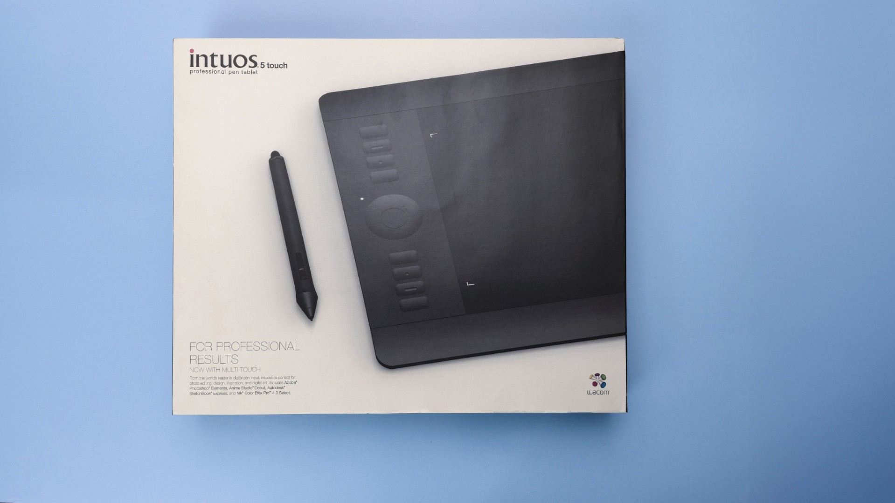
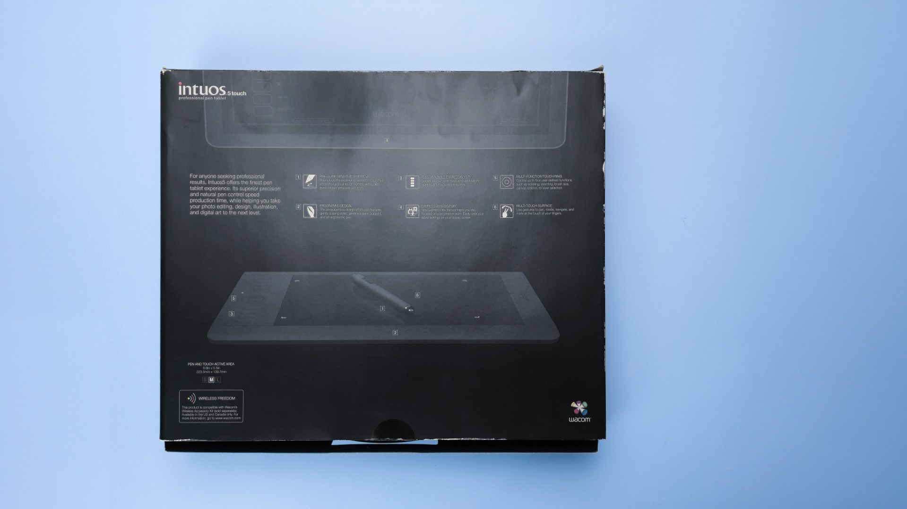

# Wacom Intuos5 (PTH-x50/PTK-x50) notes

## Name

This is the last time "Intuos + Number" was how these professional pen tablets were named.

## Core links

* [User manual](https://cdn.wacom.com/f/manuals/en/Intuos5-Users-Manual.pdf) · [Series specs in DrawTabData Explorer](https://thesevenpens.github.io/DrawTabDataExplorer/entity/wacom.tabletfamily.wacom_intuos5_2012)
* **Intuos5 touch Small** (PTH-450): [Specs](https://thesevenpens.github.io/DrawTabDataExplorer/entity/wacom.tablet.pth450)
* **Intuos5 touch Medium** (PTH-650): [Specs](https://thesevenpens.github.io/DrawTabDataExplorer/entity/wacom.tablet.pth650)
* **Intuos5 touch Large** (PTH-850): [Specs](https://thesevenpens.github.io/DrawTabDataExplorer/entity/wacom.tablet.pth850)
* **Intuos5 Small** (PTK-450): [Specs](https://thesevenpens.github.io/DrawTabDataExplorer/entity/wacom.tablet.ptk450)
* **Intuos5 Medium** (PTK-650): [Specs](https://thesevenpens.github.io/DrawTabDataExplorer/entity/wacom.tablet.ptk650)

## Photos

<figure><figcaption></figcaption></figure>

<figure><figcaption></figcaption></figure>

## Other links

The reviews in this table come from the [DrawTabData Explorer](https://thesevenpens.github.io/DrawTabDataExplorer/entity/wacom.tabletfamily.wacom_intuos5_2012). To add or fix a link, change it in DrawTabData.

| Source | Link | Date |
| --- | --- | --- |
| New Brit Workshop (Peter) | [Wacom Intuos 5 Medium Touch Tablet Review](https://www.youtube.com/watch?v=KXoYgYUdVyY) (PTH-650) | 2013-01-22 |
| Parka Blogs | [Review: Wacom Intuos5 Medium Touch Tablet](https://www.parkablogs.com/content/review-wacom-intuos5-medium-touch-tablet) (PTH-650) | 2012-12-03 |
| Terry Lee White | [Wacom Intuos 5 Review](https://www.youtube.com/watch?v=4bNXtZCVg54) | 2012-03-15 |

## Resources

* [Sara Dietschy - Wacom Tablet Small Intuos Pro VS Medium Intuos5 | Which One To Get / Size Comparison](https://www.youtube.com/watch?v=MeJ6DvJCjUk) 2015-02-10
