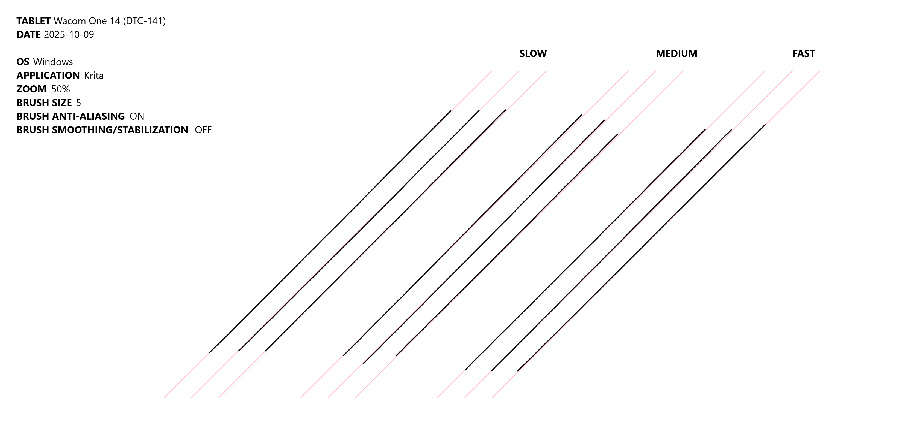
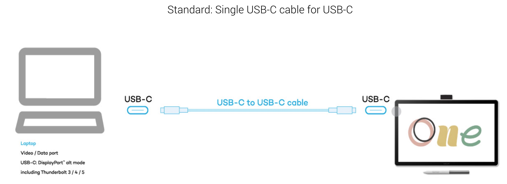
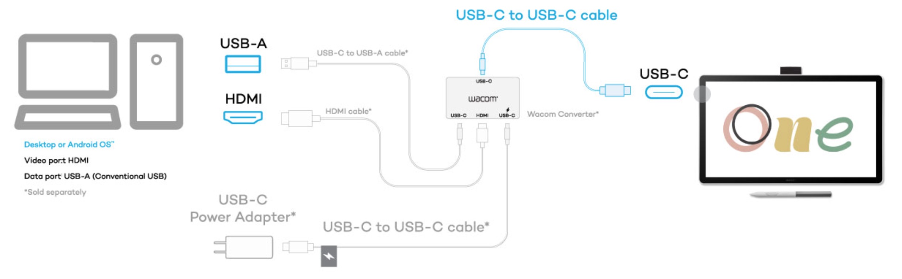

# Wacom One 14 (DTC-141) notes

## Summary

The Wacom One (DTC-141) is a decent entry level consumer pen display with OK drawing performance at a competetive price.

* The OK rating for drawing performance is due to the physical pressure range of the pen which has a HIGH IAF and LOW maximum physical pressure.
* The tablet will require buying $100+ of additional accessories if you need to connect to your computer with HDMI. HDMI will be almost certainly needed to connect it to desktop computers.

This tablet makes sense for the following scenarios:

* someone's first pen display
* a good tablet for a beginner
* light artistic work
* for use in education or communication or online meetings

**Ensure you understand how it will connect to your computer.** This tablet is intended to connect to your computer via the provided USB-C cable. You MUST make sure your USB-C port on your computer meets all the requirements. It is possible to connect to your computer via HDMI. However, this requires the purchase of the Wacom Converter ($80) and additional cables.

## Core links

* DrawTabData Explorer: [DTC-141 specs](https://thesevenpens.github.io/DrawTabDataExplorer/entity/wacom.tablet.dtc141)
* [Product page](https://www.wacom.com/en-us/products/wacom-one)
* [Store page](https://estore.wacom.com/en-us/wacom-one-14-dtc141w0.html)
* [User manual](https://101.wacom.com/UserHelp/en/TOC/DTC141.html)
* [Product information](https://www.wacom.com/en-us/products/pen-displays/wacom-one)

## Video

## Other links

The reviews in this table come from the [DrawTabData Explorer](https://thesevenpens.github.io/DrawTabDataExplorer/entity/wacom.tabletfamily.wacom_ondpendisplaygen2). To add or fix a link, change it in DrawTabData.

| Source | Link | Date |
| --- | --- | --- |
| Aaron Rutten | [Wacom One 14 Review (with Comparisons to 13 Touch & MovinkPad)](https://www.youtube.com/watch?v=XDZzzs6e7zU) | 2026-02-05 |
| Brad Colbow | [Wacom One 14 Review](https://www.youtube.com/watch?v=GKxx9Vwz79U) | 2025-11-10 |
| Seven Pens | [Notes on Wacom One 14 (DTC-141)](https://www.youtube.com/watch?v=eDu-6BBp8JI) | 2025-10-15 |
| Seven Pens | [DRAFT Review of Wacom One 14 (DTC-141)](https://www.youtube.com/watch?v=v8kZk0eldHI) | 2025-10-10 |
| Seven Pens | [Unboxing and Testing: Wacom One 14 (DTC-141)](https://www.youtube.com/watch?v=mz7-ufAIXcw) | 2025-09-29 |

## Notes on specs

### Device

* I bought mine in September 2025. It cost about $300, which is a competitive price for a Wacom pen display.
* In the box
  * Wacom One Standard Pen (CP-923)
  * Nib remover and 3 replacement nibs
  * USB-C to USB-C cable
  * A 3-in-1 cable is NOT included
* Only a single USB-C port and two buttons (power and OSD menu)
* No legs, no included stand, and no VESA mounting holes
* Size comparisons
  * Much smaller bezels than older Wacom One models - about a third of the width of the [Wacom One 13 2019 (DTC-133)](wacom-dtc133-notes.md) bezels
  * Compared to the [Wacom One 13 touch (DTH-134)](wacom-one-2023-pen-displays-notes.md): the same width but not as tall. Its bezels are about half the width on the sides and about a quarter at the bottom. The DTH-134 has two USB-C ports.
  * Thinner than the DTC-133, but nowhere near as thin as the [Movink 13 (DTH-135)](../wacom-movink/wacom-dth135-notes.md). The Movink 13 is almost the same height (a couple of millimeters taller) and not quite as wide.
  * Compared to the [Huion Kamvas 13 Gen 3 (GS1333)](../../huion/huion-gs1333-notes.md): the same height. The Kamvas is wider because of its buttons, and its bezels are about twice as big.

### Display

* Lamination: Described as "Direct Bonding"
* Contrast ratio: 1000:1
* Full HD (1920x1080). I was a little concerned about the resolution at first, but it's fine and it looks nice. Some people will want the next resolution up.
* At 50% brightness it was fine for me to use

### Pens

* Included pen: [Wacom One 2023 Standard Pen (CP-923) notes](../../../pens/wacom-pens/wacom-cp923-notes.md)
  * High consumer-level IAF
  * OK pressure range
  * Replacement cost: $35
* UD EMR pens. See [Pens that support UD EMR 2nd gen](../../../../tech/wacom-ud-emr/ud-emr-pens.md)
* I tested these pens and they worked fine
  * Samsung S Pen
  * Staedtler Noris Digital
  * Staedtler Noris Digital Jumbo
  * Staedtler Mars Lumograph digital
  * Wacom One pen (CP-913) - I tested four units. If I had to guess, they have a slightly lower IAF than the CP-923, but I wouldn't bet on it. See [Wacom CP-913 notes](../../../pens/wacom-pens/wacom-cp913-notes.md)
* The CP-923 has two buttons (a rocker switch). The CP-913 has only one button.
* 4,096 pressure levels. You don't really need more than 2,000, so this is plenty.
* Incompatible pens: all Wacom pro pens are incompatible
  * Example: Pro Pen 2, Pro Pen 3, Art Pen, etc.
  * With an incompatible pen you might see the pen move the pointer, but the pressure or the buttons (usually both) won't work

## Display

### Anti-glare sparkle

LOW (GOOD)

On the low end. You see a slight brightness variation more than rainbow sparkle. Not as good as a Cintiq Pro, but normal for Wacom.

### Viewing angles

Very good. Almost no color shift at extreme angles.

### Surface protection

the tablet does NOT come with a screen protector

* The surface is etched anti-glare and anti-fingerprint glass. It is not a matte film.
* Wacom doesn't sell a screen protector for it as an optional accessory. If you are worried about scratching the glass, consider a third-party screen protector - for example from Photodon.

### Display sharpness

Very good. Pixels are clear and well-delineated.

### OSD menu

* The button toward the top is power. The one toward the bottom opens the OSD menu.
* Color modes: Native, sRGB, and Custom. In sRGB you control brightness but not contrast. Custom adds color temperature and RGB controls.
* Other settings include language, menu transparency, LED luminance, the power button behavior, and the pen side switch.
* Navigating the OSD with the buttons is a little confusing - this is a case where I miss touch.

## Pixelation

As expected slightly more pixelation (slightly lower PPI) than previous Wacom One tablet that have same native resolution but are 13" instead of 14".

I did not notice the difference in practive.

## Drawing performance

The drawing performance OK. It's not bad. However, it does not match the excellent experience you would see with a Wacom Cintiq or Wacom Cintiq Pro and their professional pens.

* The Cintiq and the Movink 13 are better to draw on - largely because of the pen. The difference with the Pro Pen 2 or Pro Pen 3 is astounding.
* If you are used to a Pro Pen, you will definitely notice the high IAF, and you'll hit the max pressure easily. Pressure is harder to control. It's not bad - it's just OK.

### **Static tracking accuracy**

* EXCELLENT. The pointer is directly under the tip of the pen across the entire surface when the pen is held perpendicular to the tablet
* Like all pen displays, there is a little deviation in the last 2mm at the edges

### Tilt compensation

* EXCELLENT. At all angles the pointer is very close to the tip of the pen.
* In my browser pen tester, tilt altitude and tilt azimuth changed smoothly with no unexpected jumps

### Diagonal wobble

* Low wobble at all strokes speeds
* In Krita, weighted smoothing at level 30 removed the wobble
* In comparison, Wacom Movink 13 has less notably diagonal wobble

<figure><figcaption></figcaption></figure>

### Pointer lag

OK. Typical for a pen display of this size.

### Artifacts at low pressure

TYPICAL. Drawing near IAF with large brushes (ex: 300px) you might see some blobby strokes. Can control with pressure curves and pressure smoothing.

### Pressure banding

EXCELLENT. No pressure banding observed.

* I did a constant-pressure test in Clip Studio Paint: the Milli pen at 99px with pressure mapped linearly to opacity, drawing slowly up and down. I saw no regular bands. A few people watching my stream thought they saw slight banding, but I think that was my hand.
* I also looked for the regular pressure pulsation (pressure wobble) at low pressure that I saw with the Wacom One M and S pen tablets. I did not see it.
* In my browser pen tester, mapping pressure to color showed smooth transitions with no weird jumps

### Pressure range (IAF and MAX)

See my notes on the Wacom One Standard Pen (CP-923) - [Wacom One 2023 Standard Pen (CP-923) notes](../../../pens/wacom-pens/wacom-cp923-notes.md)

### Pressure scan rate

EXCELLENT. No missed strokes during fast input of 50 strokes

### Pressure Banding

GOOD. DIsplayed NO pressure banding.

### Parallax

VERY GOOD (LOW)

I was surprised by how low it is. Probably not as good as the Movink 13, but pretty good.

## Pressure curves

The "Tip feel" slider in the Wacom One application controls the pressure curve. However the curve itself is not shown in the Wacom Center, just the slider.

### Surface texture

* OK. Light surface texture. Typical of many pen displays
* Feels similar to MovinkPad 11 or Movink 13
* Pen does NOT feel slippery on the glass
* Enough texture to draw well
* Side by side, the Movink 13 has a bit more texture

## Ergonomics

### Noise

None. Completely silent. Has no fans to cause noise.

### Heat

Stayed cool to the touch even at 100% brightness brightness

### Stand

* For this tablet, Wacom suggestes the Wacom Foldable Stand (ACK652Z). This costs $100
* I used the tablet with a Parblo PR-100 stand

## Other inputs

### Touch

If you need touch, consider these tablets:

* Wacom Movink 13 (DTH-135)
* Wacom One 13 touch (DTH-134)

### Buttons, dials, and audio

None. No express keys, no dials, no audio, and no auxiliary inputs.

### Using it as a pen tablet

* I set the power button to "display off" hoping to draw with the screen off. Turning off the display also turns off the pen.
* On Windows you can tell the OS to disconnect a display. I couldn't find that option on macOS.
* You can map the pen to another monitor with Display Toggle on a pen button. However, there's no Force Proportions setting and no Mapping tab in Wacom Center, so circles come out distorted. If you want a pen tablet, get a pen tablet.

## Connections and cabling

### USB-C connection

<figure><figcaption></figcaption></figure>

The tabet comes with a USB-C cable to achieve a single cable connection to your computer.

You computer's USB-C port needs to meet the requirements for this to work. See: [Connecting a pen display with USB-C](../../../../guides/connecting/connecting-pen-display/connecting-pen-display-usbc.md)

* Both the cable and the port on your computer need to support DisplayPort, power, and data. That's a pretty high requirement, and many people don't have a port like that.
* Using it with a phone may not work well. A phone likely won't provide enough power for it.
* Because there's only one USB-C port, if you ever need extra power you will have to use the Wacom Converter.

### HDMI connection

Instead of USB-C, the tablet CAN connect via HDMI. However it DOES NOT include the cables you need for this. AND it requires very a specific accessory for this to work.

<figure><figcaption></figcaption></figure>

You need to purchase:

* Wacom Converter device
* USB-A to USB-C cable for data
* HDMI cable
* USB-C to USB-C cable for power
* USB-C power adapter

The Wacom Converter costs $80. If you need to connect via HDMI then you are going to end up spending more than $100.

* I tested the Wacom Converter with separate cables for power, data, and HDMI connected to my MacBook. The display and the pen worked.
* With the converter plus cables, the total for someone who needs HDMI comes to around $450. When you add it up, it's not a great deal for that person.
* I'm afraid people will buy it because it's $300 and then discover after they buy it that they can't use it. Wacom should have included a 3-in-1 cable.

### Notes on alternative cabling

Older Wacom one tablets use their own cables for HDMI connection. I've tested and they WILL NOT WORK with this device. Here are the cables that DO NOT work:

* Wacom One X-Shape Cable (ACK44506Z) - will not work with DTC-141
* Wacom One 3 In 1 Cable (ACK4490602Z) - does not work with DTC-141

I tried the Wacom One 3-in-1 cable with power from several dock ports and directly from my MacBook. In every case the tablet would not power on.

## Compared to Huion Kamvas 13 Gen 3

The [Huion Kamvas 13 Gen 3 (GS1333)](../../huion/huion-gs1333-notes.md) cost about $225 when I checked (September 2025). It includes a 3-in-1 cable and has a better pen. Even if you add about $30 for a USB-C cable, it's a much better deal. I think it's still the better choice.

However, if you want a more established brand and your computer has a full-featured USB-C port, I have no hesitation recommending the Wacom One 14. Wacom is still the most reliable brand on the market.
