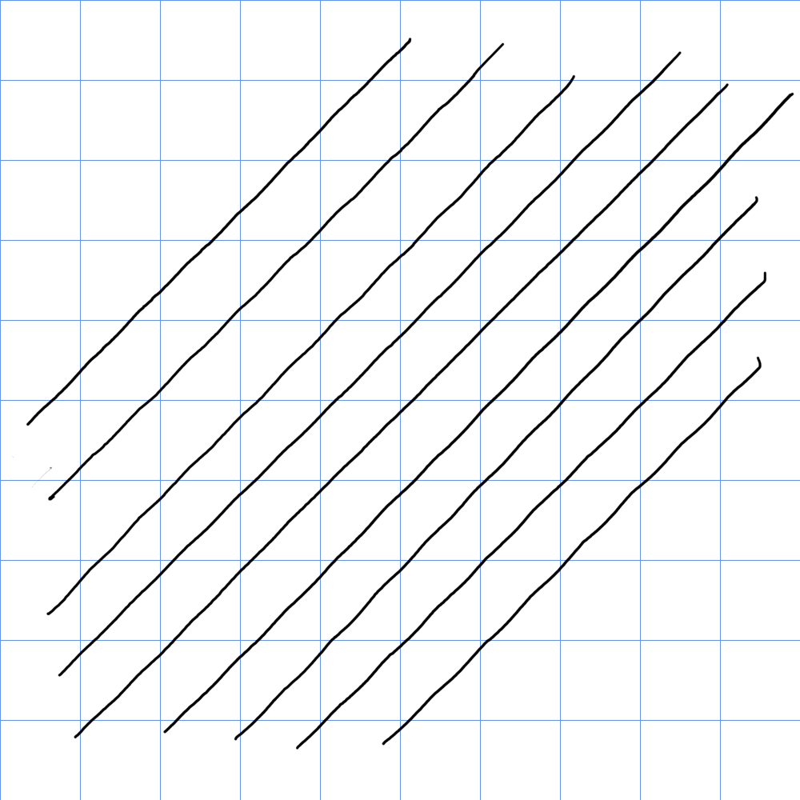
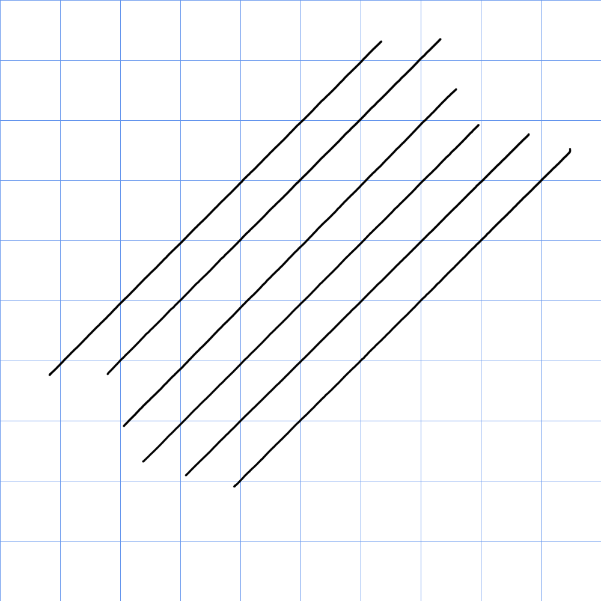

# XP-Pen Artist 12 Gen2 (CD120FH) notes

## Summary

I have this tablet but haven't used it extensively. Overall seemed like a decent tablet.

* The X3 Elite pen it came with had a good physical pressure range.
* The display has low amounts of anti-glare sparkle.
* The tablet exhibited a little more diagonal wobble than I normally like but smoothing/stabilization should help. The Artist 13 GEN2 unit has less diagonal wobble.

## Links

These links come from the [DrawTabData Explorer](https://thesevenpens.github.io/DrawTabDataExplorer/entity/xppen.tabletfamily.xppen_artistgen2). To add or fix a link, change it in DrawTabData.

| Source | Link | Date |
| --- | --- | --- |
| DrawTabData Explorer | [CD120FH specs](https://thesevenpens.github.io/DrawTabDataExplorer/entity/xppen.tablet.cd120fh) |  |
| XP-Pen | [Product page](https://www.xp-pen.com/product/artist-12-2nd-gen.html) |  |
| XP-Pen | [Store page](https://www.xp-pen.com/store/buy/artist-12-2nd-gen.html) |  |
| XP-Pen | [User manual](https://www.xp-pen.com/user-manual/artist-12-2nd.html) |  |
| EyekooDrawsStuff | [A cheap drawing tablet with a screen - XPPEN's Artist 12 2nd Gen Review](https://www.youtube.com/watch?v=CJuDEe3qyl8) | 2022-11-18 |
| Brad Colbow | [XP-Pen Artist 12 (2nd Gen) review](https://www.youtube.com/watch?v=O6OzBT7BLsA) | 2021-12-13 |
| Teoh on Tech | [XP-Pen Artist 12 (2nd gen) review: HUGE improvement over 1st gen](https://www.youtube.com/watch?v=M0ULxV-oOf0) | 2021-11-19 |
| Parka Blogs | [XP-Pen Artist 12 (2nd gen)](https://www.parkablogs.com/content/review-xp-pen-artist-12-2nd-gen-gift-edition) |  |

## Notes on specs

### Pens

* Included pen: OK IAF and a GOOD pressure range. More here: [XP-Pen X3 Elite pen notes](../../pens/xppen-pens/xppen-x3elitepen-notes.md)

## Pen tracking 

* I agree with XP-Pens accuracy numbers

## Diagonal wobble

<figure><figcaption>
Diag Wobble XP-Pen Artist 12 GEN2 (CD120FH)
</figcaption></figure>

Compare to the Artist 13 GEN2

<figure><figcaption></figcaption></figure>

## Pen pressure range 

See: [XP-Pen X3 Elite pen notes](../../pens/xppen-pens/xppen-x3elitepen-notes.md)

## Pointer lag 

TYPICAL for a pen display - very slightly more than typical. But not by much.

## Parallax

VERY GOOD. The tip of the pointer aligns very closely with the tip of the pen.
