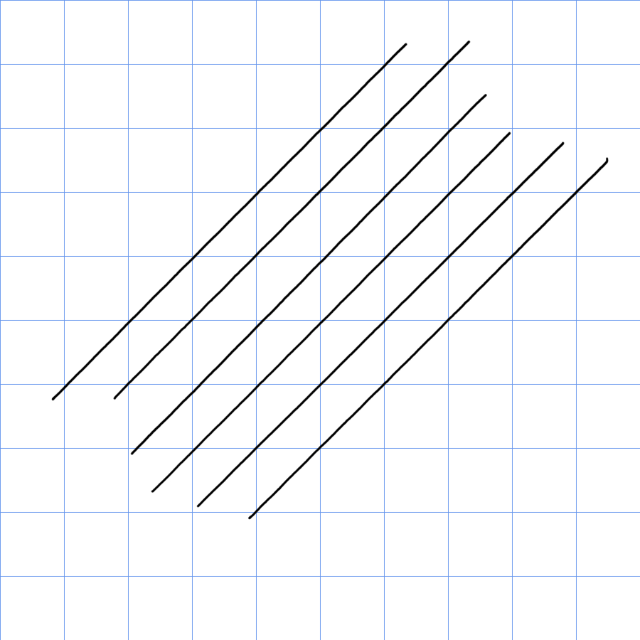

# XP-Pen Artist 13 GEN2 (CD130FH) notes

## Overall

Decent tablet. Not the ultimate drawing experience but I think it will server a lot of people well and is a good beginner tablet.

## Official resources

* [Product page](https://www.xp-pen.com/product/artist-13-2nd-gen.html)
* [Store page](https://www.xp-pen.com/store/buy/artist-13-2nd-gen.html)
* [User manual](https://www.xp-pen.com/user-manual/artist-13-2nd.html)
* [Product information](https://www.xp-pen.com/ie-store/buy/artist-13-2nd-generation.html)

## Basics

* [user manual](https://download01.xp-pen.com/file/2022/07/Artist%20Series%20Drawing%20Display%20\(2nd%20Gen\)\(English\).pdf)

## Links

These links come from the [DrawTabData Explorer](https://thesevenpens.github.io/DrawTabDataExplorer/entity/xppen.tabletfamily.xppen_artistgen2). To add or fix a link, change it in DrawTabData.

| Source | Link | Date |
| --- | --- | --- |
| DrawTabData Explorer | [CD130FH specs](https://thesevenpens.github.io/DrawTabDataExplorer/entity/xppen.tablet.cd130fh) |  |
| Gartzia Artz | [XP PEN Artist 13 2ª Gen Review en Español \| Una tableta gráfica perfecta para empezar a dibujar](https://www.youtube.com/watch?v=8_5yF-jx8D4) | 2022-10-28 |
| Teoh on Tech | [XP-Pen Artist 13 (2nd gen) review](https://www.youtube.com/watch?v=-q_eFIuibnc) | 2022-09-27 |
| Teoh on Tech | [XP-Pen Artist 10 & 13 (2nd gen) Unboxing and Impression](https://www.youtube.com/watch?v=Exj2PZu4MHM) | 2022-08-18 |
| Parka Blogs | [Review: XP-Pen Artist 13 (2nd gen)](https://www.parkablogs.com/content/review-xp-pen-artist-13-2nd-gen) |  |

## Notes on specs

### Device

* The ports are on the side
* Note that the ports are deeply recessed into wells.

### Pens

* Included pen: OK IAF and a GOOD pressure range. More here: [XP-Pen X3 Elite pen notes](../../pens/xppen-pens/xppen-x3elitepen-notes.md)

## Pen

### Pen tracking 

* Accuracy in edges and corners is good.
* I agree with XP-Pens accuracy numbers

## Diagonal wobble

EXCELLENT. very little wobble. at all stroke speeds.

These are 10cm lines - each drawn over 4 seconds. V

<figure><figcaption></figcaption></figure>

### Anti-glare sparkle 

Amount of AG sparkle is at the LOW end of MODERATE

I didn't find the sparkle distracting. And I don't notice it at my normal eye distance when drawing.

It has more sparkle than the Wacom One (DTC-133) but less than the Huion Kamvas 13.

## Drawing Experience 

These things worked well

* drawing lots of dots
* drawing many small quick tiny low pressure lines - hatching
* keeping pressure constant
* moving between high and low pressure smoothly
* Line Tapering - typical

## Pen pressure range 

See: [XP-Pen X3 Elite pen notes](../../pens/xppen-pens/xppen-x3elitepen-notes.md)

## Pointer lag 

TYPICAL for a pen display - very slightly more than typical. But not by much.

## Parallax

VERY GOOD. The tip of the pointer aligns very closely with the tip of the pen.

## Cables and connections

Comes with a a 3-in-1 cable. Which I didn't use.

Instead I my own Thunderbolt 3 cable.

because the USB-C ports are in deep wells, my TB3 cable has ends that are too thick to fit in the well. I had to chop away some plastic to make it fit.

## Using a single-USB-C cable

This works. I was able to use it with a single USB-C cable
