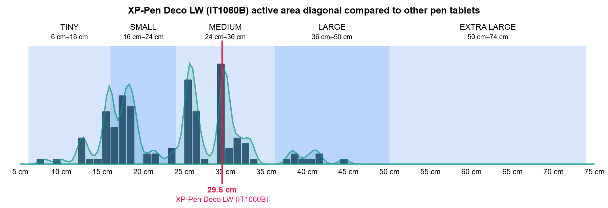
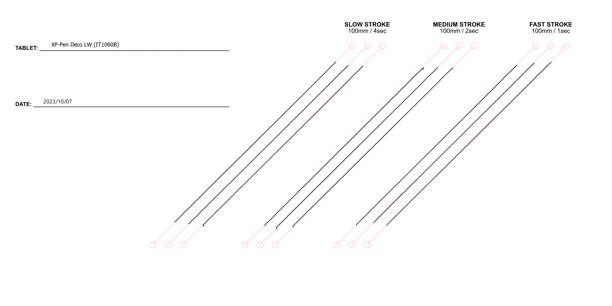

# XP-Pen Deco LW (IT1060B) notes

## Summary

A fine tablet for drawing! And it makes an excellent choice for beginners. And is a great non-Wacom choice. It has a reasonable cost, has available wireless support, has a good pen, and has buttons. It's one of my top recommendations for a beginner pen tablet.

## Basics

There are two versions of this tablet. They are exactly the same tablet but differ in connectivity

* XP-Pen Deco LW (IT1060B) is the wireless + wired version. The B stands for Bluetooth.
* XP-Pen Deco L (IT1060) is the wired-only version.

## Links

These links come from the [DrawTabData Explorer](https://thesevenpens.github.io/DrawTabDataExplorer/entity/xppen.tabletfamily.xppen_deco_2021). To add or fix a link, change it in DrawTabData.

| Source | Link | Date |
| --- | --- | --- |
| DrawTabData Explorer | [IT1060B specs](https://thesevenpens.github.io/DrawTabDataExplorer/entity/xppen.tablet.it1060b), [IT1060 specs](https://thesevenpens.github.io/DrawTabDataExplorer/entity/xppen.tablet.it1060) |  |
| XP-Pen | [Product page](https://www.xp-pen.com/product/deco-l-deco-lw-bluetooth.html) |  |
| XP-Pen | [User manual](https://www.xp-pen.com/user-manual/deco-lw.html) (IT1060B) |  |
| XP-Pen | [User manual](https://www.xp-pen.com/user-manual/deco-l.html) (IT1060) |  |
| XP-Pen | [Product information](https://www.xp-pen.com/download/deco-lw.html) (IT1060B) |  |
| Teoh on Tech | [Review: XP-Pen Deco LW pen tablet (Bluetooth)](https://www.youtube.com/watch?v=ohKeCxLL2a0) (IT1060B) | 2022-02-19 |
| Brad Colbow | [Testing the XP-Pen Deco LW Drawing Tablet](https://www.youtube.com/watch?v=0VaH-UTRL7A) (IT1060B) | 2022-02-16 |
| Parka Blogs | [Review: XP-Pen Deco LW pen tablet (Bluetooth)](https://www.parkablogs.com/content/review-xp-pen-deco-lw-pen-tablet-bluetooth) |  |

## Notes on specs

### Pens

See this for more details about the pen: [XP-Pen X3 Elite](../../pens/xppen-pens/xppen-x3elitepen-notes.md)

## Size

* Aspect Ratio: 16:9.57
* Size Category: Medium
* Similar ISO Paper: 15% larger than A5

### Comparison to other pen tablets

<figure><figcaption></figcaption></figure>

## Drawing experience

### Pressure handling

IAF - subjectively around 3gf

Max physical pressure - surprisingly good

See this for more details about the pen: [XP-Pen X3 Elite](../../pens/xppen-pens/xppen-x3elitepen-notes.md)

### Diagonal wobble

Rating: GOOD (LOW amount of diagonal wobble)

<figure><figcaption></figcaption></figure>
