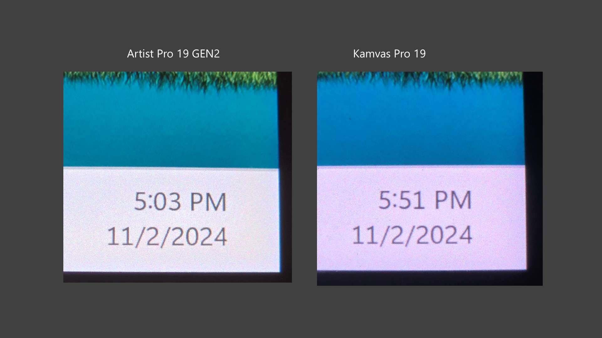
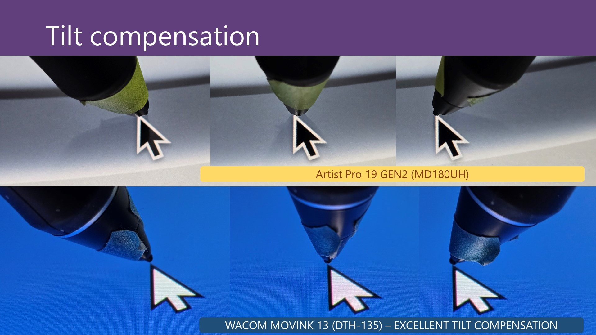
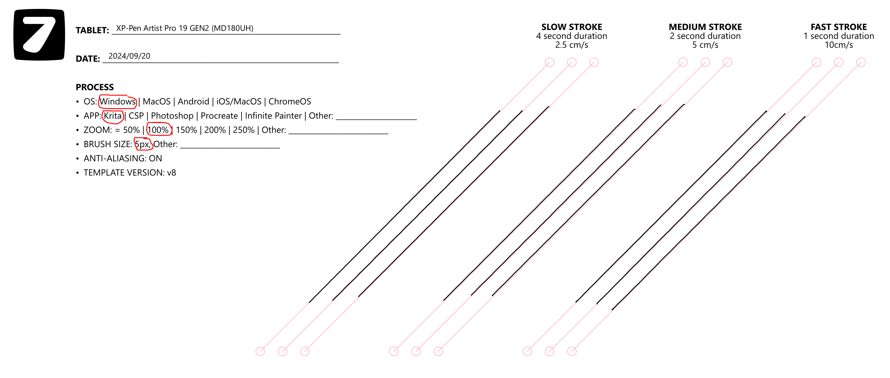
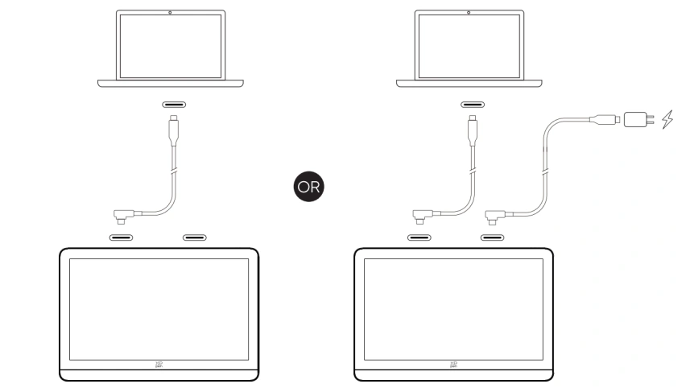
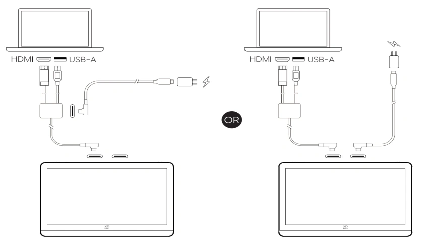
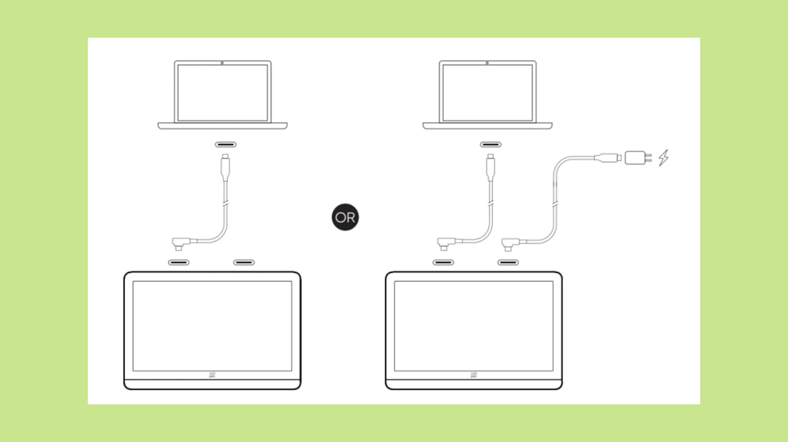

# XP-Pen Artist Pro 19 GEN2 (MD180UH) notes

## Official resources

* [Product page](https://www.xp-pen.com/product/artist-pro-19-gen-2.html)
* [Store page](https://www.xp-pen.com/store/buy/artist-pro-19-gen2.html)
* [User manual](https://www.xp-pen.com/user-manual/artist-pro-19-gen-2.html)

## Links

These links come from the [DrawTabData Explorer](https://thesevenpens.github.io/DrawTabDataExplorer/entity/xppen.tabletfamily.xppen_artistprogen2_2023). To add or fix a link, change it in DrawTabData.

| Source | Link | Date |
| --- | --- | --- |
| DrawTabData Explorer | [MD180UH specs](https://thesevenpens.github.io/DrawTabDataExplorer/entity/xppen.tablet.md180uh) |  |
| David Revoy | [XPpen Artist Pro 19 (Gen 2) - review](https://www.youtube.com/watch?v=d8Ft3b002LM) | 2024-11-20 |
| David Revoy | [XPPen Artist Pro 19 (Gen 2) - review on GNU/Linux](https://www.davidrevoy.com/article1053/xppen-artist-pro-19-gen-2-review-on-gnulinux) | 2024-11-14 |
| Seven Pens | [Notes on XP-Pen Artist Pro 19 GEN2 (MD180UH)](https://www.youtube.com/watch?v=y2nDFHThC3A) | 2024-11-03 |
| Parka Blogs | [XPPen Artist Pro 19 (gen 2)](https://www.parkablogs.com/content/review-xppen-artist-pro-19-gen-2) | 2024-10-24 |
| Teoh on Tech | [Xppen Artist Pro 19 (gen 2) review: The era of 4K pen displays approaches](https://www.youtube.com/watch?v=d51hmYgfz5E) | 2024-10-22 |
| Gartzia Artz | [¡MI NUEVO TAMAÑO FAVORITO! XP Pen Artist Pro 19 Gen 2](https://www.youtube.com/watch?v=pAUAEPB_P5k) | 2024-08-28 |
| Brad Colbow | [XP Pen Artist Pro 19 (Gen 2) Review](https://www.youtube.com/watch?v=eByrnaa0vf8) | 2024-08-27 |
| Gartzia Artz | [Unboxing y Primeras impresiones de la XP Pen Artist Pro 19 Gen 2 ¡DIBUJANDO!](https://www.youtube.com/watch?v=Cm-ukaV3opM) | 2024-08-26 |

## Notes on specs

### Digitizer

* NOTE: it has the exact same size Active Area as the Huion Kamvas Pro 19.

### Display

* Color: the 10 bit is 8bit+FRC

### Pens

See [XP-Pen X3 Pro pens](../../pens/xppen-pens/xppen-x3propen-notes.md).

* X3 Pro - I tested this. It worked.

## Display experience

### Anti-glare sparkle

* RATING: VERY GOOD. Low amounts of AG sparkle.
* Maybe just slightly more than the Cintiq Pro 22.
* Similar to Huion Kamvas Pro 19

### Pixel sharpness

Pixels are relatively clear and well delineated.

The look is clearly sharper than the Huion Kamvas Pro 19 which has a soft look that some people don't like.

<figure><figcaption></figcaption></figure>

## Design

* Really does look like a larger version of the XP-Pen Artist Pro 16 GEN2

## Drawing experience

### Pen pressure

XP-Pen states these numbers for X3 Pro pens

* IAF: 3gf
* Max Pressure: 400gf

In my testing with the pens that came with the tablet

* Subjectively, 3gf seemed about right
* I measured the max pressure at around 250gf.

### Pressure transition

Moving between low and high pressure cave smooth pressure transitions.

### Accuracy

RATING: VERY GOOD.

My experience matched the accuracy numbers XP-Pen provides.

### Parallax

VERY GOOD.

On par with Cintiq Pro 22 and with Huion Kamvas Pro 19.

### Tilt compensation

OK. Minor displacement at 45deg

* Pen tilted left -> 1.8 mm displacement
* Pen vertical -> \~1 mm displacement
* Pen tilted right -> \~0 mm displacement

<figure><figcaption></figcaption></figure>

### Pressure scan rate testing

RATING: VERY GOOD

Drawing 50 strokes as fast possible results in no lost strokes.

### Diagonal wobble

Rating: GOOD low amounts of diagonal wobble.

* Just a little more than the Huion Kamvas Pro 19
* About the same as the Cintiq Pro 22
* A little less than the XP-Pen Artist Pro 16 GEN2
* About the same as the Huion Kamvas 13 GEN3
* About the same as the XP-Pen Artist 22 Plus

<figure><figcaption></figcaption></figure>

### Surface texture

As is typical for etched glass surfaces, there is a slight surface texture.

Using the same X3 Pro pen with a plastic nib

The XP-Pen Artist Pro 19 GEN2 has an amount of surface texture that is

* about the same as the XP-Pen Artist Pro 19 GEN2
* about the same as the Huion Kamvas Pro 19
* a little less than the XP-Pen Artist 22 Plus
* a little less than the Cintiq Pro 22

## Connections and cabling

### Ports

* 2 USB-C ports on the top edge
  * The ports are NOT recessed

### USB-C connection options

<figure><figcaption></figcaption></figure>

### HDMI connection options

<figure><figcaption></figcaption></figure>

### How I connected it

I tested both the configurations below with my M3 MacBook Pro and a Surface Pro 8

<figure><figcaption></figcaption></figure>

## Ergonomics

### Legs

This tablet has a two folding legs on the back.

### Stand

I used the stand that came with the Xencelabs Pen Display 16 to hold this tablet. It worked very well.

### Noise

Silent.

### Heat

GOOD. Tablet keeps cool

* Left 1/3 cool
* Right 2/3 slightly warm
* Warmer near the USB-C ports

## Other features

### Audio

There are no audio features such as a headphone jack.
