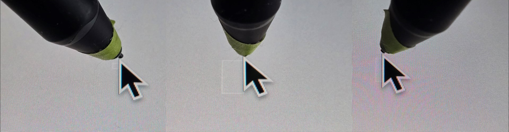
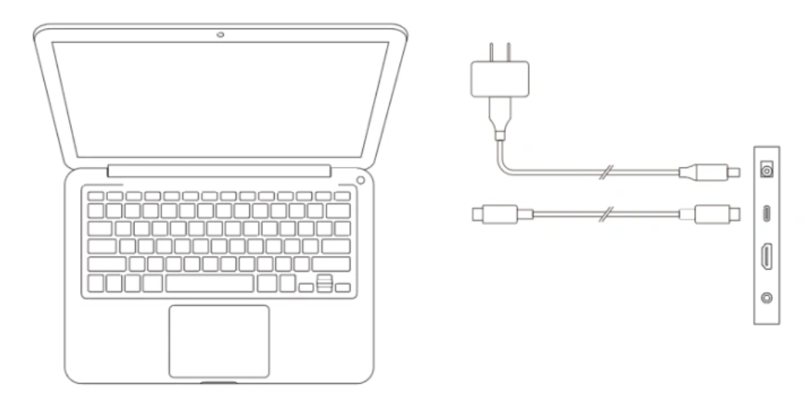
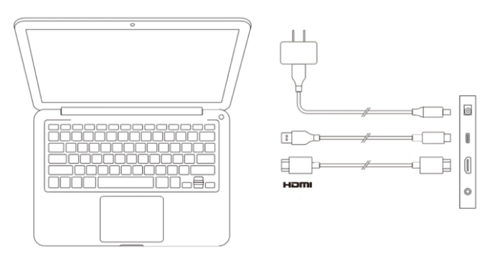

# XP-Pen Artist 22 Plus (MD220FH) notes

## Display

* **Resolution**
  * The model ID encodes this: FH is Full HD. The 22" WQHD (2560x1440) XP-Pen is the Artist Pro 22 GEN2 (MD220QH) - see [XP-Pen Artist Pro 22 GEN2 (MD220QH) notes](xppen-md220qh-notes.md).

## Links

These links come from the [DrawTabData Explorer](https://thesevenpens.github.io/DrawTabDataExplorer/). To add or fix a link, change it in DrawTabData.

| Source | Link | Date |
| --- | --- | --- |
| DrawTabData Explorer | [MD220FH specs](https://thesevenpens.github.io/DrawTabDataExplorer/entity/xppen.tablet.md220fh) |  |
| XP-Pen | [Product page](https://www.xp-pen.com/product/artist-22-plus.html) |  |
| XP-Pen | [Store page](https://www.xp-pen.com/store/buy/artist-22-plus.html) |  |
| XP-Pen | [User manual](https://www.xp-pen.com/user-manual/artist-22-plus.html) |  |
| Gartzia Artz | [¿Una Cintiq 22 por 500€? Review XP Pen Artist 22 Plus \| Grande Buena y Barata](https://www.youtube.com/watch?v=9kVPptiRZYI) | 2023-12-08 |
| Brad Colbow | [XP Pen Artist 22 Plus 2023 Review](https://www.youtube.com/watch?v=YfEfGOJOQJs) | 2023-11-20 |

## Anti-glare sparkle

Rating: VERY GOOD. very low amount of AG sparkle visible. Your eyes would have to be within a few inches to see it.

## Tilt compensation

Rating: VERY GOOD.

<figure><figcaption></figcaption></figure>

## Connections

Option 1: USB-C + power

<figure><figcaption></figcaption></figure>

Option 2: HDMI + USB + power

<figure><figcaption></figcaption></figure>
