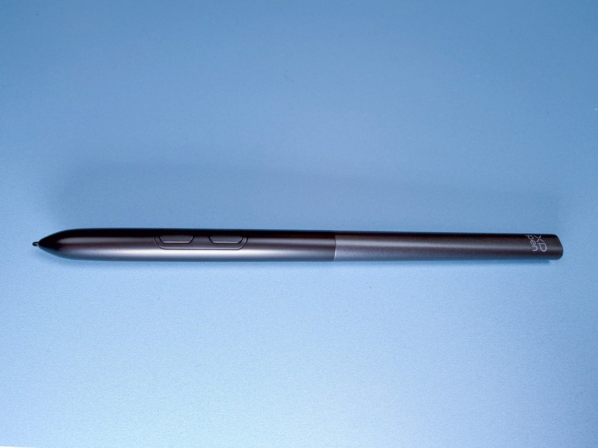
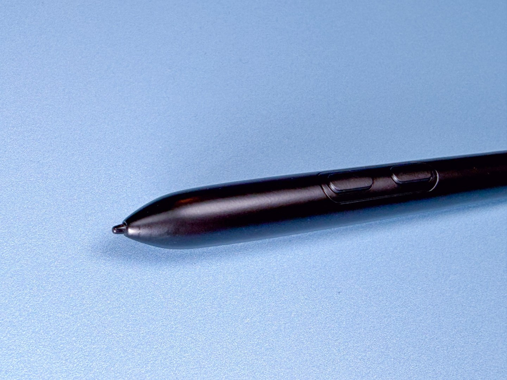
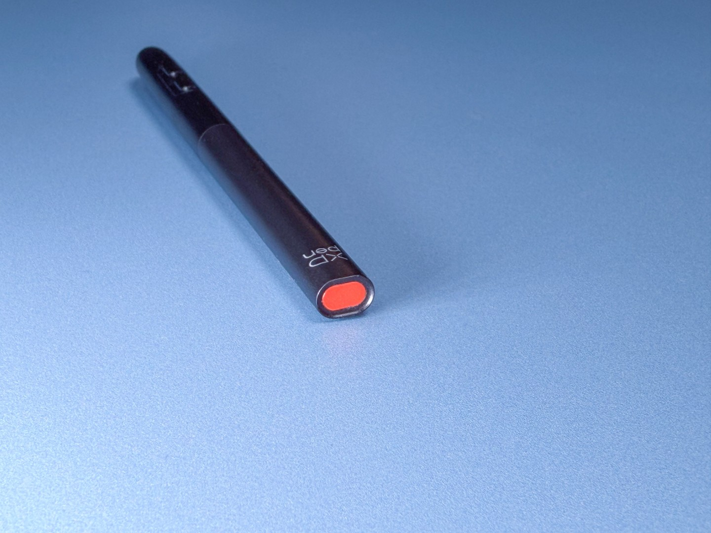

# XP-Pen X4 pen notes

## Overview

The X4 pen series was introduced with the X4 Smart Chip Stylus pen that came with the XP-Pen Artist 12 GEN3 released in 2025.

## Pressure range

XP-pen states:

* IAF: 2gf
* Max pressure: NOT STATED

My measurements:

* I have not measured it yet. When I get 3 of them I will measure.
* But subjectively, I would agree that IAF is close to what XP-Pen states, and the max pressure seemed to be in the GOOD range (>350gf).

## Design

* Two buttons.
* The barrel is round, but near the back end (where it turns gray) it becomes a rounded rectangle. In theory this should resist rolling. It does still roll, with a slight wobble, and settles on one side - I wouldn't call it roll resistant, but it has a little resistance.
* The finish is very smooth and slick, in a good way. It feels good to hold. Some people may say it doesn't feel premium, but I think it does. I wish it had a little more weight to it.

## Pen feel

From my XP-Pen Artist 12 GEN3 (CD121FH) livestream:

* It draws under its own weight.
* It was easy to keep the pressure in the low range.
* I had to press harder than I expected to reach max pressure. My guess was that it's over 350 gf, probably 350 to 400 gf. I haven't measured it.

## Misc

* Magnet - the X4 pens contain a magnet. For example this helps secure them to the XP-Pen Magic Pro 13 (MDP1311).

## Photos&#x20;

<figure><figcaption></figcaption></figure>

<figure><figcaption></figcaption></figure>

<figure><figcaption></figcaption></figure>
