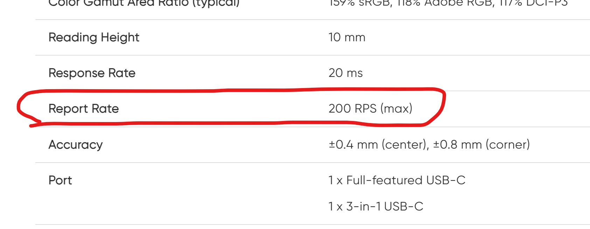

# Tablet reports

## Overview

Somewhere between 100 and 300 times a second, your tablet sends a "package" of data about the pen to your computer. This package is called a "tablet report" or just "report." The tablet driver, operating system, and application may modify that data. A drawing application then uses that data to draw a stroke.

The pen is not the only thing that sends reports. A tablet that also has ExpressKeys, a dial, a touch ring, or touch support sends **separate kinds of reports** for each of those. They have different layouts, they are sent under different conditions, and they can even travel through different USB interfaces. This page starts with the pen report (the one that matters most for drawing) and then explains how the other kinds of input fit alongside it.


Most tablets connect over USB and describe their reports using the USB HID ("Human Interface Device") standard, the same standard used by mice and keyboards. Bluetooth tablets usually use the same HID report model. This page uses USB HID terms throughout.


## Report rate

You can see this often in the specifications for a tablet as "report rate". Here is an example.

<figure><figcaption></figcaption></figure>

"RPS" means "Reports per second"

Because this is a value per second, some literature uses the unit Hz. So, for example, instead of "200 RPS" you might see "200 Hz."

The report rate in a tablet's specifications is the rate of **pen** reports. Touch, buttons, and dials are sent at their own rates, described in [When reports are sent](#when-reports-are-sent) below.

## Three layers: sensing, delivery, and dispatch

It helps to keep three separate things apart, because the word "report" is sometimes used loosely for all of them:

1. **Sensing (inside the tablet).** The digitizer measures the pen's position, pressure, and tilt. A capacitive sensor (on tablets with touch) measures fingers. Buttons and dials are read separately. The tablet's firmware turns these measurements into numbers.
2. **Delivery (USB HID reports).** The firmware packs those numbers into fixed-layout HID reports and sends them to the computer. This is what "tablet report" means on this page.
3. **Dispatch (the operating system and driver).** Software on the computer reads the reports and turns them into something apps understand: Windows Ink / Windows pointer messages or Wintab on Windows, libinput / evdev events on Linux, and tablet events on macOS. Apps never see the raw reports; they see what the driver and OS made of them.

The tablet driver (or [OpenTabletDriver](https://opentabletdriver.net/)) sits between layers 2 and 3. Anything it does, such as pressure curves, smoothing, button remapping, or area mapping, happens after the report arrives and before the app sees the result.

## One device, several kinds of reports

A single tablet can contain several logical input devices. When you plug it in, the operating system may see a pen digitizer, a touch device, and a keyboard or "consumer control" device, all belonging to the same physical tablet.

This happens at two levels.

### Report IDs

Every HID device sends a **report descriptor** when it connects. The descriptor is a small program that tells the computer exactly what each report looks like: which bits are buttons, which bytes are X and Y, how many bits the pressure uses, and so on.

A descriptor can declare several kinds of report. Each one is given a **Report ID**, which is sent as the **first byte** of every report. The computer reads that first byte to know which layout the rest of the bytes follow. Each Report ID has its own fixed length.

So a pen report and an ExpressKey report are not parts of one big packet. They are separate, smaller reports that take turns on the same connection, each starting with its own Report ID.

The values are chosen by the manufacturer. The numbers used in the examples on this page (`0x02` for pen, `0x03` for pad, `0x04` for touch) are only illustrations. Real tablets use many different numbers, and the same brand often changes them between generations.

### USB interfaces and endpoints

Separately, a USB device can expose more than one **interface**, each with its own interrupt endpoint (its own data "pipe"). Many tablets put different kinds of input on different interfaces. For example:

* a **pen interface** carrying digitizer reports,
* a **touch interface** carrying multi-touch reports, and
* an interface that looks like a **keyboard or consumer-control device**, carrying button and dial reports.

Some tablets put everything on one interface and rely only on Report IDs. Others split everything into separate interfaces. Many do a mix. The layout depends on the model, not just the brand.

### What this looks like

Here is a simplified picture of how one tablet with a pen, touch, and ExpressKeys might appear to the computer:

```
Tablet (one USB device)
│
├── Interface 0  ─ interrupt endpoint
│     ├── Report ID 0x02  Pen         Usage Page 0x0D (Digitizers), Usage 0x02 (Pen)
│     └── Report ID 0x03  Pad         buttons, touch ring / dial
│
├── Interface 1  ─ interrupt endpoint
│     └── Report ID 0x04  Touch       Usage Page 0x0D (Digitizers), Usage 0x05 (Touch Pad)
│                                       or 0x04 (Touch Screen) on a pen display
│
└── Interface 2  ─ interrupt endpoint
      ├── Report ID 0x01  Keyboard    Usage Page 0x01 (Generic Desktop), Usage 0x06 (Keyboard)
      └── Report ID 0x05  Consumer    Usage Page 0x0C (Consumer), e.g. volume, scroll
```


A **Usage Page** and **Usage** are standard numeric codes from the HID Usage Tables that say what something is. For example, Usage Page `0x0D` is "Digitizers", and within it Usage `0x02` is "Pen". Operating systems use these codes to decide which built-in driver should handle each part of the device.


## When reports are sent

The different kinds of report are sent for different reasons and at different rates.

| Kind of report        | When it is sent                                                                                             | Typical rate                                                            |
| --------------------- | ----------------------------------------------------------------------------------------------------------- | ----------------------------------------------------------------------- |
| **Pen**               | Continuously while the pen is in range (hovering) or touching the surface. Stops when the pen leaves range. | The tablet's stated report rate, for example 200–300 per second         |
| **Touch**             | Continuously while one or more fingers are touching the sensor.                                             | Often lower and independent of the pen, commonly around 60–120 per second |
| **ExpressKeys, dials** | Only when something changes: a key is pressed or released, a dial clicks one step, a touch ring moves.     | No fixed rate; zero while nothing changes                               |

Some consequences of this:

* When you measure report rate, you are measuring pen reports. Keep the pen moving in range. See [Measuring report rate](../../process/measuring/measuring-report-rate.md).
* Holding an ExpressKey down does not generate a stream of reports. The tablet sends one report when you press it and one when you release it. Any "key repeat" is created later by the driver or the operating system.
* Pen and touch reports interleave on the wire. Many tablets and drivers deliberately ignore touch while the pen is in range ("palm rejection"), but the reports themselves are independent.

## Report contents

The exact format of the data varies depending on the tablet and on which kind of report it is.

### Pen reports

Conceptually a pen report includes data like this:

* The x,y **position** of the pen
* The **pressure** reading. 0 = no pressure or some positive integer if there is pressure
* The **tilt** - composed of two values. Either given as an x tilt and y tilt or as altitude angle and azimuth angle.
* The **button** press status
* **Status flags** that say whether the pen is in range (hovering) and whether the tip is touching

Pens that support it may also report **barrel rotation** (twist), an **eraser** state, and an identifier for which pen or tool is in use. These are the critical values for drawing strokes, but the report can contain other things too.

In the standard HID digitizer usages, these values are called:

| Value            | HID usage (Usage Page `0x0D`, Digitizers)          |
| ---------------- | -------------------------------------------------- |
| In range (hover) | In Range `0x32`                                    |
| Tip touching     | Tip Switch `0x42`                                  |
| Pen buttons      | Barrel Switch `0x44`, Secondary Barrel Switch `0x5A` |
| Eraser end       | Invert `0x3C` (in range), Eraser `0x45` (touching) |
| Pressure         | Tip Pressure `0x30`                                |
| Tilt             | X Tilt `0x3D`, Y Tilt `0x3E`                       |
| Rotation         | Twist `0x41`                                       |
| Position         | X `0x30`, Y `0x31` (from Usage Page `0x01`, Generic Desktop) |

#### Example pen report

This is an **illustrative** 10-byte pen report. The layout is typical of a standards-compliant HID pen, but no specific tablet is guaranteed to use exactly these positions. Multi-byte values are little-endian (lowest byte first), which is what HID uses.

| Byte | Contents                                        | Notes                                                                          |
| ---- | ----------------------------------------------- | ------------------------------------------------------------------------------ |
| 0    | Report ID                                       | `0x02` in this example                                                         |
| 1    | Status bits                                     | bit 0 Tip Switch, bit 1 Barrel Switch, bit 2 Invert, bit 3 Eraser, bit 4 In Range |
| 2–3  | X position, unsigned 16-bit                     |                                                                                |
| 4–5  | Y position, unsigned 16-bit                     |                                                                                |
| 6–7  | Pressure, unsigned 16-bit field                 | A pen with 8192 levels only uses the low 13 bits (0–8191)                      |
| 8    | X tilt, signed 8-bit                            | Degrees, for example -60 to +60                                                |
| 9    | Y tilt, signed 8-bit                            |                                                                                |

Here is a short sequence of these reports as the pen approaches, touches down, and lifts:

```
02 10 34 12 78 56 00 00 F6 0A   hovering:   In Range=1, Tip=0, X=0x1234 (4660), Y=0x5678 (22136), pressure 0, tilt -10/+10
02 11 36 12 7A 56 00 01 F6 0A   touching:   In Range=1, Tip=1, pressure 0x0100 (256)
02 11 3A 12 80 56 00 10 F5 0A   pressing:   pressure 0x1000 (4096), tilt -11/+10
02 13 3E 12 84 56 00 10 F5 0A   + button:   Barrel Switch=1 while still touching
02 10 40 12 88 56 00 00 F5 0A   lifted:     Tip=0, back to hovering
```

Once the pen goes out of range, most tablets send one final report with In Range cleared and then stop sending pen reports entirely.

### ExpressKeys, touch rings, and dials

Buttons and dials on the tablet are usually grouped into a "pad" or "frame" report. These reports are much simpler than pen reports.

* **Buttons** are packed as a **bitfield**: one bit per key, 1 = pressed.
* **Rotary dials** usually report a **relative** change: a signed number of steps ("detents") since the last report, such as +1 or -1.
* **Touch rings and touch strips** often report an **absolute** finger position along the ring or strip instead of a change.

#### Example pad report

An **illustrative** 4-byte pad report:

| Byte | Contents                         |
| ---- | -------------------------------- |
| 0    | Report ID (`0x03` in this example) |
| 1    | Buttons 1–8, one bit each        |
| 2    | Buttons 9–16, one bit each       |
| 3    | Dial movement, signed 8-bit      |

A sequence: press key 1, also press key 3, release both, then turn the dial one click each way:

```
03 01 00 00   key 1 down
03 05 00 00   keys 1 and 3 down   (0x05 = bits 0 and 2)
03 00 00 00   all keys released
03 00 00 01   dial +1 step
03 00 00 FF   dial -1 step        (0xFF = -1 as a signed byte)
```

Nothing is sent between these lines, no matter how long you wait.

#### Buttons that act like a keyboard

Some tablets expose their buttons and dials as an ordinary **keyboard** (Usage Page `0x01`) or **consumer-control** device (Usage Page `0x0C`, used for things like volume and scrolling). That way the buttons do something useful, such as sending a keyboard shortcut, even when no tablet driver is installed. When the tablet driver is installed, it typically takes over and uses its own pad report instead so that you can remap the buttons.

For more about these controls, see [Auxiliary inputs](../../core/expresskeys/README.md).

### Multi-touch reports

On tablets with [touch support](../touch/README.md), touch is a separate digitizer collection, using Usage `0x05` (Touch Pad) on pen tablets or `0x04` (Touch Screen) on pen displays.

A touch report describes one or more **contacts** (fingers). For each contact, it includes:

* a **Contact Identifier** (`0x51`) that stays the same for one finger from touch-down until lift-off,
* a **Tip Switch** (`0x42`) saying whether that finger is currently touching,
* often a **Confidence** flag (`0x47`) saying the contact is a real finger rather than, for example, a palm,
* the **X and Y** position of that finger.

The report also includes a **Contact Count** (`0x54`) and, on Windows Precision Touchpad devices, a **Scan Time** (`0x56`) timestamp.

A report may have room for several contacts at once. If more fingers are down than fit in one report, the tablet sends several reports for the same scan. The first one carries the total Contact Count and the rest carry 0, so the computer knows when it has received them all.

#### Example touch report

An **illustrative** report with room for two contacts:

| Byte  | Contents                                          |
| ----- | ------------------------------------------------- |
| 0     | Report ID (`0x04` in this example)                |
| 1     | Contact 1: bit 0 Tip Switch, bit 1 Confidence     |
| 2     | Contact 1: Contact Identifier                     |
| 3–4   | Contact 1: X                                      |
| 5–6   | Contact 1: Y                                      |
| 7     | Contact 2: bit 0 Tip Switch, bit 1 Confidence     |
| 8     | Contact 2: Contact Identifier                     |
| 9–10  | Contact 2: X                                      |
| 11–12 | Contact 2: Y                                      |
| 13–14 | Scan Time                                         |
| 15    | Contact Count                                     |

Two fingers touch, then one lifts:

```
04 03 00 E8 03 D0 07  03 01 B8 0B A0 0F  10 27  02   two fingers: id 0 at (1000,2000), id 1 at (3000,4000)
04 03 00 EC 03 D4 07  02 01 B8 0B A0 0F  F8 2A  02   finger id 1 lifts (Tip=0), reported one last time
04 03 00 F0 03 D8 07  00 00 00 00 00 00  E0 2E  01   one finger left
```

### Putting it together

On a busy tablet, all of these reports take turns on the same connection (or arrive on separate interfaces at the same time). A short slice of traffic on a single interface might look like this, where the first byte tells you which kind each line is:

```
02 11 3A 12 80 56 00 10 F5 0A   pen
02 11 3C 12 82 56 10 10 F5 0A   pen
03 01 00 00                     pad: key 1 pressed
02 11 3E 12 84 56 20 10 F5 0A   pen
02 11 40 12 86 56 28 10 F5 0A   pen
03 00 00 00                     pad: key 1 released
02 11 42 12 88 56 30 10 F5 0A   pen
```

## Standard HID reports vs. vendor-defined reports

Tablets can describe their reports in two very different ways, and this is a large part of why some tablets work without a driver and others do not.

### Standard HID digitizer reports

If the tablet describes its pen using the standard Digitizer usages above, the operating system can understand it with no extra software. On Windows, the built-in HID pen support turns these reports directly into Windows Ink / pointer input, which is how some tablets get pressure and tilt with no tablet driver installed. See [Windows PnP support](../platforms/windows/windows-pnp-support.md). Linux handles standard HID pens the same way through its generic HID driver.

### Vendor-defined reports

Many tablets instead (or additionally) use a **vendor-defined** Usage Page, in the range `0xFF00`–`0xFFFF`. The descriptor then only says "here are N bytes of the manufacturer's own data" without saying what the bytes mean. The operating system cannot interpret these reports, so it ignores them.

Something that knows the layout has to read them: the manufacturer's tablet driver, a brand-specific Linux kernel driver (such as `wacom` for Wacom or `hid-uclogic` for many Huion, XP-Pen, and Gaomon models), or OpenTabletDriver. That software decodes the bytes and then passes the result on as Windows Ink, Wintab, keystrokes, or OS events.

Vendor reports often carry things the standard layout does not, such as a serial number for each individual pen or extra pad controls. They also don't have to follow the "one Report ID per kind of input" pattern. For example, many UC-Logic based tablets (a family that includes many Huion and XP-Pen models) send both pen and pad data under the **same** vendor Report ID and use a flag in the next byte to say which kind it is.

### Tablets that switch modes

It is common for a tablet to support both. It starts up in a basic, standards-compliant mode so that it works when nothing is installed, and the tablet driver sends it a command to switch into its full vendor mode. Some Huion tablets, for example, switch modes when the driver reads a particular USB string descriptor. This is one reason a tablet can behave differently with and without its driver, and why [running more than one tablet driver](../drivers/multiple-tablet-drivers.md) causes conflicts: only one of them can usefully own the vendor interface.

## Higher report rates

### The current state of the art

As of Jan 2025, the highest report rates stated for a tablet are 300Hz. Even the leading brand, Wacom, only supports a maximum of 220Hz. Numbers in the 200Hz to 300Hz are surprising when we see mice that have report rate of 1000Hz.

### Is there a hardware limitation?

No. As far as I know there is no clear hardware or system limitation.

### Why don't we see higher report rates?

I believe the reason is simple: the typical customer for a drawing tablet would experience no benefit, while the tablet manufacturer would have to implement a more expensive design. In other words, nobody benefits. The current state of affairs is "good enough."

I think tablet brands are aware of this desire from gamers, but they have not done anything to make the tablets work better for these scenarios.

[Wacom - Does a higher, or faster, report rate mean better performance?](https://support.wacom.com/hc/en-us/articles/1500006331322-Does-a-higher-or-faster-report-rate-mean-better-performance) ([archive](https://archive.is/s6gOg))

## Finding report rates

Different tools can be used: [Measuring report rate](../../process/measuring/measuring-report-rate.md)

## Seeing real reports

If you want to look at the actual reports your tablet sends:

* **OpenTabletDriver** has a tablet debugger that shows the raw bytes of each report next to the decoded values.
* On **Linux**, `hid-tools` (`hid-recorder`) prints a device's report descriptor and every report it sends.
* On **Windows**, USB analyzers such as Wireshark with USBPcap can capture the raw traffic.

## References

* [USB Device Class Definition for HID 1.11](https://www.usb.org/document-library/device-class-definition-hid-111) - Section 5.6 (Reports) and Section 6.2.2 (Report Descriptor) explain Report IDs.
* [HID Usage Tables](https://usb.org/document-library/hid-usage-tables-15) - the Digitizers page (`0x0D`) defines the pen and touch usages used above.
* [Microsoft: Pen devices](https://learn.microsoft.com/en-us/windows-hardware/design/component-guidelines/pen-devices) and [Windows Precision Touchpad](https://learn.microsoft.com/en-us/windows-hardware/design/component-guidelines/touchpad-windows-precision-touchpad-collection) - sample descriptors and the usages Windows requires.
* Linux kernel: [`drivers/hid/wacom_wac.c`](https://github.com/torvalds/linux/blob/master/drivers/hid/wacom_wac.c) (Wacom pen, pad, and touch parsing) and [`drivers/hid/hid-uclogic-params.c`](https://github.com/torvalds/linux/blob/master/drivers/hid/hid-uclogic-params.c) (Huion / XP-Pen / UC-Logic initialization and report layouts).
* [OpenTabletDriver configurations](https://github.com/OpenTabletDriver/OpenTabletDriver/tree/master/OpenTabletDriver.Configurations/Configurations) - per-tablet definitions of real report layouts.
