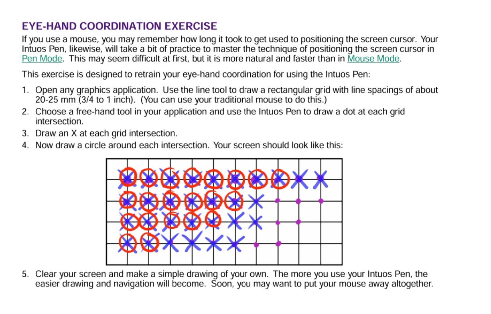

# Adjusting to a pen tablet

## Introduction

Pen tablets, also known as screenless drawing tablets, are a great choice for many artists. However, some people struggle to use them.

This document covers common difficulties and ways to make using a pen tablet feel more natural, comfortable, and productive.

## Time to adjust

I think people fall into three broad groups when using a pen tablet for the first time:

* 80% of people can adjust to a pen tablet immediately or within an hour.
* 10% of people take a couple of days or perhaps even a couple of weeks to adjust.
* The remaining 10% never adjust. No matter how long they use a pen tablet, they prefer a drawing tablet with a screen.

## Hand and eye integration - or lack of it

​Drawing tablets with screens integrate your hand and eye movements. Like drawing on paper, you draw on the surface you are looking at. Your eyes focus near the pen tip, so you can see what you are drawing. This is a natural way to use a pen.

​Pen tablets, however, do not integrate your hand and eye movements. You look in one place while drawing in another. This is somewhat similar to using a computer mouse, but a tablet pen can feel disconcerting.

While we cannot change the hand-eye integration, the techniques in this doc may help you to better adjust to it.

## Force proportions

Most often, a pen tablet feels strange because force proportions are not enabled in the tablet driver.

Before exploring other ways to make your pen tablet feel natural, check the force proportions guide and enable the setting. Wacom calls this feature “force proportions.” Other tablet brands use different names. Find instructions for multiple brands here: [Force proportions](../customizing/force-proportions.md).

## Multiple monitors? Map your tablet's active area to a single monitor

This is a follow-up setting for when you use force proportions. You will generally find drawing more comfortable when you map your tablet's active area to one display, rather than all displays. The force proportions guide also covers this setup: [Force proportions](../customizing/force-proportions.md).

## Disable mouse mode

The driver has a special setting called mouse mode. It is designed for using a tablet with certain games. This setting may have been accidentally enabled. Check your driver and verify that mouse mode is disabled. If it is enabled, disable it. See [Mouse mode](../../core/active-area/mouse-mode.md).

## Size

You may have already purchased a pen tablet. Its size can affect how it feels to draw with. Here, size means the tablet's active area, not its physical size. Active area size is measured diagonally in inches.

<figure><figcaption></figcaption></figure>

### Tablets that are too small (about 7" or less)

Your pen tablet might be too small for you. It might not suit your arm length or drawing style. Some people also experience wrist pain when drawing in small areas.

If this affects you, the only solution is to get a different-sized pen tablet.

### Medium-sized pen tablets (about 11")

For most people, I recommend a medium-sized pen tablet.

### Tablets that are too large (about  15")

Your tablet might be too large. This can cause fatigue because you move your pen across a greater distance.

In this case, you can configure a smaller active area in the tablet driver. The tablet cannot shrink, but the area where you draw can. Try a smaller active area and see whether it works better for you.

## Surface texture

All modern pen tablets have some texture on their surface. This texture helps the pen grip the tablet as you draw. Some tablets have more texture than others.

If your tablet does not have enough texture, try one of these options:

* Use a felt nib with your pen for a little extra texture.
* Tape paper onto the front of the tablet. It will not interfere with drawing. It may provide the texture you want. This is the only way to get a paper-like feel on a drawing tablet.

## Exercises

Wacom used to recommend these exercises in its user manuals to help people adjust to a pen tablet. Try them out.

<figure><figcaption></figcaption></figure>

## Links

* https://www.youtube.com/watch?v=MzpdGBs0S2w
* https://www.youtube.com/watch?v=c6HJt-ldZ1I
