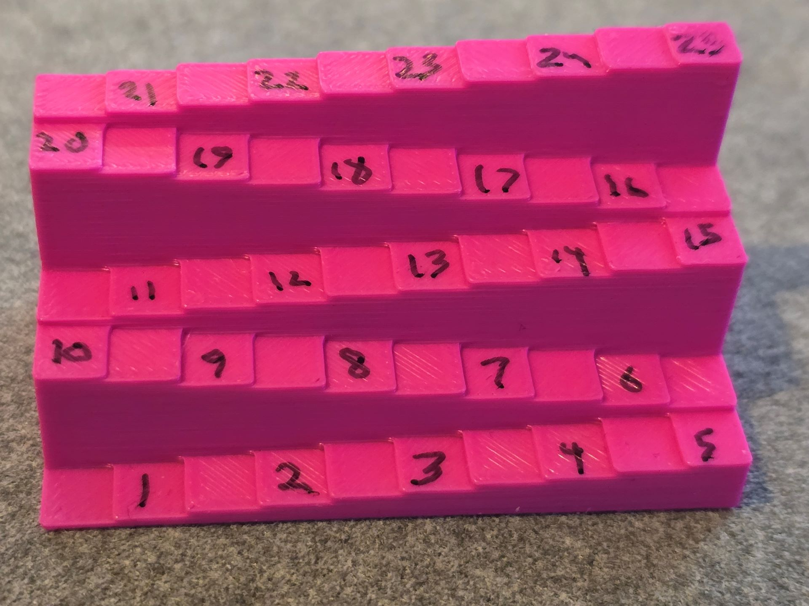

# Measuring hover

## Overview

To more accurately assess hover height, I use a small "staircase" that goes up in 0.5 mm increments to test how hover works with tablets.

## The hover testing tool

<figure><figcaption></figcaption></figure>

## Testing process

* Overall, I move from low to high
* I begin with the pen placed on the first step which represents 0.5mm from the tablet surface.
* I then move up each step in 0.5 mm increments
* On each step I note
  * Whether the tablet detects the pen
  * If the tablet detects the pen, then whether there is any hover jitter. And how much hover jitter there is.
* I move up the steps until the pen is no longer detected by the tablet.
