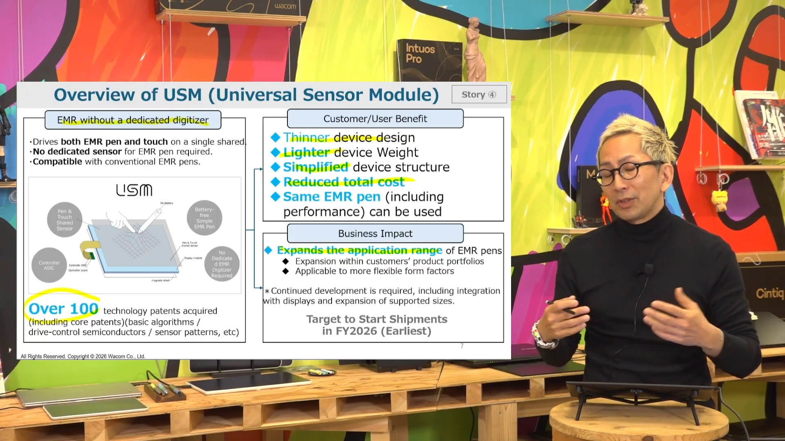
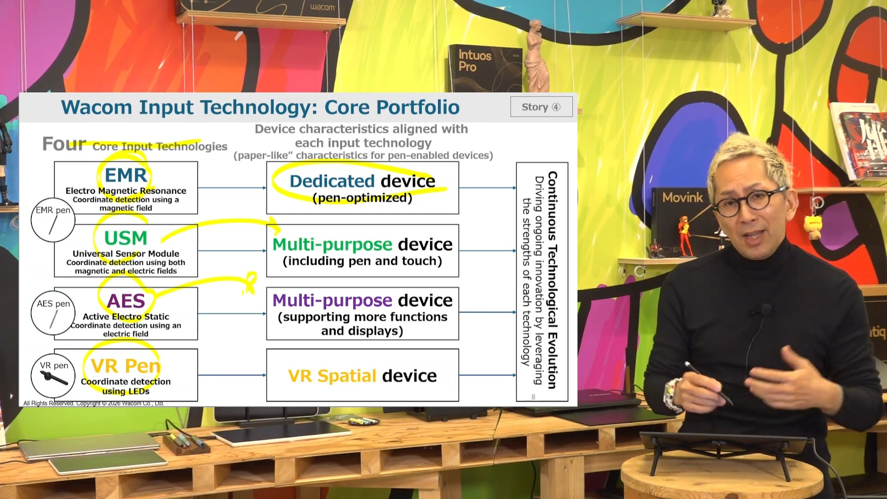

# Universal Sensor Module (USM)

## Overview

USM is a technology created and patented by Wacom which combines a touch capacitive layer with an EMR digitizer layer into one single layer.

Combining into one layer has the potential to deliver these improvements for drawing tablets that have screens: because the EMR digitizer layer is no longer needed - the device can become thinner,  lighter, less complex to build.

<figure><figcaption>
The USM layer is illustrative only - it does not accurately show the layout of the wires in the layer. See the patent applications for details.
</figcaption></figure>

## What Wacom has shared

Wacom shared a few details about USM in this video: See 3:06 to 7:06 in the video



<figure><figcaption></figcaption></figure>

<figure><figcaption></figcaption></figure>

## What we know

This is based on the video above:

* Wacom is actively working on it
* Wacom said USM will not cannibalize Wacom's EMR devices
* EMR is intended for "pen-optimized" devices while USM is intended for "Multi-purpose devices"
* USM pens will not have a battery&#x20;

## What we suspect

* USM will likely only appear in devices that have displays. It will not appear in pen tablets
* USM will likely not support Wacom professional pens
* USM will most likely support pressure
* USM will most likely support tilt

## What we don't know

These are questions we have

* Will USM appear in any Wacom branded devices
* Will USM appear Samsung Galaxy Tab S device.
* will USM be compatible with existing Wacom consumer pens such as their CP-913 and CP-923
* Will USM deliver any material improvements to the drawing experience in terms of accuracy lag tilt support barrel rotation support etc. compared to the EMR technology Wacom uses currently
* Will USM pens support buttons or more than one button?
* Will USM pens support erasers?
* Will USM replace AES eventually?

## Links

Patents:&#x20;

* [https://patents.google.com/patent/US20260111079A1/en](https://patents.google.com/patent/US20260111079A1/en)&#x20;
* [https://patents.google.com/patent/WO2025005161A1/en](https://patents.google.com/patent/WO2025005161A1/en)

