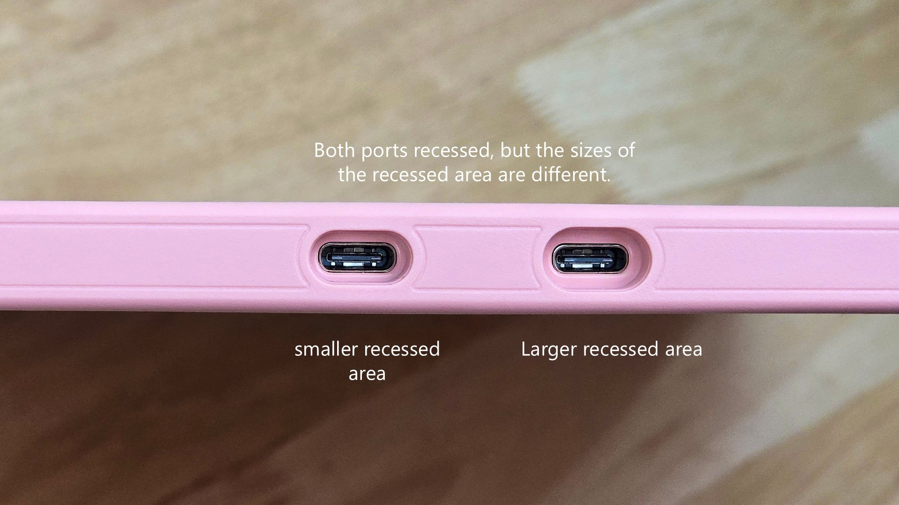
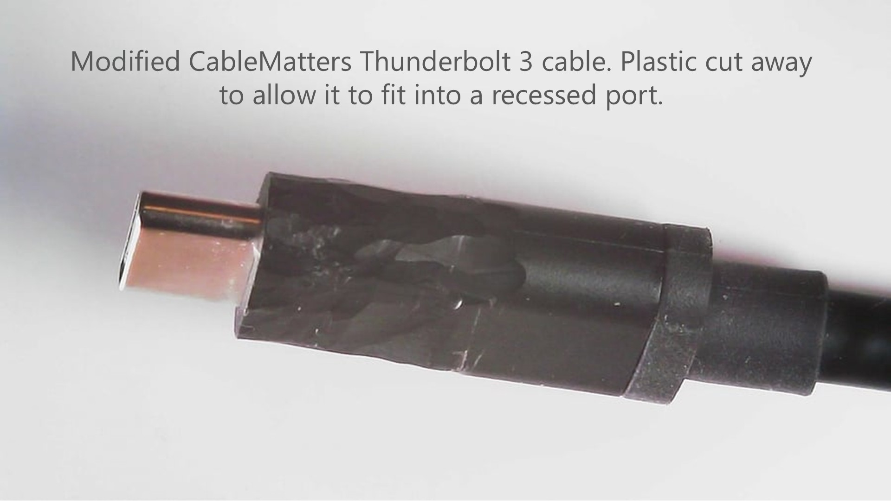

# TSG: USB-C cable does not fit into USB-C port

## Overview

This usually occurs with pen displays (screen tablets) which may have one or more recessed USB-C ports. It is unusual on pen tablets. See: [Recessed USB-C ports](../guides/connecting/recessed-usbc-ports.md)

<figure><figcaption></figcaption></figure>

## Manufacturer cables

If you are trying to connect a cable to the tablet and the cable is from the manufacturer and it doesn't fit in the recessed port it's probably because it wasn't designed to fit in the recessed port. Either you're looking at the wrong end of the cable or that's the wrong cable. Check in the box for a different cable. If you're not sure, read the user manual or contact customer support.

Keep in mind you might need a cable that did not come with your tablet and that may require a separate purchase from your tablet manufacturer.

## 3rd party cables

Third-party cables may not fit into a recessed port. This is one reason I tend to recommend that for pen displays you simply use or purchase the a cable from your tablet manufacturer.

However if you do want to use a third party cable and you want to make it fit it is possible.

It depends the material used at the ends of the cable. Some materials cannot be cut. But sometimes they use plastic that can be cut even if it does take some effort. Carefully using a knife you can trim away some of the plastic and make it fit.  As the picture below shows I have done this with a third party cable - specifically a CableMatters Thunderbolt 3 cable.

<figure><figcaption></figcaption></figure>

It is not a very attractive solution. And you have to be careful not to cut away too much plastic. And I've made that mistake I've actually cut away too much and left a hole in that end of the cable where you can see the exposed wires underneath. And although that cable still works it looks dangerous and I could have easily ruined the cable.

This is another reason I think it's simpler just to get the manufacturer cable instead of a third party cable in some cases.

See: [Using 3rd-party cables with your drawing tablet](../guides/connecting/3rd-party-cables-for-drawtab/)
